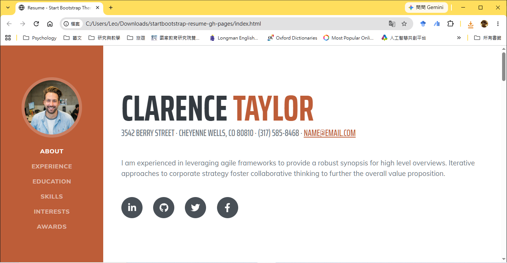
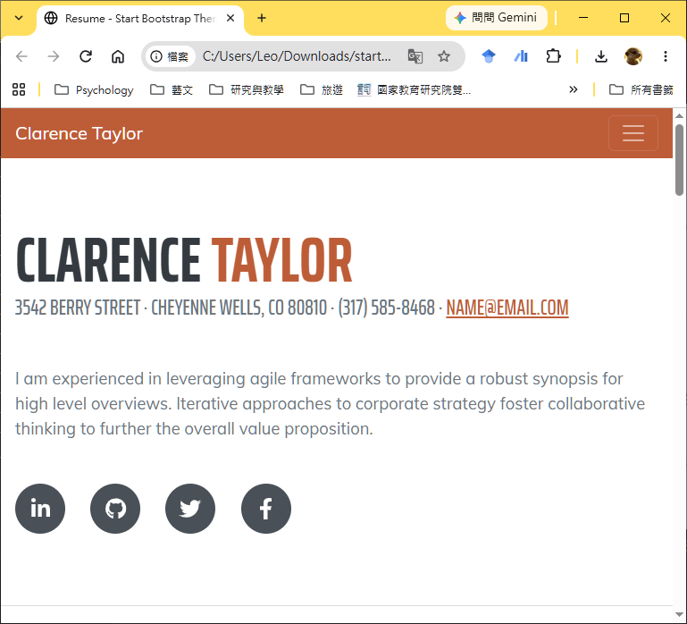
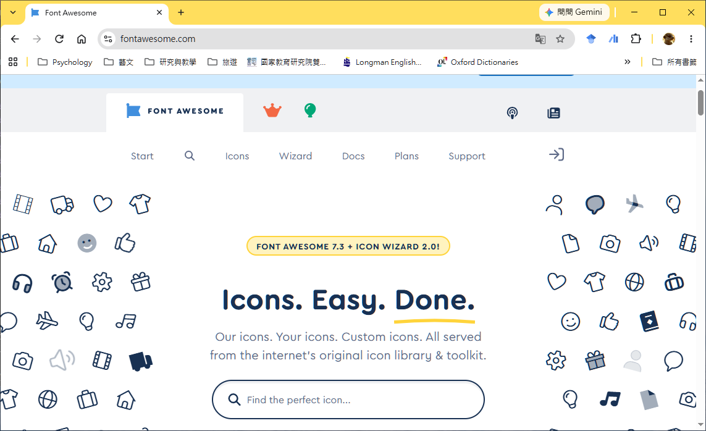

---
puppeteer:
  displayHeaderFooter: true
  scale: 1.15
  headerTemplate: '<div style="font-size: 11px; margin: 0 auto;">第七週：實作專案一 — 打造線上個人履歷(GitHub 部署與基本資料篇)</div>'
  footerTemplate: '<div style="font-size: 11px; margin: 0 auto;">第 <span class="pageNumber"></span> 頁 / 共 <span class="totalPages"></span> 頁</div>'
  margin:
    top: "1.5cm"
    bottom: "1.5cm"
    left: "1.5cm"
    right: "1.5cm"
---

<style>
  /* 全域字型、字級與行距 */
  body {
    font-size: 16pt !important;
    line-height: 1.7 !important;
    font-family: "Microsoft JhengHei", "PingFang TC", "Helvetica Neue", sans-serif;
  }

  /* 階層標題微調 */
  h1 { font-size: 30pt !important; margin-bottom: 0.5em !important; }
  h2 { font-size: 24pt !important; page-break-before: always; }
  h3 { font-size: 20pt !important; }
  h4 { font-size: 18pt !important; }

  /* 表格文字放大與排版優化 */
  table, th, td {
    font-size: 15pt !important;
    line-height: 1.5 !important;
  }

  /* 程式碼區塊 (自動換行防止 PDF 截斷) */
  pre, code {
    font-size: 13pt !important;
    font-family: Consolas, "Courier New", monospace !important;
    white-space: pre-wrap !important;
    word-break: break-all !important;
  }

  /* Mermaid 流程圖節點字體放大 */
  .mermaid text {
    font-size: 14px !important;
  }
</style>

---

# 第七週：實作專案一 — 打造線上個人履歷(GitHub 部署與基本資料篇) (Personal Online Resume - GitHub Pages Setup & Profile Info)

**課程名稱**：網頁設計 (Webpage Design)  
**授課教師**：林頌堅 副教授 (Prof. Sung-Chien Lin)  
**授課單位**：世新大學 資訊傳播學系  
**聯絡方式**：scl@mail.shu.edu.tw  
**線上資源**：[GitHub 官方網站](https://github.com/) | [GitHub Desktop 下載專區](https://desktop.github.com/) | [Start Bootstrap - Resume Template](https://startbootstrap.com/theme/resume)  

---

## Ⅰ. 專案目標與平台簡介 (Project Goals & Platform Overview)

各位同學好！歡迎來到我們的第一個實作專案！在接下來的三週課程中，我們將運用前面所學的 **HTML** 和 **CSS** 知識，將一份業界專業的網頁模板，修改成屬於你自己的「單頁式線上個人履歷 (Single-Page Online Resume)」，並直接發佈到全球網際網路上！

這份履歷模板是基於前端主流框架 **Bootstrap** 製作的，它已經幫我們處理好了大部分複雜的版面排版與**響應式網頁設計 (RWD, Responsive Web Design)**。這意味著你所製作的履歷，無論是在桌上型電腦、平板電腦還是智慧型手機上，都能自動呈現完美的瀏覽視覺效果！

本週我們採取「**先上雲端、再改內容**」的現代開發工作流：我們會先在全球最大的程式碼平台 **GitHub** 建立個人首頁專用倉庫 (Repository)，將履歷模板放入倉庫中，接著完成網頁標題、Meta 搜尋引擎資訊、左側導覽列大頭照，以及個人核心簡介與社群連結的修改，最後直接發佈上線，在第一週就獲得你的專屬個人網站網址！

---

### 1. 什麼是 GitHub 與 GitHub Pages？

* **GitHub**：簡單來說，GitHub 是「**程式碼的雲端硬碟**」兼「**全球開發者的社群平台**」。全世界的工程師與設計師都會把他們的專案存放在 GitHub 上，方便進行版本管理、雲端備份與團隊協作。
* **GitHub Pages**：GitHub 提供了一項殺手級的免費託管服務叫做 **GitHub Pages**，它允許你將程式碼倉庫 (Repository) 中的網頁檔案直接轉化為公開的靜態網站。這對我們展示線上個人履歷來說，是絕佳且免費的官方工具！

---

### 2. 本週五大實作目標

1. **申請 GitHub 帳號與設定 GitHub Desktop**：打造你在軟體與設計社群的數位身份證，並透過圖形化介面工具進行版控操作。
2. **建立個人首頁專用倉庫 (`username.github.io`)**：掌握 GitHub Pages 個人首頁命名規則，並將履歷模板匯入倉庫。
3. **理解履歷模板的 HTML 架構**：培養閱讀他人原生專業 HTML/CSS 程式碼結構的能力。
4. **完成基本資料與核心簡介修改**：精準修改網頁 `<title>`、`<meta>` 搜尋資訊、左側導覽列大頭照，以及 `<section id="about">` 個人核心簡介與 Font Awesome 社群連結。
5. **首次 Commit 提交與 Push 發佈上線**：啟動 GitHub Pages，取得個人專屬網址並進行線上驗證。

---

### 3. 履歷專案整體評分標準

本系列實作專案的評分，將與**網頁內容的豐富程度與專業度**有直接關係：

* **內容深度與廣度**：請盡可能充實你的個人資料，包含完整的個人簡介、求學經歷、社團/實習經驗、專業技能與個人興趣。
* **條理清晰與排版專業感**：豐富不等於雜亂無章！請在充實內容的同時，保持視覺版面的清晰與層次感。內容愈豐富且資訊排版愈有條理，分數愈高！

---

## Ⅱ. 步驟一：申請 GitHub 帳號與設定 GitHub Desktop (GitHub Account & Desktop Setup)

### 1. 申請 GitHub 帳號

請開啟瀏覽器，著手註冊你的 GitHub 個人帳號：

1. 前往 [GitHub 官方網站](https://github.com/)。
2. 點擊右上角 **"Sign up"** 按鈕，依照畫面指示輸入 Email、密碼並完成驗證。
3. **選擇你的使用者名稱 (Username)**：這是最關鍵的一步！

> 💡 **老師的真心話：請務必慎選你的 GitHub 使用者名稱 (Username)！**  
> 這個使用者名稱未來將會直接成為你個人網站網址的一部分（例如 `https://your-username.github.io`），並且很可能會跟隨你整個職業生涯！  
> 建議使用**具備專業感、容易辨識的英文姓名或專業暱稱**（例如 `chen-shiau-ming` 或 `sming-dev`），避免使用像 `apple123` 或 `god-of-game` 這類非專業感的暱稱喔！

---

### 2. 下載與設定 GitHub Desktop

雖然專業工程師大多使用指令列 (Terminal / Command Line)，但對初學者來說，圖形化介面的 **GitHub Desktop** 是我們最好的朋友。

1. 請前往 [GitHub Desktop 官網](https://desktop.github.com/) 下載符合你作業系統（Windows 或 macOS）的版本。
2. 安裝完成後開啟 GitHub Desktop，軟體會引導你進行授權登入。請點擊 **"Sign in to GitHub.com"** 並於瀏覽器完成登入授權。
3. **確認登入狀態**：
   * 登入後，點擊左上角選單的 **File** > **Options...** (macOS 為 **GitHub Desktop** > **Preferences...**)。
   * 在 **Accounts** 分頁中，務必確認顯示的是你自己的 GitHub 帳號！

> 💡 **老師的真心話 (超級重要)：在電腦教室忘記確認登入會怎樣？**  
> * **公用電腦風險**：如果你在學校電腦上忘了確認登入帳號，你可能會不小心使用到前一位同學留下的 GitHub Desktop 帳號！你辛苦完成的履歷提交紀錄 (Commit) 都會被算在別人頭上。
> * **發佈失敗**：若未成功登入，最後一步發佈專案時程式會不知道要傳送到哪個雲端帳號而失敗。
> * **解決方法**：每次上課入座後，隨時先開啟 **File** > **Options...** > **Accounts** 檢查。如果登錯了，點擊 **Sign out** (登出) 再重新 **Sign in** (登入) 你自己的帳號即可！

---

## Ⅲ. 步驟二：建立個人首頁專用倉庫並放入履歷模板 (Creating Repository & Importing Template)

### 1. 建立個人首頁專用倉庫 (`username.github.io`)

為了啟動 GitHub Pages 的「個人頂級網域首頁」功能，你的履歷倉庫必須使用一個**特殊的命名規則**：

$$\text{你的使用者名稱} + \text{.github.io}$$

* **命名範例**：若你的 GitHub Username 是 `sungchien`，則你的 Repository 名稱必須精準命名為 **`sungchien.github.io`**（全小寫、無空格）。

#### 操作步驟：

1. 在 GitHub Desktop 中，點擊左上角選單 **File** > **New repository...**。
2. 在 **Name** 欄位，輸入這個特殊名稱（例如 `your-username.github.io`）。
3. 在 **Local path** 欄位，點擊 **Choose...** 選擇一個你電腦中乾淨的資料夾（例如桌面上的 `github-project` 資料夾），用來存放這個線上專案。
4. **Git ignore** 選擇 `None`，**License** 選擇 `None`。
5. 點擊右下角藍色的 **"Create repository"** 按鈕。

---

### 2. 將履歷模板放入 Repository 資料夾

現在，你的電腦本地 (Local) 已經有了一個名為 `your-username.github.io` 的空倉庫資料夾。接著我們要把履歷模板放進去：

1. 下載課程提供的 [Start Bootstrap - Resume 履歷模板](https://startbootstrap.com/theme/resume) 壓縮檔並解壓縮。
2. 將模板資料夾裡面的**所有檔案與子資料夾**（包含 `index.html`、`css/` 資料夾、`js/` 資料夾、`assets/` 圖片資料夾等），**全部複製**並貼到剛剛建立的 `your-username.github.io` 資料夾的**最上層根目錄**中！
3. 開啟 **VS Code**，選擇 **File** > **Open Folder...**，開啟這個 `your-username.github.io` 資料夾，準備開始進行內容修改！

> 💡 **老師的真心話：千萬別多包一層資料夾！**  
> 請確保打開 `your-username.github.io` 資料夾時，第一眼就能直接看到 `index.html`！如果點進去還有一層 `startbootstrap-resume-gh-pages` 子資料夾才看到 `index.html`，之後 GitHub Pages 會因為找不到首頁檔案而出現 404 錯誤喔！

---

## Ⅳ. 履歷模板結構拆解 (Template Structure Analysis)

在開始動手修改程式碼之前，我們先來整體拆解這份 `index.html` 履歷模板的架構。該模板主要由兩大核心區域構成：



---

### 1. 左側導覽列 (`<nav id="sideNav">`)

* **桌機版呈現**：固定在螢幕左側的垂直導覽欄，頂部包含個人正方形圓角大頭照，下方為各章節區塊的錨點跳轉連結。
* **手機/平板版 (RWD 響應式)**：當螢幕寬度縮小時，導覽列會自動收合至網頁最上方，並切換為三條線的「漢堡選單 (Hamburger Menu)」按鈕。



* **平滑滾動 (Smooth Scroll)**：點擊導覽項時，頁面會以平滑的滑動動畫滾動至對應的 `<section>` 區塊。

---

### 2. 右側主要內容區 (`<div class="container-fluid p-0">`)

這裡是履歷的主要展示空間，由多個獨立的 `<section>` 區塊組成。每個 `<section>` 都帶有獨一無二的 `id` 屬性，例如：
* `<section id="about">`：關於我與聯絡資訊（**本週實作重點**）
* `<section id="experience">`：工作與社團經歷（第八週實作）
* `<section id="education">`：學歷背景（第八週實作）
* `<section id="skills">`：專業技能與工具標籤（第八週實作）
* `<section id="interests">`：個人興趣與休閒（第八週實作）
* `<section id="awards">`：榮譽獎項與證照（第八週實作）

---

## Ⅴ. 網頁標題與 Meta 搜尋引擎資訊修改 (Title & Meta Settings)

請在 VS Code 中開啟 `index.html` 檔案。第一步，我們先找到頁面最頂端的 `<head>` 區塊，修改網頁分頁標籤顯示的標題與給搜尋引擎看的 Metadata。

### 1. 修改網頁分頁標題 (`<title>`)

將 `<title>` 標籤內的預設文字，替換為包含你自己姓名的履歷標題。

#### 修改前 (範例碼)：
```html
<title>Resume - Start Bootstrap Theme</title>
```

#### 修改後 (示範碼)：
```html
<title>王大明的個人線上履歷 | Personal Resume</title>
```

---

### 2. 修改 Meta 搜尋引擎與作者資訊 (`<meta>`)

為了讓 Google 等搜尋引擎能精準檢索你的個人網頁，請填寫 `<meta>` 標籤中的 `description` (網頁描述) 與 `author` (作者姓名)。

#### 修改前 (範例碼)：
```html
<meta name="description" content="" />
<meta name="author" content="" />
```

#### 修改後 (示範碼)：
```html
<meta name="description" content="這是王大明的個人線上履歷，包含前端網頁設計技能、世新大學資傳系學歷與實習經歷展示。" />
<meta name="author" content="王大明" />
```

---

## Ⅵ. 左側導覽列與大頭照替換 (Sidebar & Avatar Settings)

接下來，我們來修改左側導覽列中的個人大頭照與導覽選單項目。

### 1. 替換大頭照與手機版顯示姓名

找到 `<nav id="sideNav">` 標籤內部的 `<a class="navbar-brand">` 區塊：

#### 原始碼結構：
```html
<a class="navbar-brand js-scroll-trigger" href="#page-top">
    <span class="d-block d-lg-none">Clarence Taylor</span>
    <span class="d-none d-lg-block">
        
    </span>
</a>
```

#### 修改要點：
1. **手機版姓名**：將 `<span class="d-block d-lg-none">` 內部的 `Clarence Taylor` 替換為你的中文姓名。
2. **大頭照圖片檔名與路徑**：
   * 請準備一張**正方形**的個人大頭照圖片（建議解析度尺寸為 `500x500` 像素左右，避免檔案過大導致載入緩慢）。
   * 將照片存入倉庫目錄下的 `assets/img/` 資料夾中（例如命名為 `my-photo.jpg`）。
   * 將 `` 標籤的 `src` 屬性修改為 `"assets/img/my-photo.jpg"`，並將 `alt` 屬性寫上 `"王大明的大頭照"`。

---

### 2. 中文化與自訂導覽列項目

向下找到導覽列的 `<ul>` 列表，將裡面的英文選單項目修改為中文：

```html
<div class="collapse navbar-collapse" id="navbarResponsive">
    <ul class="navbar-nav">
        <li class="nav-item"><a class="nav-link js-scroll-trigger" href="#about">關於我</a></li>
        <li class="nav-item"><a class="nav-link js-scroll-trigger" href="#experience">個人經歷</a></li>
        <li class="nav-item"><a class="nav-link js-scroll-trigger" href="#education">學歷背景</a></li>
        <li class="nav-item"><a class="nav-link js-scroll-trigger" href="#skills">專業技能</a></li>
        <li class="nav-item"><a class="nav-link js-scroll-trigger" href="#interests">個人興趣</a></li>
        <li class="nav-item"><a class="nav-link js-scroll-trigger" href="#awards">榮譽獎項</a></li>
    </ul>
</div>
```

> 💡 **老師的真心話**  
> 如果你不需要某個區塊（例如目前沒有「榮譽獎項」要展示），請直接將該對應的 `<li>...</li>` 整行刪除，並同時把右側內容區對應的 `<section id="awards">` 區塊整段刪除即可！

---

## Ⅶ. 個人核心簡介與社群連結修改 (About Section & Social Icons)

找到右側內容區的第一個區塊 `<section id="about">`，這是 HR 或訪客進入你履歷時的第一印象！

### 1. 修改姓名與聯絡資訊

```html
<section class="resume-section" id="about">
    <div class="resume-section-content">
        <h1 class="mb-0">
            大明
            <span class="text-primary">王</span>
        </h1>
        <div class="subheading mb-5">
            台北市文山區木柵路111號 · 0912-345-678 ·
            <a href="mailto:daming@email.com">daming@mail.shu.edu.tw</a>
        </div>
        <p class="lead mb-5">
            您好！我是王大明，目前就讀於世新大學資訊傳播學系。熱愛網頁前端開發、視覺設計與數位內容創作。具備 HTML/CSS/JavaScript 基礎，並具備良好的團隊溝通與問題解決能力。
        </p>
    </div>
</section>
```

---

### 2. 設定社群網站圖示連結 (Font Awesome Icons)

在 `<div class="social-icons">` 區塊中，包含多個社群媒體連結按鈕。這些精美的圖示使用了業界標準的 **Font Awesome** 圖示庫。請將 `href` 替換為你自己的社群主頁網址（包含你剛剛申請的 GitHub 個人主頁網址！）：

```html
<div class="social-icons">
    <!-- LinkedIn 連結 -->
    <a class="social-icon" href="https://www.linkedin.com/in/your-profile" target="_blank"><i class="fab fa-linkedin-in"></i></a>
    <!-- GitHub 連結 (填入你剛申請的 GitHub 網址) -->
    <a class="social-icon" href="https://github.com/your-username" target="_blank"><i class="fab fa-github"></i></a>
    <!-- Facebook 連結 -->
    <a class="social-icon" href="https://facebook.com/your-id" target="_blank"><i class="fab fa-facebook-f"></i></a>
    <!-- Instagram 連結 -->
    <a class="social-icon" href="https://instagram.com/your-id" target="_blank"><i class="fab fa-instagram"></i></a>
</div>
```



> 💡 **老師的真心話：認識 Font Awesome 圖示庫**  
> 網頁上的小圖示（如 `<i class="fab fa-github"></i>`）並不是圖片，而是「圖示字型」！  
> 你可以前往 [Font Awesome 官方網站](https://fontawesome.com/search?o=r&m=free) 搜尋數千個免費圖示。只需複製對應的 `<i class="..."></i>` 語法，即可輕鬆更換或新增社群圖示（例如新增 YouTube、Threads 或 Behance 圖示）。

---

## Ⅷ. 首次發佈上線：Commit 提交、Push 推送與啟動 GitHub Pages (First Deployment to GitHub Pages)

完成上述基本資料與核心簡介的修改後，請先在 VS Code 按下 `Ctrl + S` (Mac `Cmd + S`) 儲存 `index.html`，並在本地瀏覽器確認畫面無誤。接著，我們就要把這個網站正式推送到 GitHub Pages 上線！

### 1. 提交變更 (Commit)

切換到 **GitHub Desktop** 視窗，你會發現左側的 **Changes** 欄位自動列出了所有新增與修改過的履歷檔案。

1. 在左下角 **Summary (required)** 欄位中，輸入本次上傳的中文說明，例如：`建立履歷模板與完成個人基本簡介`。
2. 點擊藍色的 **"Commit to main"** 按鈕。

> 💡 **核心觀念解析：什麼是 Commit (提交)？**  
> Commit 的意思是「**在本地電腦上記錄並確認這筆存檔變更**」。這就像是在玩遊戲時建立了一個存檔點 (Save Point)，未來隨時可以回溯！

---

### 2. 發佈與推送 (Publish & Push)

1. 完成 Commit 後，GitHub Desktop 主畫面中央上方會出現一個 **"Publish repository"** 按鈕，請點擊它。
2. 在跳出的確認視窗中，**請務必確認「Keep this code private (保持程式碼私有)」選項沒有被勾選**！
   * **關鍵**：我們的履歷網站必須設定為 **Public (公開)**，GitHub Pages 才能免費將網頁發佈給全世界看！
3. 點擊 **"Publish repository"** 按鈕，GitHub Desktop 就會把檔案正式「推送 (Push)」到遠端 GitHub 伺服器上了！

---

### 3. 檢查 GitHub Pages 網頁發佈狀態

因為你使用了 `your-username.github.io` 這個特殊名稱命名倉庫，GitHub Pages 伺服器會自動為你啟動網頁發佈！

1. 開啟瀏覽器回到 [GitHub 網站](https://github.com/)，登入後點擊右上角個人頭像，選擇 **"Your repositories"**。
2. 點擊進入你剛剛建立的 `your-username.github.io` 倉庫。
3. 點擊頂部選單列的 **"Settings" (設定)**，並在左側選單欄中點擊 **"Pages"**。
4. 在 "GitHub Pages" 區塊上方，你應該會看到綠色的成功提示：  
   `Your site is live at https://your-username.github.io/`
5. **測試**：點擊該網址，看看你的個人履歷是否已經順利在網際網路上開啟了！

> 💡 **老師的真心話：遇到 404 Page Not Found 怎麼辦？**  
> 第一次發佈網站時，GitHub 伺服器通常需要 **1 到 5 分鐘** 的時間進行編譯生效。如果你剛點開網址看到 404 錯誤，請先稍等 2 分鐘，再按 `F5` 重新整理。  
> 如果超過 10 分鐘依然顯示 404 錯誤，最常見的原因有兩個：  
> 1. **倉庫名稱拼錯**：倉庫名稱必須與你的 GitHub 使用者名稱 **完全一模一樣**（如 `your-username.github.io`）。  
> 2. **`index.html` 位置放錯**：你的 `index.html` 檔案必須直接放在倉庫的**最上層根目錄**中！如果把它誤放在內層子資料夾裡，GitHub Pages 會找不到首頁而報錯。

---

### 4. 本週隨堂實做進度自我核對表 & 下週預告

- [ ] **關卡 1**：成功申請 GitHub 帳號，並於 GitHub Desktop 確認已登入個人帳號。
- [ ] **關卡 2**：精準建立名稱為 `your-username.github.io` 的個人首頁專用倉庫，並將履歷模板放入倉庫根目錄。
- [ ] **關卡 3**：完成 `index.html` 的 `<title>`、`<meta>`、左側導覽列選單中文化與個人大頭照替換。
- [ ] **關卡 4**：完成 `<section id="about">` 個人姓名、聯絡資訊、自我介紹與 Font Awesome 社群連結設定。
- [ ] **關卡 5**：於 GitHub Desktop 完成 Commit 並以 **Public (公開)** 狀態 Publish 上傳，能夠透過 `https://your-username.github.io` 瀏覽線上履歷！

#### 下週預告 (Next Week)
本週我們成功搭建了專屬的 GitHub Pages 個人網站，並完成了第一屏的個人核心簡介！  
**第八週（完整內容篇）**，我們將繼續深入編輯履歷的下半部區塊：完成**個人經歷、學歷背景、專業技能圖示、興趣與獎項**，並學習如何**自己擴充新增「作品集 (Portfolio)」區塊**，最後透過 GitHub Desktop 將完整內容同步更新至線上網站！
