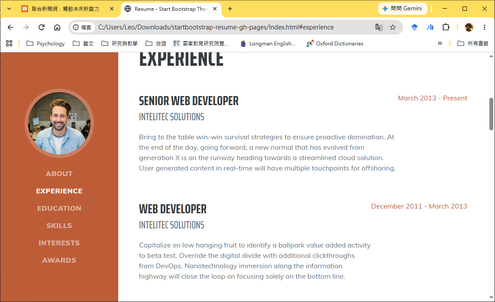
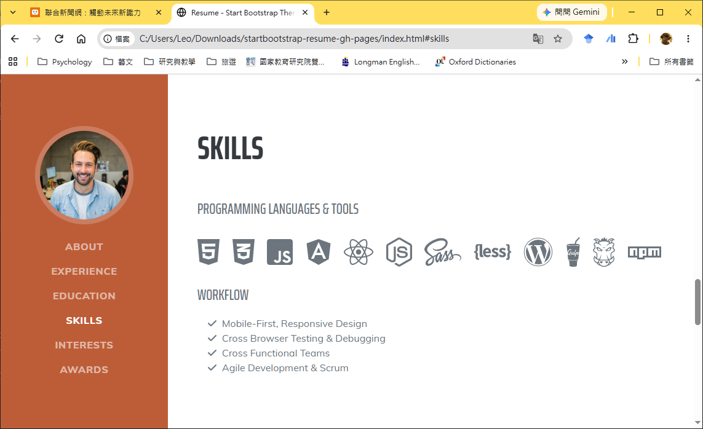
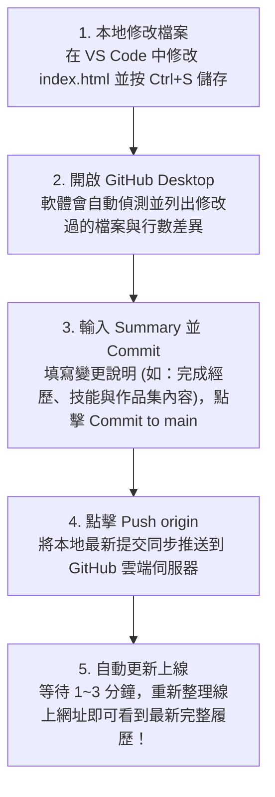

---
puppeteer:
  displayHeaderFooter: true
  scale: 1.15
  headerTemplate: '<div style="font-size: 11px; margin: 0 auto;">第八週：實作專案二 — 打造線上個人履歷(完整內容篇)</div>'
  footerTemplate: '<div style="font-size: 11px; margin: 0 auto;">第 <span class="pageNumber"></span> 頁 / 共 <span class="totalPages"></span> 頁</div>'
  margin:
    top: "1.5cm"
    bottom: "1.5cm"
    left: "1.5cm"
    right: "1.5cm"
---

<style>
  /* 全域字型、字級與行距 */
  body {
    font-size: 16pt !important;
    line-height: 1.7 !important;
    font-family: "Microsoft JhengHei", "PingFang TC", "Helvetica Neue", sans-serif;
  }

  /* 階層標題微調 */
  h1 { font-size: 30pt !important; margin-bottom: 0.5em !important; }
  h2 { font-size: 24pt !important; page-break-before: always; }
  h3 { font-size: 20pt !important; }
  h4 { font-size: 18pt !important; }

  /* 表格文字放大與排版優化 */
  table, th, td {
    font-size: 15pt !important;
    line-height: 1.5 !important;
  }

  /* 程式碼區塊 (自動換行防止 PDF 截斷) */
  pre, code {
    font-size: 13pt !important;
    font-family: Consolas, "Courier New", monospace !important;
    white-space: pre-wrap !important;
    word-break: break-all !important;
  }

  /* Mermaid 流程圖節點字體放大 */
  .mermaid text {
    font-size: 14px !important;
  }
</style>

---

# 第八週：實作專案二 — 打造線上個人履歷(完整內容篇) (Personal Online Resume - Complete Content & Custom Sections)

**課程名稱**：網頁設計 (Webpage Design)  
**授課教師**：林頌堅 副教授 (Prof. Sung-Chien Lin)  
**授課單位**：世新大學 資訊傳播學系  
**聯絡方式**：scl@mail.shu.edu.tw  
**線上資源**：[Start Bootstrap - Resume Template](https://startbootstrap.com/theme/resume) | [Font Awesome 官方圖示庫](https://fontawesome.com/search?o=r&m=free)  

---

## Ⅰ. 本週目標與課前準備 (Weekly Goals & Preparation)

各位同學好！在上週（第七週）的課程中，我們已經成功在 GitHub 建立了個人首頁專用倉庫 (`your-username.github.io`)，並完成了網頁標題、Meta 資訊、左側導覽列大頭照，以及 `<section id="about">` 個人核心簡介與社群連結的設定，正式讓個人網站上線！

本週我們將進入「**完整內容篇**」，把履歷其餘的核心章節（個人經歷、學歷背景、專業技能、個人興趣、榮譽獎項）全部替換為你自己的真實資料，並且學習如何自己擴充新增一個「**作品集展示 (Portfolio)**」區塊，最後透過 GitHub Desktop 將最新修改同步更新至線上網站！

---

### 1. 本週四大學習目標

1. **掌握經歷與學歷的 Flexbox 排版結構**：熟練新增、修改與刪除 `<section id="experience">` 與 `<section id="education">` 中的經歷條目。
2. **活用 Font Awesome 技能圖示與核對清單**：在 `<section id="skills">` 中展示你所熟悉的程式語言、設計工具與專業工作流程。
3. **完成興趣、獎項與擴充自訂區塊**：修改 `#interests` 與 `#awards`，並學會複製 `<section>` 結構來新增「作品集 (`#portfolio`)」及連動導覽列錨點。
4. **熟練 GitHub 日常更新工作流**：透過 GitHub Desktop 執行 Commit 與 Push，體驗雲端網站即時更新的開發流程。

---

### 2. 課前準備：從雲端同步你的最新專案

如果你今天在電腦教室使用了與上週不同的電腦，或是回家後曾在自己的筆電修改過履歷，請在開始動手前先確認以下步驟：

1. **檢查 GitHub Desktop 帳號**：開啟 GitHub Desktop，進入 **File** > **Options...** > **Accounts**，確認登入的是你自己的 GitHub 帳號。
2. **下載或同步最新進度**：
   * 若這台電腦還沒有你的專案資料夾：點擊 **File** > **Clone repository...**，選擇你的 `your-username.github.io` 下載至電腦。
   * 若這台電腦已有專案資料夾：點擊上方選單列的 **"Fetch origin" / "Pull origin"**，確保本機檔案與雲端最新版本同步。
3. **以 VS Code 開啟專案**：在 GitHub Desktop 中點擊 **"Open in Visual Studio Code"** 按鈕，即可直接打開專案資料夾並編輯 `index.html`！

---

## Ⅱ. 經歷與學歷區塊修訂 (Experience & Education Sections)

「個人經歷 (`#experience`)」與「學歷背景 (`#education`)」這兩個區塊的 HTML 排版結構非常相似，皆採用 Bootstrap 的 Flexbox 彈性盒佈局 (`d-flex`)，讓左側顯示職稱與內容、右側自動對齊顯示日期區間。



---

### 1. 經歷區塊 (`#experience`) 語法對應與新增/刪除

找到 `<section class="resume-section" id="experience">`。在這個區塊裡，每一個工作、打工、實習或社團幹部經歷，都是由一個 `class="d-flex flex-column flex-md-row justify-content-between mb-5"` 的 `<div>` 容器所包覆。

#### 語法結構示範：
```html
<div class="d-flex flex-column flex-md-row justify-content-between mb-5">
    <div class="flex-grow-1">
        <h3 class="mb-0">前端網頁設計 實習生</h3>
        <div class="subheading mb-3">科技數位行銷有限公司</div>
        <p>負責公司官網活動頁面維護與 RWD 響應式切版，運用 HTML5 與 CSS3 重構產品展示頁，使手機端瀏覽留存率提升 15%。</p>
    </div>
    <div class="flex-shrink-0">
        <span class="text-primary">2024 年 7 月 - 2024 年 8 月</span>
    </div>
</div>
```

#### 修改與增刪技巧：
* **結構解析**：
  * `<div class="flex-grow-1">`：負責包覆左側的主標題 (`<h3>` 職稱/幹部名稱)、副標題 (`.subheading` 公司/社團名稱) 與工作內容描述 (`<p>`)。
  * `<div class="flex-shrink-0">`：負責包覆右側的時間區間 (`<span class="text-primary">`)，確保日期不會被長文字擠壓換行。
* **新增經歷**：直接複製上方整段 `<div class="d-flex...">...</div>` 區塊（注意起始 `<div>` 與結束 `</div>` 標籤要成對完整複製），並貼在同區塊的下方。
* **刪除經歷**：若目前經歷較少，直接選取多餘的 `<div class="d-flex...">...</div>` 整段刪除即可。

---

### 2. 學歷區塊 (`#education`) 語法修訂

向下滾動找到 `<section class="resume-section" id="education">`，依據完全相同的 Flexbox 結構，替換為你的大學與高中學歷資訊：

```html
<div class="d-flex flex-column flex-md-row justify-content-between mb-5">
    <div class="flex-grow-1">
        <h3 class="mb-0">世新大學 (Shih Hsin University)</h3>
        <div class="subheading mb-3">資訊傳播學系 學士班</div>
        <div>主修數位內容設計、網頁前端開發與資料庫管理</div>
        <p>GPA: 3.85 / 4.0</p>
    </div>
    <div class="flex-shrink-0">
        <span class="text-primary">2023 年 9 月 - 就讀中</span>
    </div>
</div>
```

---

## Ⅲ. 專業技能與 Font Awesome 圖示庫 (Skills & Font Awesome)

在 `<section class="resume-section" id="skills">` 區塊中，包含了「程式語言與開發工具圖示清單 (`dev-icons`)」以及「工作流程與能力條列 (`fa-ul`)」兩個子部分。



---

### 1. 技能圖示清單 (`dev-icons`)

模板預設列出了許多前端工程圖示，你可以前往 [Font Awesome 官方網站](https://fontawesome.com/search?o=r&m=free) 搜尋你會使用的軟體或語言圖示（例如 `fa-html5`、`fa-css3-alt`、`fa-figma`、`fa-python`、`fa-wordpress` 等），將它們替換進 `<ul class="list-inline dev-icons">` 清單中：

```html
<div class="subheading mb-3">程式語言 & 開發設計工具</div>
<ul class="list-inline dev-icons">
    <li class="list-inline-item"><i class="fab fa-html5" title="HTML5"></i></li>
    <li class="list-inline-item"><i class="fab fa-css3-alt" title="CSS3"></i></li>
    <li class="list-inline-item"><i class="fab fa-js-square" title="JavaScript"></i></li>
    <li class="list-inline-item"><i class="fab fa-bootstrap" title="Bootstrap"></i></li>
    <li class="list-inline-item"><i class="fab fa-figma" title="Figma"></i></li>
    <li class="list-inline-item"><i class="fab fa-github" title="GitHub"></i></li>
</ul>
```

---

### 2. 工作流程與能力條列 (`fa-ul`)

如果是無法單純用品牌圖示表達的專業能力（例如攝影剪輯、企劃撰寫、RWD 設計或團隊溝通），可以使用下方的 `<ul class="fa-ul mb-0">` 配合勾選圖示 (`fa-check`) 進行條列說明：

```html
<div class="subheading mb-3">專業能力與工作流程</div>
<ul class="fa-ul mb-0">
    <li>
        <span class="fa-li"><i class="fas fa-check"></i></span>
        跨裝置響應式網頁設計 (RWD) 與 Mobile-First 開發流程
    </li>
    <li>
        <span class="fa-li"><i class="fas fa-check"></i></span>
        數位影音剪輯、平面視覺排版與社群圖文企劃
    </li>
    <li>
        <span class="fa-li"><i class="fas fa-check"></i></span>
        跨部門團隊溝通與敏捷專案管理 (Agile Workflow) 協作經驗
    </li>
</ul>
```

---

## Ⅳ. 興趣與榮譽獎項區塊修訂 (Interests & Awards Sections)

### 1. 修改個人興趣區塊 (`#interests`)

`<section class="resume-section" id="interests">` 的結構最為直觀，直接修改 `<p>` 段落標籤中的文字內容，展現你在課業與工作之外的個人特質與生活熱情：

```html
<section class="resume-section" id="interests">
    <div class="resume-section-content">
        <h2 class="mb-5">個人興趣</h2>
        <p>課餘時間我熱愛街頭攝影與獨立音樂，喜歡背著相機記錄城市街景與自然風光。每逢假日也喜歡造訪獨立書店與參與設計展覽，從日常生活中汲取視覺創作靈感。</p>
        <p class="mb-0">在室內休閒方面，我喜歡閱讀科技趨勢專欄、研究新興 AI 生成工具，並透過自主練習不斷精進網頁設計與數位敘事能力。</p>
    </div>
</section>
```

---

### 2. 修改榮譽獎項與證照區塊 (`#awards`)

在 `<section class="resume-section" id="awards">` 中，模板使用了金色獎盃圖示 (`<i class="fas fa-trophy text-warning"></i>`) 搭配列表來呈現得獎紀錄或專業證照：

```html
<section class="resume-section" id="awards">
    <div class="resume-section-content">
        <h2 class="mb-5">榮譽獎項與專業證照</h2>
        <ul class="fa-ul mb-0">
            <li>
                <span class="fa-li"><i class="fas fa-trophy text-warning"></i></span>
                2025 世新大學資訊傳播學系 專題成果展 — 最佳網頁互動設計獎
            </li>
            <li>
                <span class="fa-li"><i class="fas fa-trophy text-warning"></i></span>
                Google Analytics (GA4) 數位分析個人認證
            </li>
            <li>
                <span class="fa-li"><i class="fas fa-trophy text-warning"></i></span>
                TQC+ 網頁資料擷取與分析 專業級證照
            </li>
        </ul>
    </div>
</section>
```

---

## Ⅴ. 進階技巧：新增自訂專案區塊 (Custom Sections - Portfolio)

除了模板預設的六個區塊外，身為資傳系或設計相關領域的學生，展示「**作品集 (Portfolio)**」往往是吸引面試官最關鍵的加分項！如果你想在履歷中額外加入「作品集展示」或「專案成果」區塊，只需簡單四個步驟：

1. **步驟 1：複製現有區塊** — 在 `index.html` 中，複製整段現有的 `<section>` 區塊（以及下方的 `<hr class="m-0" />` 分隔線），並貼到你想要新增的位置（例如貼在 `#awards` 區塊的下方）。
2. **步驟 2：修改 ID 屬性** — 將新複製區塊的 `id` 改為一個全新的、有意義且不重複的英文名稱，例如 `id="portfolio"`。
3. **步驟 3：更換內部標題與內容** — 將新區塊內的 `<h2>` 標題（例如改成 `<h2 class="mb-5">作品集展示</h2>`）與內部項目，替換為你的作品資料與連結。
4. **步驟 4：新增左側導覽連結** — 回到最上方的 `<nav id="sideNav">` 導覽列區塊，在 `<ul>` 中複製一個 `<li>...</li>` 項目，將 `<a>` 標籤的 `href` 屬性修改為 `#` 加上新區塊的 id（即 `href="#portfolio"`），同時修改連結顯示文字。

---

### 程式碼示範：

#### (1) 在右側內容區新增作品集區塊 (`index.html`)：
```html
<hr class="m-0" />
<!-- 作品集展示 Portfolio-->
<section class="resume-section" id="portfolio">
    <div class="resume-section-content">
        <h2 class="mb-5">作品集展示</h2>
        
        <!-- 作品項目 1 -->
        <div class="d-flex flex-column flex-md-row justify-content-between mb-5">
            <div class="flex-grow-1">
                <h3 class="mb-0">線上電子商城 UI/UX 設計</h3>
                <div class="subheading mb-3">網頁前端實作專案</div>
                <p>運用 HTML5、CSS3 與 Bootstrap 框架打造的響應式商務平台原型，優化購物車結帳流程體驗。</p>
                <p><a href="https://github.com/your-username" target="_blank">查看專案作品連結</a></p>
            </div>
            <div class="flex-shrink-0">
                <span class="text-primary">2025 年 5 月</span>
            </div>
        </div>

        <!-- 作品項目 2 -->
        <div class="d-flex flex-column flex-md-row justify-content-between mb-5">
            <div class="flex-grow-1">
                <h3 class="mb-0">城市微光 攝影專題</h3>
                <div class="subheading mb-3">視覺傳達與圖像編排</div>
                <p>記錄台北街頭夜間光影人文紀錄特輯，包含專題文章撰寫、影像編排與視覺海報設計。</p>
            </div>
            <div class="flex-shrink-0">
                <span class="text-primary">2025 年 3 月</span>
            </div>
        </div>
    </div>
</section>
```

#### (2) 在左側 `<nav id="sideNav">` 補上跳轉連結：
```html
<li class="nav-item"><a class="nav-link js-scroll-trigger" href="#portfolio">作品集展示</a></li>
```

> 💡 **老師的真心話：內容篇與下週外觀篇的分工**  
> 在本週的「完整內容篇」中，我們聚焦於**將作品集的文字、標題、說明與連結等 HTML 內容結構寫得豐富且清晰**。  
> 到了下週（第九週）的「外觀篇」，我們將教大家如何撰寫自訂 CSS 樣式，將這些 HTML 作品資料升級為極具視覺吸引力的**便當盒風格 (Bento-Box Grid)** 或 **瀑布流風格 (Waterfall Layout)**！

---

## Ⅵ. 本地預覽與 GitHub Pages 雲端更新維護 (Preview & GitHub Pages Sync)

當你完成了所有章節的內容修改後，請依照以下標準流程進行本地檢查與雲端發佈更新：

### 1. 本地儲存與瀏覽器即時預覽

1. **隨時儲存檔案**：在 VS Code 中按下快捷鍵 `Ctrl + S` (Mac `Cmd + S`) 儲存 `index.html`。
2. **瀏覽器全面檢查**：在本地瀏覽器開啟 `index.html` 並按下 `F5` 重新整理，逐一檢查：
   * 各區塊文字是否皆已完成中文化與個人化？
   * 點擊左側導覽列每一個項目（包含新增的「作品集展示」），頁面是否都能平滑滾動到正確對應的 `<section>` 區塊？

---

### 2. 將最新內容 Commit 並 Push 更新至 GitHub Pages

確認本地畫面完美無誤後，我們就可以透過 **GitHub Desktop** 將本週的成果同步更新到你的線上個人首頁。未來每當你想要更新履歷內容或樣式時，都是遵循這套標準維護流程：



---

### 3. 本週隨堂實做進度自我核對表 & 下週預告

- [ ] **關卡 1**：完成 `<section id="experience">` 與 `<section id="education">` 的個人經歷與學歷背景修改。
- [ ] **關卡 2**：在 `<section id="skills">` 中更換符合自身專長的 Font Awesome 工具圖示 (`dev-icons`) 與專業能力條列 (`fa-ul`)。
- [ ] **關卡 3**：完成 `<section id="interests">` 個人興趣與 `<section id="awards">` 榮譽獎項/證照內容。
- [ ] **關卡 4**：成功複製新增自訂區塊（如 `<section id="portfolio">` 作品集展示），並在左側導覽列補上對應的 `href="#portfolio"` 跳轉連結。
- [ ] **關卡 5**：透過 GitHub Desktop 完成 **Commit to main** 與 **Push origin**，並於 `https://your-username.github.io` 確認線上網站已更新為完整內容！

#### 下週預告 (Next Week)
恭喜大家！本週我們順利完成了整份線上履歷的 **HTML 完整內容建置與結構擴充**。  
**第九週（外觀篇）**，我們將進入令人期待的 **CSS 視覺風格客製化**！我們將學習如何建立獨立的 `mystyles.css` 覆寫 Bootstrap 預設樣式，一鍵更換全站主題配色、引入 Google Fonts 思源黑體、加上質感背景紋理，並把今天新增的作品集區塊升級為**便當盒風 (Bento Box)** 或**瀑布流 (Waterfall)** 排版，打造獨一無二的個人品牌網站！
