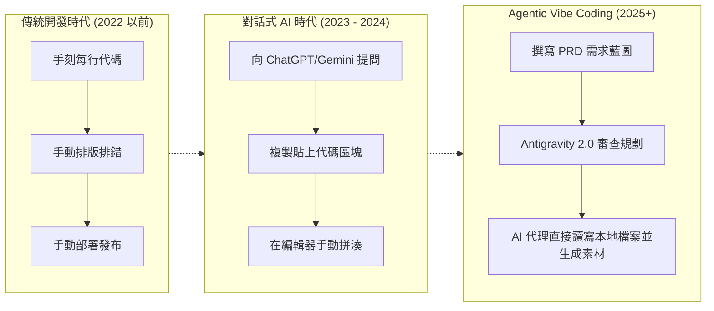
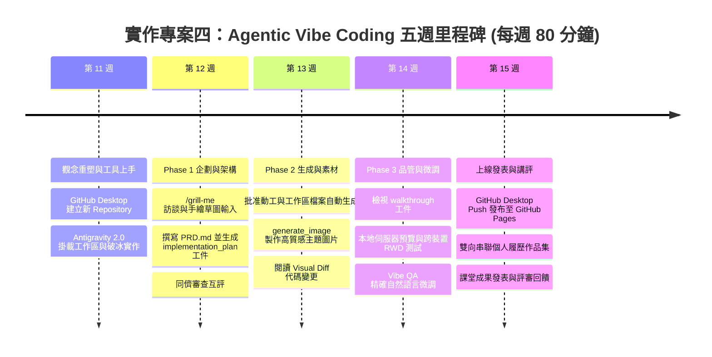
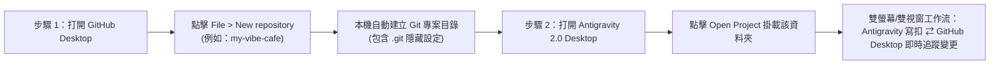
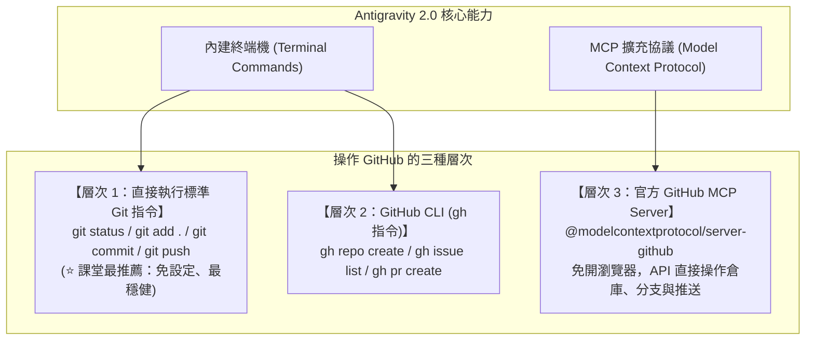

---
puppeteer:
  displayHeaderFooter: true
  scale: 1.15
  headerTemplate: '<div style="font-size: 11px; margin: 0 auto;">第十一週：實作專案四 — AI 協作：Vibe Coding 觀念重塑與 Antigravity 2.0 上手</div>'
  footerTemplate: '<div style="font-size: 11px; margin: 0 auto;">第 <span class="pageNumber"></span> 頁 / 共 <span class="totalPages"></span> 頁</div>'
  margin:
    top: "1.5cm"
    bottom: "1.5cm"
    left: "1.5cm"
    right: "1.5cm"
---

<style>
  /* 全域字型、字級與行距 */
  body {
    font-size: 16pt !important;
    line-height: 1.7 !important;
    font-family: "Microsoft JhengHei", "PingFang TC", "Helvetica Neue", sans-serif;
  }

  /* 階層標題微調 */
  h1 { font-size: 30pt !important; margin-bottom: 0.5em !important; }
  h2 { font-size: 24pt !important; page-break-before: always; }
  h3 { font-size: 20pt !important; }
  h4 { font-size: 18pt !important; }

  /* 表格文字放大與排版優化 */
  table, th, td {
    font-size: 15pt !important;
    line-height: 1.5 !important;
  }

  /* 程式碼區塊 (自動換行防止 PDF 截斷) */
  pre, code {
    font-size: 13pt !important;
    font-family: Consolas, "Courier New", monospace !important;
    white-space: pre-wrap !important;
    word-break: break-all !important;
  }

  /* Mermaid 流程圖節點字體放大 */
  .mermaid text {
    font-size: 14px !important;
  }
</style>

---

# 第十一週：實作專案四 — AI 協作：Vibe Coding 觀念重塑與 Antigravity 2.0 上手 (Orientation & Workspace Setup)

**課程名稱**：網頁設計 (Webpage Design)  
**授課教師**：林頌堅 副教授 (Prof. Sung-Chien Lin)  
**授課單位**：世新大學 資訊傳播學系  
**聯絡方式**：scl@mail.shu.edu.tw  
**核心工具**：Google Antigravity 2.0 Desktop、GitHub Desktop、VS Code  
**課堂時間**：共 80 分鐘（雙節課：40 min + 40 min）  

---

## Ⅰ. 專案背景：從手刻編碼到 Agentic Vibe Coding (Evolution of Web Development)

各位同學好！

恭喜大家順利完成了前幾週的「線上個人履歷」專案，並且成功使用 Git 與 GitHub Pages 將自己的作品發佈到了全世界！在過去的學習中，我們學習了如何「一磚一瓦」地用 HTML 定義網頁骨架、用 CSS 雕琢樣式排版，並透過 JavaScript 增加基礎的互動效果。

現在，我們將正式跨入網頁開發的全新紀元 —— **AI Agent 協作開發**。



### 1. 什麼是 Vibe Coding？
「Vibe Coding」（氛圍編程）是當前軟體界最受矚目的開發範式。它的核心哲學是：**你不再需要被動地逐行打字，而是扮演「產品經理 (Product Manager)」與「技術品管師 (QA Inspector)」，透過清晰的願景、精確的氛圍描述與架構引導，指揮 AI 代理人（AI Agent）為你完成程式碼的實作與迭代。**

### 2. 為什麼我們要升級到 Antigravity 2.0 Desktop？
在過去，許多人使用 ChatGPT 或 Gemini 網頁版來寫網頁，但往往會陷入痛苦的瓶頸：
- **「複製貼上地獄 (Copy-Paste Hell)」**：AI 在網頁聊天框印出 500 行代碼，你得自己複製、開 VS Code、存檔；改一個小地方，又得重新覆蓋整份檔案。
- **上下文遺失與失憶**：網頁版聊天室不知道你本地資料夾裡有哪些圖片、CSS 檔案或歷史紀錄。
- **假字與假圖氾濫**：AI 只能給你不著邊際的 `Lorem Ipsum` 假文和失效的假圖片連結，缺乏真實質感。

**Google Antigravity 2.0 Desktop** 是一套 AI-First 的桌面級 Agent 開發平台。它徹底解決了上述斷裂問題：
1. **直接讀寫本地工作區 (Direct Workspace File Access)**：AI 直接在你的專案資料夾建立、修改、重構檔案，零複製貼上。
2. **結構化工件系統 (Interactive Artifacts)**：AI 會在編碼前產出完整的實作計畫書（`implementation_plan.md`）與架構圖，完成後自動交付走查報告（`walkthrough.md`）。
3. **視覺化代碼變更審查 (Visual Diff Overlays)**：以清楚的紅/綠色標註修改範圍，讓學生精準掌握 AI 的每一步改動。
4. **多模態素材生成 (Built-in Image Generation)**：內建圖像生成工具，能根據你的風格氛圍直接產出高質感的真實圖片素材並存入專案。
5. **整合終端機指令**：一鍵啟動本地預覽伺服器、自動執行 Git 指令。

> 💡 **老師的真心話**  
> 以前我們是花 80% 時間「寫」程式碼，花 20% 時間「規劃」；  
> 現在，你必須花 60% 時間「規劃藍圖 (PRD)」、花 10% 時間「指揮 AI 代理」、花 30% 時間「品管審查與細節微調」。  
> 記住：**AI 不會通靈，Garbage In 就必定 Garbage Out！** 你的價值不在於打字速度，而在於你對產品目標的精確描述與品味把關！

---

## Ⅱ. 工具對比：網頁對話式 AI vs. Antigravity 2.0 桌面代理 (Tool Comparison)

| 評比維度 | 傳統網頁 AI (ChatGPT / Gemini Web) | Antigravity 2.0 Desktop 代理平台 | 對學生的實質效益 |
| :--- | :--- | :--- | :--- |
| **檔案操作** | 只能在聊天視窗輸出文字區塊，學生須手動全選、複製、貼上到檔案中。 | **直接讀寫工作區**：AI 代理自動建立 `index.html`、`style.css` 並精準局部替換。 | 告別「複製貼上覆蓋失誤」，節省 70% 雜務時間。 |
| **專案感知** | 無法讀取本地資料夾目錄結構與多個檔案關聯。 | **全專案上下文感知**：使用 `@` 即可引用專案中的任意檔案、圖片或設定。 | AI 能理解整個網站架構，不再瞎子摸象。 |
| **需求企劃** | 學生面對空白文檔發呆，缺乏專業引導；或直接丟一句話導致 AI 生成芭樂範本。 | **`/grill-me` 互動訪談 + 多模態草圖輸入**：AI 化身產品總監主動提問，並能看懂手繪草圖。 | 徹底解決學生「不知如何描述」的痛點，消除模糊盲區。 |
| **架構規劃** | 一股腦直接輸出大量程式碼，容易漏掉需求或產生幻覺。 | **Planning Mode 規範模式**：先產出 **Artifact (`implementation_plan.md`)**，學生確認後才動工。 | 培養先思考後動手的工程思維，掌控 Single Source of Truth。 |
| **代碼審查** | 學生無法看清到底改了哪幾行，只能盲目相信 AI。 | **視覺化 Diff 比對**：綠色新增、紅色刪除，清楚列出具體變更。 | 強化 HTML/CSS 專業閱讀與品管審查能力。 |
| **圖片素材** | 只能提供佔位圖 (Placeholder) 或無效連結。 | **內建多模態生成 (`generate_image`)**：直接產出符合主題氛圍的真實高品質圖片。 | 網站完成即具備商業質感，無須額外到處找圖。 |
| **預覽與測試** | 須自行開 Live Server 或手動開瀏覽器重整除錯。 | **內建終端機環境**：可直接下指令開啟本地伺服器測試，並整合 Git 發布。 | 打造專業的一站式現代化開發工作流程。 |

---

## Ⅲ. 專案五週整體進度規劃 (Weeks 11-15 Overview)

本專案採循序漸進的五週節奏進行，每週 80 分鐘（雙節課）：



---

## Ⅳ. 核心工作流程基石：GitHub Desktop 專案初始化與 Antigravity 串聯 (Project Setup)

在第 11 週進入 Phase 1 之前，**強烈建議採取「先在 GitHub Desktop 建立 Repository，再用 Antigravity 掛載」的標準流程**：



### 為什麼這套「專案前置初始化」是最佳教學實務？
1. **銜接舊知識，降低認知負擔**：同學們在第 7~9 週已經學過 GitHub Desktop，延續這個熟悉的工具能給學生強烈的安全感。
2. **自動 Git 初始化（Zero Config Git）**：透過 GitHub Desktop 建立資料夾，會自動完成 `git init`，建立好乾淨的目錄，避免學生在「桌面」或「下載」等雜亂路徑下開專案。
3. **即時視覺同步回饋（Visual Feedback）**：當 Antigravity 在工作區中新增或修改任何檔案時，GitHub Desktop 的 **"Changes"** 列表會**「零秒差」**跳出變更！學生可以一邊看 AI 在 Antigravity 動手，一邊看 GitHub Desktop 的綠色代碼新增，極大地強化學習的安心感與可控感。

---

## Ⅴ. Antigravity 如何操作 GitHub？指令、終端與 MCP 工具解析 (Git & GitHub Integration)

很多同學好奇：**Antigravity 能不能像自動寫檔案一樣，幫我操作 GitHub 或 GitHub Desktop？**

答案是：**完全可以！Antigravity 具備強大的終端機指令與 MCP（Model Context Protocol）生態系支援！**



### 1. 概念澄清：GitHub Desktop vs. Git
* **GitHub Desktop** 是 GitHub 官方開發的**圖形化介面軟體 (GUI)**，專門用滑鼠點擊操作，本身並不提供外部 API 讓 AI 遙控它的視窗。
* 但是，GitHub Desktop 背後的核心就是 **Git**！因此，**當 Antigravity 在終端機執行 Git 指令、或在工作區修改檔案時，GitHub Desktop 會即時感知並完全同步！**

### 2. Antigravity 操作 GitHub 的實用方式
* **終端機標準 Git 指令（免任何額外設定，課堂最強烈推薦）**：  
  學生只需在 Antigravity 對話框中用口語要求：
  ```text
  請幫我將目前的修改進行 Git 提交，commit 訊息寫「初次建立專案環境」，並推送到 GitHub 遠端倉庫。
  ```
  Antigravity 會自動在背景執行 `git add .`、`git commit -m "..."` 與 `git push`。打開旁邊的 GitHub Desktop，紀錄便已同步推上雲端！

---

## Ⅵ. 第十一週課堂 80 分鐘實作節奏與破冰練習 (Classroom Lab & Icebreaker)

### 課堂時間分配表 (40 min × 2)
* **第 1 節 (40 分鐘)：觀念重塑與專案初始化**
  1. 解說 Vibe Coding 演進與 60/10/30 時間法則 (15 min)。
  2. 開啟 GitHub Desktop，點擊 `File > New repository`，命名為 `my-vibe-project`，路徑設為熟悉資料夾（如 `Documents/GitHub`）(15 min)。
  3. 打開 Antigravity 2.0 Desktop，點擊左側 `Projects > Open Project` 掛載剛才建立的資料夾 (10 min)。
* **第 2 節 (40 分鐘)：Antigravity 介面巡禮與零複製貼上破冰體驗**
  1. 認識主畫布、右側 Artifacts 窗格、與下方終端機 (15 min)。
  2. **破冰實作（零複製貼上震撼體驗）** (20 min)：
     在 Antigravity 輸入：
     ```text
     請直接在我的專案目錄建立一個 hello.html 檔案，裡面放一個置中的發光粉彩按鈕，按鈕上寫「點我計數」，並加入一段簡單的 JavaScript 讓它每次點擊都會累加次數。
     ```
     觀察檔案瞬間出現在左側檔案樹，切換到 GitHub Desktop 觀察 Changes 列表即時亮出綠色代碼！
  3. 預告下週專案自選主題，思考你想為誰做網站 (5 min)。

---

## Ⅶ. 專案主題自選範圍 (Project Topics)

請在課後思考並挑選一個你感興趣的主題，下週我們將正式進入 Phase 1 企劃撰寫：
1. **社團招生官網**（例如：世新吉他社、熱舞社、登山隊、攝影社）
2. **校園或文藝活動宣傳頁**（例如：2026 校慶音樂祭、迎新營隊、資傳系成果展）
3. **地方小型企業 / 特色店面**（例如：老王手沖咖啡、巷口手作甜點店、個人烘焙坊）
4. **個人高質感作品集**（例如：攝影作品集、UI/UX 設計展示、影音創作集錦）

> 💡 **老師的真心話**  
> 記住，從今天開始，你不再是機械式敲打鍵盤的「碼農」，而是手握強大 AI 代理人團隊的「AI 產品總監」！請帶上你的品味與想像力，我們下週進入 Phase 1 企劃見！
