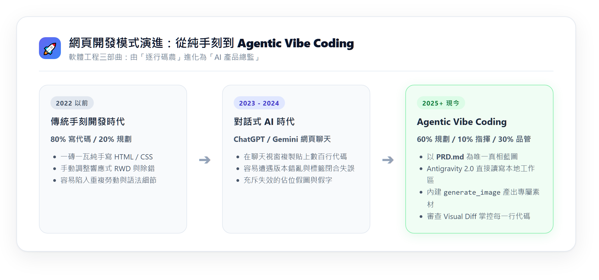
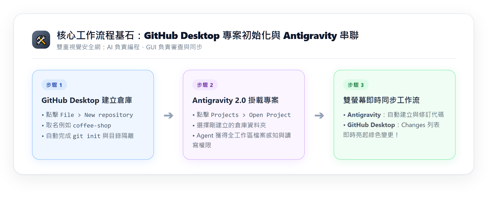
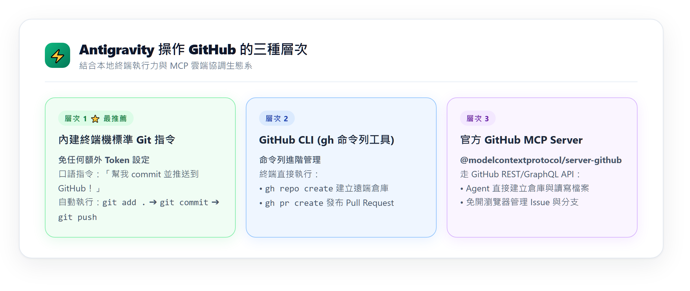

---
puppeteer:
  displayHeaderFooter: true
  scale: 1.15
  headerTemplate: '<div style="font-size: 11px; margin: 0 auto;">第十一週：實作專案四 — AI 協作：Vibe Coding 工具上手與專案工作區建立</div>'
  footerTemplate: '<div style="font-size: 11px; margin: 0 auto;">第 <span class="pageNumber"></span> 頁 / 共 <span class="totalPages"></span> 頁</div>'
  margin:
    top: "1.5cm"
    bottom: "1.5cm"
    left: "1.5cm"
    right: "1.5cm"
---

<style>
  /* 全域字型、字級與行距 */
  body {
    font-size: 16pt !important;
    line-height: 1.7 !important;
    font-family: "Microsoft JhengHei", "PingFang TC", "Helvetica Neue", sans-serif;
  }

  /* 階層標題微調 */
  h1 { font-size: 30pt !important; margin-bottom: 0.5em !important; }
  h2 { font-size: 24pt !important; page-break-before: always; }
  h3 { font-size: 20pt !important; }
  h4 { font-size: 18pt !important; }

  /* 表格文字放大與排版優化 */
  table, th, td {
    font-size: 15pt !important;
    line-height: 1.5 !important;
  }

  /* 程式碼區塊 (自動換行防止 PDF 截斷) */
  pre, code {
    font-size: 13pt !important;
    font-family: Consolas, "Courier New", monospace !important;
    white-space: pre-wrap !important;
    word-break: break-all !important;
  }
</style>

---

# 第十一週：實作專案四 — AI 協作：Vibe Coding 工具上手與多頁專案起手式 (Orientation & Multi-page Setup)

**課程名稱**：網頁設計 (Webpage Design)  
**授課教師**：林頌堅 副教授 (Prof. Sung-Chien Lin)  
**授課單位**：世新大學 資訊傳播學系  
**必備工具**：Google Antigravity 2.0 Desktop、GitHub Desktop、VS Code、Google Chrome / Edge  

---

## Ⅰ. 學習目標與心態重塑：你不再是「碼農」，而是「AI 產品總監」

各位同學好！在前半學期中，我們學習了用 HTML 刻畫結構、用 CSS 雕琢樣式，並用 GitHub Pages 上線了自己的線上個人履歷。

這週開始，我們要跨入目前全球最火紅的開發模式 —— **Vibe Coding（氛圍編程）**。



### 1. 什麼是 Vibe Coding？
過去寫多個網頁，你必須手動建立 `index.html`、`about.html`、`menu.html`，一個個複製貼上導覽列與樣式，稍不注意連結就失效了。  
在 **Vibe Coding** 的世界裡：
* **你扮演「產品總監 (PM)」與「技術品管 (QA)」**：負責定義網站願景、規劃各頁面架構、挑選視覺氛圍（Vibe），並檢查成品細節。
* **AI Agent（Antigravity 2.0 Desktop）扮演你的「初階工程團隊」**：負責直接在你的電腦資料夾建立多個網頁、編寫代碼、生成真實圖片素材，並聽從你的指示精確修改。

### 2. 你的黃金時間分配法則
* **60% 時間「規劃藍圖」**：想清楚網站有哪些頁面、要放什麼、給誰看（寫好 PRD）。
* **10% 時間「指揮 AI」**：用精準、具體的自然語言引導 AI 動工。
* **30% 時間「品管審查」**：檢查頁面連結是否正常、手機版排版是否跑版、細節微調。

---

## Ⅱ. 工具對比：為什麼我們不用網頁版 ChatGPT/Gemini？

很多同學問：「老師，我用瀏覽器開 ChatGPT 或 Gemini 寫網頁不行嗎？」

| 比較項目 | 傳統網頁 AI (ChatGPT / Gemini Web) | 桌面端 AI 代理 (Antigravity 2.0 Desktop) |
| :--- | :--- | :--- |
| **多網頁處理** | 痛苦！AI 每次只印一個檔案，你要手動開 4 個分頁反覆複製貼上。 | **一次搞定**！AI 直接在本地資料夾自動建立並關聯所有網頁檔案。 |
| **檔案感知** | 瞎子摸象！它看不到你電腦裡有哪些圖片與 CSS 檔案。 | **全域感知**！直接掛載你的專案目錄，看得懂所有檔案的相互關聯。 |
| **圖片素材** | 只能給你失效的佔位假圖 (`via.placeholder.com`)。 | **內建繪圖**！直接呼叫 `generate_image` 為你畫出高質感真實商用圖。 |
| **代碼修改** | 改一個字就重新印出 500 行，很容易貼錯位置。 | **精準替換**！支援 Visual Diff，清清楚楚顯示它修改了哪幾行代碼。 |

---

## Ⅲ. 實戰任務一：用 GitHub Desktop 建立多頁專案資料夾 (Project Setup)

為了讓未來的專案管理與發布最省力，我們採取**「先建倉庫，再開 Antigravity」**的標準流程：



### 🛠️ 操作步驟：
1. **打開 GitHub Desktop**。
2. 點擊頂部選單的 **`File > New repository...`**（新增儲存庫）。
3. 填寫專案設定：
   * **Name**：請使用英文小寫與減號，例如 `laowang-cafe`、`guitar-club` 或 `portfolio-2026`（這個名稱未來會變成你的網址一部分！）。
   * **Local Path**：選擇你電腦中熟悉的資料夾（例如 `Documents/GitHub`）。
   * **其他選項**：不要勾選 "Initialize this repository with a README"。
4. 點擊 **`Create repository`** 按鈕。此時你的電腦硬碟中已經建立了一個乾淨、具備完整 Git 版本控制的專案目錄！

---

## Ⅳ. 實戰任務二：在 Antigravity 2.0 Desktop 中掛載專案工作區

現在，我們要讓 AI 結對工程師進入你的專案目錄。

### 🛠️ 操作步驟：
1. 打開 **Antigravity 2.0 Desktop** 桌面應用程式。
2. 在左側欄點擊 **`Projects`**，選擇 **`Open Project`**（或從檔案選單開啟資料夾）。
3. 選擇剛剛由 GitHub Desktop 建立的那個資料夾（例如 `laowang-cafe`）。
4. **認識主介面三大核心區域**：
   * **左側/中央聊天畫布 (Chat Canvas)**：你向 AI 下達指令、討論需求、審查代碼的核心對話窗。
   * **右側工件視窗 (Artifacts Pane)**：AI 交付的設計文件（`implementation_plan.md`、`walkthrough.md`）會以精美的互動頁面呈現在這裡。
   * **底部終端機 (Terminal)**：AI 會在這裡幫你啟動本機預覽伺服器、執行 Git 指令。

---

## Ⅴ. 實戰任務三：破冰體驗 — 見證「零複製貼上」的神奇建檔

讓我們用一段簡單的指令，親自體會 AI 代理人直接在你的硬碟寫入檔案的威力！

### 💬 請在 Antigravity 對話框中輸入以下提示詞：

```text
請直接在我的專案目錄中建立一個 hello.html 檔案：
1. 包含完整的 HTML5 骨架與繁體中文語系設定。
2. 畫面中央放一張粉彩漸層卡片，上面有一顆精美的發光按鈕，標題寫「Antigravity 破冰成功！」。
3. 寫一段簡單的 JavaScript，讓每次點擊按鈕時，按鈕下方會顯示點擊次數與一句隨機的鼓勵小語。
4. 建立完成後，請告訴我檔案已建立。
```

### 🔍 觀察與自我檢核 (Self-Check)：
1. **觀察 Antigravity**：對話框中會跳出工具呼叫提示（`write_to_file`），AI 直接將代碼寫入你的硬碟。
2. **切換到 GitHub Desktop**：看一下左側的 **"Changes"** 列表，你會發現 `hello.html` 已經自動出現，右側清楚顯示所有新增的綠色代碼！
3. **在瀏覽器打開**：到你的專案資料夾中雙擊 `hello.html`，在瀏覽器裡點點看按鈕，確認互動功能是否正常！

> 💡 **這就是 Vibe Coding 的核心魅力**：你不用在視窗之間複製貼上代碼，你動口，AI 動手！

---

## Ⅵ. 實戰任務四：指揮 AI 執行 Git 提交與推送到雲端，並在線上觀察結果

當 AI 幫你寫好程式碼後，你甚至不需要手動點擊按鈕，直接用自然語言就能指揮它完成版本提交與雲端推送！



### 1. 指揮 Antigravity 進行 Commit 與 Push
請在 Antigravity 對話框中輸入：

```text
請在終端機幫我將目前的檔案加入 Git 暫存並進行 Commit：
- Commit 訊息請寫：「初次建立專案環境並完成破冰 hello.html」
- 請在終端機執行 git status 讓我確認狀態。
- 若已經關聯遠端倉庫，請順便幫我執行 git push 推送到雲端！
```

> 📌 **初次發布小提醒**：如果你的專案剛在 GitHub Desktop 建立尚未推上雲端，你也可以直接切換到 GitHub Desktop，點擊頂部的 **「Publish repository」**（**務必取消勾選「Keep this code private」**，確保為公開儲存庫）。

### 2. 在 GitHub.com 網站查看上傳結果
推送完畢後，讓我們到雲端驗收成果：
1. 打開瀏覽器，造訪你的 GitHub 個人主頁：`https://github.com/你的帳號/你的專案名稱`  
   （在 GitHub Desktop 也可以按下快捷鍵 `Ctrl + Shift + G`，或點選頂部選單 `Repository > View on GitHub` 快速開啟）。
2. 在網頁的檔案清單中，你會驚喜地發現 `hello.html` 已經穩穩躺在雲端倉庫中！
3. 檔案旁邊清清楚楚記錄著你剛才由 AI 提交的 Commit 訊息：「初次建立專案環境並完成破冰 hello.html」，以及精確的提交時間。

### 3. 開啟 GitHub Pages 並從專屬網址觀察生成結果
既然檔案已經上傳雲端，我們就能讓全世界看到這個破冰網頁：
1. 在該 GitHub 倉庫頁面，點擊頂部的 **`Settings`**（設定）。
2. 在左側選單點選 **`Pages`**。
3. 在 **Build and deployment** 下方：
   * **Source** 選擇 `Deploy from a branch`。
   * **Branch** 選擇 `main`，路徑保持 `/(root)`，點擊 **`Save`**。
4. 等待 1~2 分鐘後重新整理頁面，頂部會跳出綠色勾勾與專屬網址：  
   `https://<你的GitHub帳號>.github.io/<專案名稱>/hello.html`
5. 用瀏覽器打開這個網址（甚至可以用手機掃描或開啟），親眼見證自己剛才用嘴巴指揮 AI 寫出的互動網頁，已經真正發布到全網！

---

## Ⅶ. 實戰任務五：體驗 Vibe Coding 迭代循環 — 再次修改、推送與觀察更新 (The Iterative Loop)

網頁開發最迷人的精髓就在於**「快速迭代 (Iterative Refinement)」**。  
現在讓我們親手跑一次完整的 **「修改 ➔ Commit ➔ Push ➔ 觀察線上更新」** 循環！

### 步驟 1：向 Antigravity 下達修改指令（升級網頁特效）
請在 Antigravity 對話框中輸入：

```text
請幫我修改 hello.html，進行第二版升級：
1. 將原本的按鈕升級為吸睛的紫粉漸層色彩，並加上 hover:scale-105 與 hover:shadow-lg 的平滑懸浮放大動畫。
2. 在按鈕下方增加一行小字：「⚡ 由 Antigravity 2.0 桌面代理人自動迭代生成」。
3. 在卡片右上角增加一個小開關按鈕，點擊後可以在「淺色米白」與「深色夜間」兩種背景模式之間切換！
```

### 步驟 2：觀察 Visual Diff 並在本地即時驗證
1. **查看 Visual Diff**：AI 執行修改時，觀察聊天視窗顯示的代碼差異，看看綠色新增了哪些 Tailwind class 與 JavaScript 切換邏輯。
2. **本地刷新確認**：回桌面雙擊 `hello.html`（或重新整理已開啟的瀏覽器標籤頁），試按切換夜間模式與動態按鈕，體驗親手主導產品升級的快感！

### 步驟 3：指揮 AI 再次提交並推送到 GitHub
在 Antigravity 對話框中輸入：

```text
修改效果非常棒！請在終端機幫我執行 git add . 與 git commit，
- Commit 訊息寫：「升級 hello.html：加入漸層懸浮特效與深淺色切換功能」
- 提交完成後，直接幫我執行 git push 推送到 GitHub 雲端！
```

### 步驟 4：在 GitHub.com 與線上網址觀察修改成果
1. **回到 GitHub.com 倉庫頁面**：重新整理，你會看到最新的 Commit 紀錄已經更新為「升級 hello.html：加入漸層懸浮特效...」，點擊 Commit 紀錄還能看到精確的代碼修改記錄。
2. **重新整理 GitHub Pages 線上網址**：  
   打開 `https://<你的GitHub帳號>.github.io/<專案名稱>/hello.html`  
   （若瀏覽器有暫存快取，請按下鍵盤 **`Ctrl + F5`** 進行強制重新整理）。  
3. 看見線上網頁瞬間換上你剛才要求的深色模式與粉紫按鈕！**這就是專業工程師每天在使用的持續發布 (Continuous Deployment) 流程！**

---

## Ⅷ. 本週課後任務：自選你的「多網頁形象網站」主題

下週我們將正式啟動 **Phase 1 企劃階段**，請在課後挑選一個你最有興趣、最想為它做官網的主題。這個網站必須規劃為 **包含 3 ~ 4 個互相跳轉網頁的完整網站**！

### 推薦主題與頁面規劃參考：

1. **巷弄特色手沖咖啡廳（如：老王手沖咖啡）**
   * 首頁 (`index.html`)：全寬主視覺、最新公告、人氣推薦
   * 關於我們 (`about.html`)：主理人烘豆理念、空間氛圍介紹
   * 風味菜單 (`menu.html`)：手沖單品、義式咖啡、手作甜點價格列表
   * 店家資訊 (`contact.html`)：營業時間、交通指南、Google Map 嵌入
2. **大學熱門社團招生官網（如：世新吉他社）**
   * 首頁 (`index.html`)：熱血招生 Hero Banner、社團大合照、近期演出
   * 社團介紹 (`about.html`)：社團歷史、指導老師與幹部團隊
   * 活動歷程 (`events.html`)：迎新露營、期末成果發表、歷年演出影音
   * 加入我們 (`join.html`)：入社常見問答 (FAQ)、報名表單連結
3. **個人高質感作品集（個人數位名片）**
   * 首頁 (`index.html`)：個人簡介、精選主打作品卡片
   * 經歷與專長 (`about.html`)：求學經歷、技能徽章、自傳
   * 作品展示 (`portfolio.html`)：影音創作、平面設計、UI/UX 專案詳細列表
   * 聯絡我 (`contact.html`)：社群連結 (IG/LinkedIn)、Email 聯絡表單

---

## Ⅸ. 本週驗收檢核清單 (Week 11 Checklist)

在關閉電腦前，請確認你已達成以下 6 大里程碑：
- [ ] 已在 GitHub Desktop 建立一個乾淨且公開的專案倉庫資料夾。
- [ ] 已在 Antigravity 2.0 Desktop 中掛載該專案資料夾。
- [ ] 已成功讓 AI 自動生成初版 `hello.html`，並在瀏覽器驗證按鈕點擊功能。
- [ ] 已在 GitHub.com 網站上看見推送上傳的檔案與 Commit 訊息。
- [ ] 已開啟 GitHub Pages，並能透過專屬公開網址連上 `hello.html`。
- [ ] 已成功完成**二次修改（迭代循環）**，透過 Git Push 更新雲端，並在線上網址看到最新修改結果！
- [ ] 心中已決定好下週要做的主題，並初步想好要包含哪 3~4 個頁面！

---

> 💡 **產品總監結語**  
> 今天你已經完整體驗了現代工程師最核心的「編程 ➔ 提交 ➔ 發布 ➔ 迭代」閉環！  
> 下週我們將正式跨入大專案的靈魂 —— **Phase 1 企劃篇**。我們將使用 `/grill-me` 指令，像專業 PM 一樣雕琢多頁網站的 PRD 藍圖！
