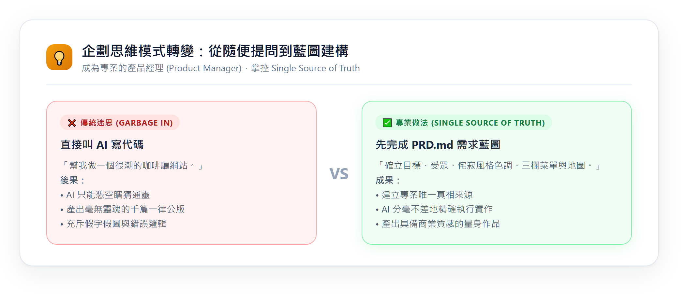
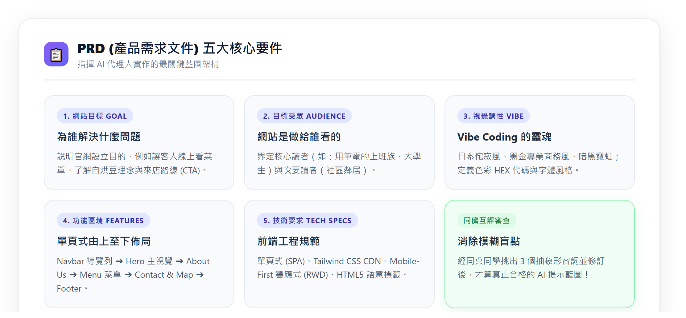
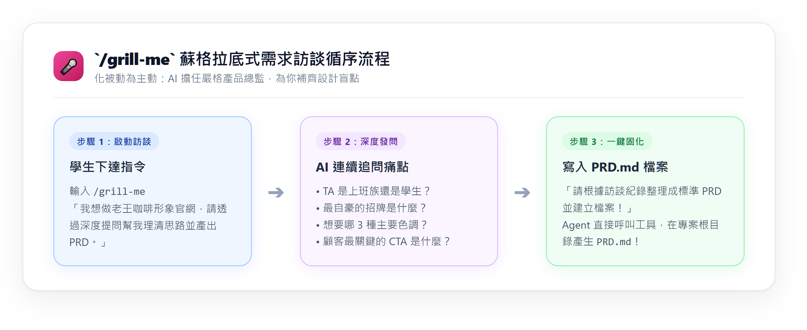

---
puppeteer:
  displayHeaderFooter: true
  scale: 1.15
  headerTemplate: '<div style="font-size: 11px; margin: 0 auto;">第十二週：實作專案四 — AI 協作：Phase 1 企劃 — 規劃多頁網站藍圖與撰寫 PRD</div>'
  footerTemplate: '<div style="font-size: 11px; margin: 0 auto;">第 <span class="pageNumber"></span> 頁 / 共 <span class="totalPages"></span> 頁</div>'
  margin:
    top: "1.5cm"
    bottom: "1.5cm"
    left: "1.5cm"
    right: "1.5cm"
---

<style>
  /* 全域字型、字級與行距 */
  body {
    font-size: 16pt !important;
    line-height: 1.7 !important;
    font-family: "Microsoft JhengHei", "PingFang TC", "Helvetica Neue", sans-serif;
  }

  /* 階層標題微調 */
  h1 { font-size: 30pt !important; margin-bottom: 0.5em !important; }
  h2 { font-size: 24pt !important; page-break-before: always; }
  h3 { font-size: 20pt !important; }
  h4 { font-size: 18pt !important; }

  /* 表格文字放大與排版優化 */
  table, th, td {
    font-size: 15pt !important;
    line-height: 1.5 !important;
  }

  /* 程式碼區塊 (自動換行防止 PDF 截斷) */
  pre, code {
    font-size: 13pt !important;
    font-family: Consolas, "Courier New", monospace !important;
    white-space: pre-wrap !important;
    word-break: break-all !important;
  }
</style>

---

# 第十二週：實作專案四 — AI 協作：Phase 1 企劃 — 規劃多頁網站藍圖與撰寫 PRD (Phase 1: Multi-Page Planning & PRD)

**課程名稱**：網頁設計 (Webpage Design)  
**授課教師**：林頌堅 副教授 (Prof. Sung-Chien Lin)  
**授課單位**：世新大學 資訊傳播學系  
**聯絡方式**：scl@mail.shu.edu.tw  
**核心工具**：Google Antigravity 2.0 Desktop、GitHub Desktop、VS Code、Google Chrome / Edge  

---

## 🎯 本週學習目標 (Weekly Mission)

歡迎進入 Vibe Coding 的核心首部曲 —— **Phase 1：企劃 (Planning)**！

上週我們已經用 GitHub Desktop 建立了專案資料夾，並在 Antigravity 2.0 Desktop 中掛載成功。這週你的核心任務只有一個：**為你的多頁式網站打造一份清晰、嚴密、AI 看得懂的施工藍圖（PRD.md），並指揮 AI 生成架構規劃工件！**

完成本週學習後，你將能夠：
1. **掌握 PRD 的五大核心要素**：以專業產品經理視角，定義多頁網站的目標、受眾、氛圍調性、分頁架構與技術規範。
2. **靈活運用 `/grill-me` 深入訪談**：讓 Antigravity 2.0 扮演嚴格的顧問，透過一問一答挖掘網站細節盲點。
3. **整合多模態草圖輸入**：手繪多頁 Wireframe 草圖拍照拖入對話框，讓 AI 快速解析佈局。
4. **啟動 Planning Mode**：引導 AI 產出 `implementation_plan.md` 工件，精確拆解 4 個 HTML 分頁、共用導覽列與圖片資產清單。
5. **在 GitHub Desktop 進行里程碑提交**：落實「企劃先行」的版本控管習慣。

---

## Ⅰ. 企劃核心觀念：為什麼做多頁網站必須先有 PRD？ (Single Source of Truth)

很多初學者一打開 AI 聊天室，就迫不及待輸入：「幫我做一個日系咖啡廳網站，要有好幾個頁面！」  
結果 AI 產出來的成果往往是一場災難：
* 首頁用深木色，點進「關於我們」卻變成粉紫色少女風。
* 導覽列的按鈕在 `index.html` 寫的是「風味菜單」，到了 `about.html` 卻變成「商品總覽」，點擊還會出現 404 找不到檔案！
* 內容充斥著「這裡放文字介紹」、「商品一」、「商品二」等敷衍的假字。



### 1. 什麼是 PRD？
**PRD (Product Requirement Document，產品需求文件)** 是整個專案的施工藍圖，也是你與 AI 代理人間的**「唯一真相來源 (Single Source of Truth)」**。

當你將網站的配色代碼（HEX）、字體、4 個分頁的檔名（`index.html`、`about.html`、`menu.html`、`contact.html`）與各頁面區塊清清楚楚記錄在 `PRD.md` 中，AI 代理人每一次建立或修改檔案時，都會以這份文件為準繩，確保**全站風格一致、相對連結零失誤**！

### 2. 多頁式網站的核心架構標準（4 個核心頁面）
在本次實作專案中，我們要求規劃一個完整的 **4 頁式網站**：
1. **首頁 (`index.html`)**：品牌門面！全寬主視覺 (Hero Banner)、品牌核心主張、最新消息/推薦品項精選、前往各分頁的引導按鈕 (Call to Action)。
2. **關於我們 (`about.html`)**：品牌靈魂！主理人理念、品牌歷史故事、店內實體空間/職人烘焙氛圍圖文排版。
3. **產品/菜單/作品頁 (`menu.html` 或 `portfolio.html`)**：核心內容！分類篩選卡片（手沖咖啡、義式特調、私房手作甜點）、風味筆記、價格與標籤。
4. **門市資訊/聯絡頁 (`contact.html`)**：轉換最後一步！營業時間、交通指引、嵌入式 Google 互動地圖、線上預約/意見回饋表單。

---

## Ⅱ. 多頁網站 PRD 的五大核心要素 (5 Core Components)

一份合格的多頁網站 PRD 必須具備以下五大要素：



| 核心要素 | 說明與指引 | 實戰範例 (老王手沖咖啡) |
| :--- | :--- | :--- |
| **1. 網站目標 (Goal)** | 這個網站要解決什麼問題？期待訪客採取什麼行動？ | 為文教區巷弄的「老王手沖咖啡」建立日系極簡形象官網，傳遞自烘豆職人理念，讓訪客快速查閱豆單與前往門市。 |
| **2. 目標受眾 (Audience)** | 網站做給誰看？使用情境是什麼？ | 主要受眾為喜愛安靜氛圍、追求單品咖啡風味的大學生與自由工作者；次要受眾為尋找假日下午茶甜點的社區居民。 |
| **3. 視覺風格 (Vibe & Style)** | 色彩計畫 (HEX 代碼)、字體設定、情緒氛圍關鍵字。 | 日系侘寂風 (Wabi-Sabi)。米杏色背景 (`#FDFBF7`)、深烘焙咖啡主色 (`#3E2723`)、灰綠點綴色 (`#556B2F`)；思源宋體與無襯線體。 |
| **4. 網站地圖 (Site Map)** | 明確列出 4 個分頁的檔名、區塊分工與跨頁導航規範。 | `index.html` (首頁)、`about.html` (理念故事)、`menu.html` (3 大分類豆單卡片)、`contact.html` (營業時間與地圖)。 |
| **5. 技術規格 (Tech Spec)** | 框架、語意化標籤、CSS 架構與響應式要求。 | 採用 Tailwind CSS CDN + 外部 `mystyles.css`；全站共用頂部 `<nav>` 與底端 `<footer>`；手機優先 (Mobile-First RWD)。 |

---

## Ⅲ. 實戰任務一：召喚 `/grill-me` 進行多頁深度訪談 (Interactive Interview)

如果你對著空白編輯器不知道該從何下筆，請使用 Antigravity 內建的超強指令 —— `/grill-me`！它會化身為經驗豐富的資深產品顧問，對你展開連續提問，幫你把模糊的想法磨成鑽石般的具體規格。



### 🛠️ 操作步驟：

#### 步驟 1：在對話框輸入 `/grill-me` 專用提示詞
複製以下提示詞範本，將主題替換成你想做的網站（例如：獨立樂團、日系服飾、貓咪中途之家、個人攝影工作室）：

```text
/grill-me
我想要為我家附近的「老王手沖咖啡」建立一個包含 4 個頁面的形象官網：
1. 首頁 (index.html)
2. 關於我們 (about.html)
3. 風味菜單 (menu.html)
4. 門市資訊 (contact.html)

我目前只有初步想法，請扮演專業嚴格的網站產品經理，針對：
1. 目標受眾與使用情境
2. 視覺調性與色彩計畫 (請建議 3 個核心 HEX 色票)
3. 4 個分頁各自的核心內容區塊與跨頁導航規劃
4. 預計需要的視覺圖片素材清單

向我進行深入提問。請一次提問 2~3 個問題，等我回答後再繼續深入，直到我們把細節釐清完畢，最後整理成一份標準的 PRD.md 並直接存入我的專案！
```

#### 步驟 2：面對 AI 提問的回答技巧（拒絕說「隨便」！）
當 AI 向你發問時，請盡可能給予**具體的名詞、數字與場景**：
* ❌ 差勁的回答：「顏色你看著辦，菜單隨便寫幾種咖啡就好。」
* ✅ 優質的回答：「色彩我希望走日系無印風，米白底色搭配深烘焙深棕色；菜單頁請分成『手沖單品』、『義式濃縮』與『主廚甜點』三大類，單品咖啡要有柑橘與花香等風味筆記，定價在 150~220 元之間。」

#### 步驟 3：指示 AI 一鍵寫入本機 `PRD.md`
當問答告一段落、規格都確認清楚後，在對話框輸入：
```text
太棒了！請依據我們剛才所有確認的細節，整理成一份符合五大要素的多頁網站 PRD 規格書，並直接在專案根目錄建立 PRD.md 檔案！
```
觀察 Antigravity 的動作 —— 它會自動使用 `write_to_file` 工具，在你的本地專案目錄建立 `PRD.md`。完全不用你手動複製貼上！

---

## Ⅳ. 實戰任務二：多模態草圖拖曳與參考網站解析 (Multimodal Analysis)

除了純文字對答，Antigravity 2.0 支援強大的多模態視覺輸入，能幫你加速企劃：

### 1. 手繪 Wireframe 草圖拍照拖入對話框
拿一張 A4 紙或筆記本，隨手畫出 4 個分頁的區塊方塊圖（標註各頁的 Navbar、Banner、卡片、表單、Footer），用手機拍照後**直接拖曳到 Antigravity 聊天框**：

```text
這張照片是我手繪的多頁網站 Wireframe 草圖（附圖）。
請幫我分析圖中 4 個分頁（index, about, menu, contact）的版面配置結構，將各分頁的區塊階層整合進我的 PRD.md 中，並更新該檔案！
```

### 2. 參考優秀網站網址解析
如果你在網路上看到很欣賞的版面排版或導航設計，直接把網址貼給 Antigravity：

```text
請讀取這個參考網站的架構：https://example-cafe.com
請分析它的多頁導覽列是如何分類的？關於頁使用了哪些版面區塊？請為我的「老王咖啡」提出類似但更簡約的 PRD 區塊規格建議。
```

---

## Ⅴ. 老王咖啡多頁網站標準 PRD 完整範本 (`PRD.md`)

這是一份達到 95 分標準的多頁網站 PRD。請打開專案中的 `PRD.md`，對照你的內容是否同樣具體詳盡：

```markdown
# 專案需求文件 (PRD)：老王手沖咖啡 (Lao-Wang Cafe) 多頁形象官網

## 1. 專案目標 (Project Goal)
為座落在文教區巷弄的「老王手沖咖啡」建立一個具備日系侘寂美感的多頁形象官網。傳遞主理人 15 年堅持自家烘焙的職人精神，提供完整清楚的產區風味單品豆單，並指引新訪客輕鬆前來門市品嚐與預約座位。

## 2. 目標受眾 (Target Audience)
- 主要受眾：喜愛安靜氛圍、追求單品咖啡產區風味的大學生、研究生與遠端自由工作者。
- 次要受眾：週末尋找特色手作甜點、享受質感閱讀空間的文藝青年與鄰近社區居民。

## 3. 視覺風格與調性 (Vibe & Style)
- 整體調性：日系侘寂風 (Wabi-Sabi)、寧靜、溫暖手作感、留白美學。
- 色彩計畫 (Color Palette)：
  - 背景底色 (Background)：燕麥米白 `#FDFBF7`
  - 核心主色 (Primary)：深烘焙黑咖啡色 `#3E2723`
  - 點綴強調色 (Accent)：靜謐灰綠色 `#556B2F`
  - 內文主要文字 (Text)：炭焙深灰 `#2B2B2B`
  - 卡片與區塊底色 (Card BG)：純白 `#FFFFFF` 搭配極細邊框 `#E5E0D8`
- 字體搭配：標題使用優雅襯線體 (Noto Serif TC)，內文使用清晰好讀無襯線體 (Noto Sans TC)。

## 4. 網站地圖與多頁規格 (Site Map & Page Architecture)
全站共用規範：
- 統一頂部導覽列：包含品牌文字 Logo 與 4 個頁面的相對連結，目前所在頁籤必須具備 active 高亮效果（下底線或強調色）。
- 統一底部頁尾：社群連結 (IG/FB)、版權宣告、回到履歷網站連結。

各分頁具體規劃：
1. 首頁 (index.html)
   - 主視覺 Banner (Hero)：全寬高清咖啡店氛圍照，置中標語「一杯好咖啡，喚醒你一整天的好日子」，附帶「探索本季豆單」引導按鈕。
   - 品牌快報 (Highlights)：3 欄特點卡片（自烘生豆、手沖教學、職人空間）。
   - 推薦精選 (Featured Items)：展示 3 款本季主打手沖單品卡片，附帶連結引導前往 menu.html。
   - 門市預覽與簡介 (Quick Visit)：營業時間摘要與交通指引按鈕。

2. 關於我們 (about.html)
   - 頂部副 Banner：主理人烘豆背影照片與「十五年，只專注於一顆豆子的溫度」副標題。
   - 品牌故事 (Brand Story)：左右雙欄佈局，左圖右文，講述老王從產地尋豆到自建烘焙工作室的歷程。
   - 職人三堅持 (Our Philosophy)：以 3 個圖文小區塊介紹「產地生豆嚴選」、「小量當期烘焙」、「手工挑豆去瑕」。
   - 店內空間寫真 (Gallery)：4 格排版呈現充滿木質調與綠植的閱讀空間。

3. 風味菜單 (menu.html)
   - 菜單分類頁籤：分為「手沖單品咖啡」、「義式濃縮與特調」、「主廚私房手作甜點」三大分類。
   - 單品豆單清單：每道品項採用卡片式排版，標註咖啡豆名稱、處理法（日曬/水洗）、烘焙度（淺焙/中焙）、產區風味筆記（如：茉莉花香、柑橘酸甜、焦糖可可）與定價（新台幣）。
   - 外帶與豆袋購買說明：告知提供半磅自烘豆袋與掛耳包宅配服務。

4. 門市資訊與聯絡 (contact.html)
   - 交通與營業資訊：地址、捷運公車抵達方式、平日與週末營業時間、店內插座與 Wi-Fi 說明。
   - 互動地圖 (Google Map)：嵌入世新大學周邊巷弄的 Google 地圖 iframe。
   - 預約與回饋表單 (Contact Form)：提供姓名、Email、預約人數、留言諮詢欄位與送出按鈕。

## 5. 技術規格 (Technical Requirements)
- 多頁式架構 (Multi-Page Website)，頁面間透過相對路徑連結（如 href="about.html"）。
- 採用語意化 HTML5 標籤 (`<header>`, `<nav>`, `<main>`, `<section>`, `<article>`, `<footer>`)。
- 引入 Tailwind CSS CDN 進行響應式排版，並搭配專案內 `mystyles.css` 補足自定義字型與微調樣式。
- 全站響應式設計 (Mobile-First RWD)，手機端（<768px）導覽列提供折疊選單，卡片自動轉為單欄顯示。
```

---

## Ⅵ. 實戰任務三：同儕互評與啟動 Planning Mode 生成工件

PRD 完成後，先不要急著動工！我們需要透過同儕互評與 AI 規劃審查，確保這份藍圖無懈可擊。

### 1. 同儕互評 3 分鐘排雷
與鄰座同學交換閱讀彼此的 `PRD.md`，拿螢光筆或便利貼挑出以下 3 個最常見的陷阱：
* 🚨 **陷阱一：形容詞太抽象**（「很潮」、「很有科技感」➔ 請對方改為具體色票 HEX 與風格參考）。
* 🚨 **陷阱二：分頁分工模糊**（「首頁跟關於頁好像都在講同一件事？」➔ 首頁放精華摘要，關於頁才放長篇歷史）。
* 🚨 **陷阱三：缺少價格或真實內容**（「菜單卡片只寫『商品A』」➔ 必須列出真實品名、風味與新台幣金額）。

### 2. 啟動 Planning Mode 生成 `implementation_plan.md`
在 Antigravity 對話框中輸入以下提示詞，指揮 AI 進入規劃模式，產出技術架構工件：

```text
請詳細研讀 @PRD.md。
現在請進入 Planning Mode（規劃模式），嚴格禁止直接動工建立 HTML 代碼！
請為我規劃一份專業的 implementation_plan.md 工件，包含：
1. 專案多頁檔案目錄結構樹（包含 index.html, about.html, menu.html, contact.html, mystyles.css, img/）
2. 全站色彩計畫與 Tailwind class 配置對照表
3. 4 個分頁的組件拆解（各頁的 section 階層）與跨頁導航 (Navbar) 連結架構
4. 網站所需生成的專屬圖片素材清單（包含每張圖的檔名、畫面描述、長寬比）
5. 若有任何規格未定義清楚的細節，請在計畫書中列出提問！
```

指令發出後，Antigravity 會在右側 **Artifacts 窗格** 渲染出結構井然有序的 `implementation_plan.md`。請逐項核對裡面的規劃是否符合你的預期！

---

## Ⅶ. 實戰任務四：在 GitHub Desktop 進行本週里程碑提交

在完成企劃階段後，請養成工程師最重要的好習慣 —— **即時版本提交**！

### 🛠️ 操作步驟：
1. 切換到 **GitHub Desktop** 應用程式。
2. 在左側 **"Changes"** 窗格中，你會看到本週新增的檔案（例如 `PRD.md`）。
3. 在左下角的 **Summary** 欄位輸入：  
   `完成多頁網站 PRD.md 規劃與實作計畫審查`
4. 在 Description 欄位可補充說明：「定義 4 個分頁規格與日系侘寂風格色票」。
5. 點擊 **`Commit to main`** 藍色按鈕！

此時你的專案企劃進度已經穩穩地存入 Git 歷史紀錄中，再也不怕檔案遺失。

---

## ✅ 本週自我檢核清單 (Self-Check Checklist)

下課前，請為自己的專案逐一打勾驗收：

* [ ] 我的專案根目錄下已存在完整的 `PRD.md` 檔案，且非空白內容。
* [ ] PRD 中明確定義了 **4 個分頁**（`index.html`、`about.html`、`menu.html`、`contact.html`）的各自職責與內容。
* [ ] PRD 中記錄了至少 3 組具體的色彩 HEX 色票代碼，而非模糊的形容詞。
* [ ] 我已在 Antigravity 中啟動 Planning Mode，並在右側 Artifacts 窗格看到了 `implementation_plan.md` 工件。
* [ ] 我已在 GitHub Desktop 完成本週的 Commit，Changes 清單已清空。

---

## ⚠️ 踩坑急救包 (Troubleshooting)

* **Q1：AI 寫出來的 PRD 只有單頁，完全忘記我要做 4 個分頁怎麼辦？**  
  👉 **解答**：請直接對它說：「請注意！本專案為『4 個獨立 HTML 頁面的多頁式網站』，不是單頁滾動網站！請重新修改 PRD.md 的第 4 節，明確列出 index.html、about.html、menu.html、contact.html 各自獨立的內容規格。」
* **Q2：點擊 Antigravity 產出的檔案，它說存檔失敗？**  
  👉 **解答**：請確認你是否在 Antigravity 中正確開啟專案資料夾（Open Project），而不是只開了單一檔案。只要掛載的是根目錄，AI 就能自由讀寫本地檔案。
* **Q3：AI 在 Planning Mode 一直想要偷跑動手寫 HTML 怎麼辦？**  
  👉 **解答**：在提示詞開頭嚴正強調：「現在是規劃階段，請停留在 Planning 模式，不要呼叫 write_to_file 建立 HTML，請專注完善 implementation_plan.md 工件！」

---

> 💡 **產品總監筆記**  
> 永遠記住：**「磨刀不誤砍柴工」**。這週你花在 PRD 上的每 10 分鐘，將在下週為你省下 2 個小時除錯與重寫代碼的痛苦時間！下週我們將正式點擊 Proceed 批准動工，見證 AI 在幾分鐘內生成完整的 4 頁網站！
