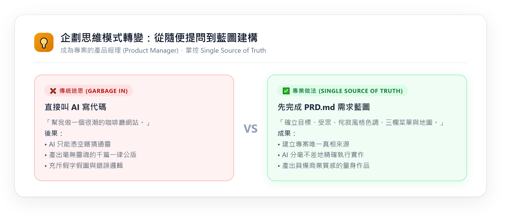
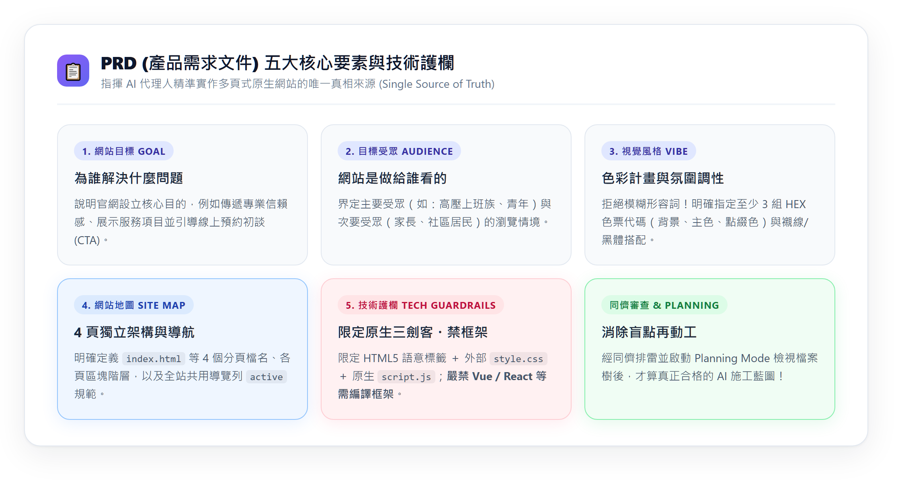
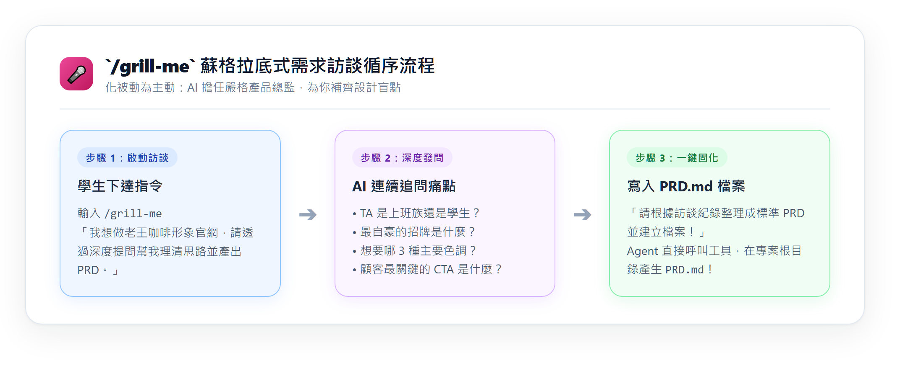

---
puppeteer:
  displayHeaderFooter: true
  scale: 1.15
  headerTemplate: '<div style="font-size: 11px; margin: 0 auto;">第十二週：實作專案四 — AI 協作：Phase 1 企劃 — 規劃多頁網站藍圖與撰寫 PRD</div>'
  footerTemplate: '<div style="font-size: 11px; margin: 0 auto;">第 <span class="pageNumber"></span> 頁 / 共 <span class="totalPages"></span> 頁</div>'
  margin:
    top: "1.5cm"
    bottom: "1.5cm"
    left: "1.5cm"
    right: "1.5cm"
---

<style>
  /* 全域字型、字級與行距 */
  body {
    font-size: 16pt !important;
    line-height: 1.7 !important;
    font-family: "Microsoft JhengHei", "PingFang TC", "Helvetica Neue", sans-serif;
    overflow-wrap: break-word !important;
    word-wrap: break-word !important;
  }

  /* 階層標題微調 */
  h1 { font-size: 30pt !important; margin-bottom: 0.5em !important; }
  h2 { font-size: 24pt !important; page-break-before: always; break-before: page; }
  h3 { font-size: 20pt !important; }
  h4 { font-size: 18pt !important; }

  /* 長段落、清單與引文避免溢出或跨頁截斷 */
  html body p,
  html body li,
  html body blockquote {
    overflow-wrap: break-word !important;
    word-wrap: break-word !important;
    max-width: 100% !important;
  }

  html body blockquote {
    overflow: visible !important;
    page-break-inside: auto !important;
    break-inside: auto !important;
    padding: 8px 15px !important;
  }

  /* 表格文字放大與排版優化（覆寫 MPE 預設 keep-all 與 overflow: auto，避免寬度溢出截斷） */
  html body table {
    display: table !important;
    width: 100% !important;
    max-width: 100% !important;
    table-layout: auto !important;
    overflow: visible !important;
    word-break: normal !important;
    overflow-wrap: break-word !important;
    box-sizing: border-box !important;
  }

  html body table,
  html body th,
  html body td {
    font-size: 15pt !important;
    line-height: 1.5 !important;
    white-space: normal !important;
    word-break: normal !important;
    overflow-wrap: break-word !important;
  }

  html body tr {
    page-break-inside: avoid;
    break-inside: avoid;
  }

  /* 程式碼區塊與行內代碼（覆寫 MPE 預設 pre 不跨頁與 overflow: auto，防止 PDF 截斷） */
  html body code {
    font-size: 13pt !important;
    font-family: Consolas, "Courier New", monospace !important;
    white-space: normal !important;
    word-wrap: break-word !important;
    overflow-wrap: break-word !important;
    word-break: break-word !important;
  }

  html body pre,
  html body pre[class*="language-"],
  html body .highlight pre,
  html body pre > code,
  html body code[class*="language-"] {
    font-size: 13pt !important;
    font-family: Consolas, "Courier New", monospace !important;
    white-space: pre-wrap !important;
    word-wrap: break-word !important;
    overflow-wrap: break-word !important;
    word-break: break-word !important;
  }

  html body pre,
  html body pre[class*="language-"],
  html body .highlight pre {
    overflow: visible !important;
    overflow-x: visible !important;
    page-break-inside: auto !important;
    break-inside: auto !important;
    max-width: 100% !important;
    box-sizing: border-box !important;
  }

  @media print {
    html body pre,
    html body pre[class*="language-"],
    html body .highlight pre,
    html body pre > code,
    html body code[class*="language-"] {
      white-space: pre-wrap !important;
      overflow-wrap: break-word !important;
      word-break: break-word !important;
      overflow: visible !important;
      page-break-inside: auto !important;
      break-inside: auto !important;
    }

    html body code {
      white-space: normal !important;
      overflow-wrap: break-word !important;
      word-break: break-word !important;
    }

    html body blockquote {
      overflow: visible !important;
      page-break-inside: auto !important;
      break-inside: auto !important;
    }

    html body table {
      display: table !important;
      overflow: visible !important;
      word-break: normal !important;
    }

    /* h2 已強制換頁，隱藏緊鄰 h2 前的分隔線，避免產生只有一條線的空白頁 */
    html body hr:has(+ h2) {
      display: none !important;
    }
  }
</style>

---

# 第十二週：實作專案四 — AI 協作：Phase 1 企劃 — 規劃多頁網站藍圖與撰寫 PRD (Phase 1: Multi-Page Planning & PRD)

**課程名稱**：網頁設計 (Webpage Design)  
**授課教師**：林頌堅 副教授 (Prof. Sung-Chien Lin)  
**授課單位**：世新大學 資訊傳播學系  
**聯絡方式**：scl@mail.shu.edu.tw  
**核心工具**：Google Antigravity 2.0 Desktop、GitHub Desktop、VS Code、Google Chrome / Edge  

---

## 本週學習目標 (Weekly Mission)

歡迎進入 Vibe Coding 的核心首部曲 —— **Phase 1：企劃 (Planning) **！

上週我們已經學會用 GitHub Desktop 建立專案資料夾，並在 Antigravity 2.0 Desktop 中掛載與推送上線。這週你的核心任務只有一個： **為你的多頁式網站打造一份清晰、嚴密、AI 看得懂的施工藍圖（PRD.md），並指揮 AI 生成架構規劃工件！**

完成本週學習後，你將能夠：
1. **掌握 PRD 的五大核心要素與技術護欄**：以專業產品經理視角，定義多頁網站的目標、受眾、氛圍調性、分頁架構，並劃定「僅限原生 HTML / CSS / JavaScript、禁用前端框架」的技術紅線。
2. **靈活運用 `/grill-me` 深入訪談**：讓 Antigravity 2.0 扮演嚴格的顧問，透過一問一答挖掘網站細節盲點與原生微互動巧思。
3. **整合多模態草圖輸入**：手繪多頁 Wireframe 草圖拍照拖入對話框，讓 AI 快速解析佈局。
4. **啟動 Planning Mode**：引導 AI 產出 `implementation_plan.md` 工件，精確拆解 4 個 HTML 分頁、外部共用 `style.css` 與 `script.js` 架構及圖片資產清單。
5. **在 GitHub Desktop 進行里程碑提交**：落實「企劃先行」的版本控管習慣。

---

## Ⅰ. 企劃核心觀念：為什麼做多頁網站必須先有 PRD？ (Single Source of Truth)

很多初學者一打開 AI 聊天室，就迫不及待輸入：「幫我做一個心理治療所網站，要有好幾個頁面！」  
結果 AI 產出來的成果往往是一場災難：
* 首頁用沉穩綠色，點進「專業團隊」卻變成粉紫色少女風。
* 導覽列的按鈕在 `index.html` 寫的是「服務項目」，到了 `team.html` 卻變成「諮商方案」，甚至連結還寫錯成不存在的檔案，點擊直接出現 404 找不到檔案！
* 內容充斥著「這裡放文字介紹」、「心理師一」、「心理師二」等敷衍的假字。



### 1. 什麼是 PRD？
**PRD (Product Requirement Document，產品需求文件)** 是整個專案的施工藍圖，也是你與 AI 代理人間的 **「唯一真相來源 (Single Source of Truth)」** 。

當你將網站的配色代碼（HEX）、字體、4 個分頁的檔名（`index.html`、`team.html`、`services.html`、`contact.html`）與各頁面區塊清清楚楚記錄在 `PRD.md` 中，AI 代理人每一次建立或修改檔案時，都會以這份文件為準繩，確保**全站風格一致、相對連結零失誤**！

### 2. 多頁式網站的核心架構標準（4 個核心頁面）
在本次實作專案中，我們要求規劃一個完整的 **4 頁式網站**（以「牧心心理治療所」為例）：
1. **首頁 (`index.html`) **：品牌門面！全寬溫暖主視覺 (Hero Banner)、核心理念與使命、精選服務/專業特色摘要、引導訪客展開諮商的行動按鈕 (Call to Action)。
2. **專業團隊 (`team.html`) **：品牌靈魂！主持心理師理念、團隊心理師資歷專長卡片、諮商倫理與隱私保護承諾。
3. **服務項目 (`services.html`) **：核心內容！分類諮商卡片（成人個別諮商、伴侶諮商、青少年情緒探索）、諮商流程與費用說明、常見問題 (FAQ)。
4. **聯絡方式 (`contact.html`) **：轉換最後一步！治療所交通指引、嵌入式 Google 互動地圖、線上初談預約表單、緊急危機求助專線說明。

> 💡 **老師的真心話**  
> 很多同學一開始會覺得「為什麼不直接叫 AI 寫代碼就好，還要花時間寫 PRD？」請記住：AI 就像一個剛進公司的初階實習生，能力很強但沒有常識。
>
> 如果你不給他一份清清楚楚的 PRD 當作「唯一真相來源 (Single Source of Truth)」，他就會在首頁用溫暖綠、團隊頁用科技風、服務頁胡亂捏造。企劃做得越嚴謹，後面的開發就越輕鬆！

---

## Ⅱ. 多頁網站 PRD 的五大核心要素 (5 Core Components)

一份合格的多頁網站 PRD 必須具備以下五大要素：



| 核心要素 | 說明與指引 | 實戰範例 (牧心心理治療所) |
| :--- | :--- | :--- |
| **1. 網站目標 (Goal)** | 這個網站要解決什麼問題？期待訪客採取什麼行動？ | 為都會文教區的「牧心心理治療所」建立溫暖且具高度專業信賴感的多頁形象官網，傳遞「傾聽心靈、陪伴成長」理念，讓訪客清楚了解心理師專長與諮商項目，安心線上預約初談。 |
| **2. 目標受眾 (Audience)** | 網站做給誰看？使用情境是什麼？ | 主要受眾為面對職場壓力、人際困擾或情緒低潮的成年上班族與青年；次要受眾為尋求伴侶協談、親職教養與青少年情緒支持的家庭成員。 |
| **3. 視覺風格 (Vibe & Style)** | 色彩計畫 (HEX 代碼)、字體設定、情緒氛圍關鍵字。 | 溫暖療癒風 (Calm & Healing)。柔和米杏白背景 (`#FAF8F5`)、沈穩鼠尾草綠主色 (`#2D5A4C`)、溫潤暖陶土橘點綴色 (`#D4A373`)；標題思源宋體、內文思源黑體。 |
| **4. 網站地圖 (Site Map)** | 明確列出 4 個分頁的檔名、區塊分工與跨頁導航規範。 | `index.html` (首頁/理念與服務摘要)、`team.html` (專業心理師群專長卡片)、`services.html` (三大諮商項目與費用FAQ)、`contact.html` (交通地圖與初談預約表單)。 |
| **5. 技術規格與護欄 (Tech Spec & Guardrails)** | 語意標籤、外部 CSS/JS 架構、RWD 要求，以及 **禁用前端框架的負向約束**。 | 採用 HTML5 語意標籤 ＋ 外部共用 `style.css`（`:root` 色票變數、Flexbox/Grid RWD）＋ 外部共用 `script.js`（原生 DOM 微互動）； **嚴禁引入 Vue、React、Vite 等前端框架**。 |
### 關鍵企劃心法：設定「技術紅線 (Negative Constraints)」與「微互動需求」

在撰寫第 5 項「技術規格」時，除了告訴 AI「要做什麼」，專業產品總監更懂得明確寫下 **Negative Constraints（負向約束／技術紅線）** —— 清楚規定 AI **「絕對不准用什麼」**：
* **為什麼必須明文禁止 Vue / React 等前端框架？**  
  當你在企劃中提到「分類篩選」、「手風琴展開」或「預約表單」時，若未加限制，AI 很容易自動引入 React、Vue 或 Vite 等進階框架，產出需要 Node.js 編譯的 `.jsx` / `.vue` 檔案與數萬個 `node_modules` 套件檔。這不僅會讓電腦教室環境跑不動、打開網頁變全白，更會讓你無法運用前半學期學過的知識進行審查。
* **回歸第 3～5 週課堂所學的黃金架構**：  
  在 PRD 中限定使用 **「4 個獨立 `.html` ＋ 單一外部共用 `style.css` ＋ 單一外部共用 `script.js`」**，不僅能完美兌現我們第 4 週學過的「結構與視覺分離（改一個 CSS 變數，全站 4 頁同步換色）」，也能將漢堡選單、FAQ 摺疊或分類篩選等微互動集中寫在幾十行乾淨的原生 JavaScript 中，讓你對每一行代碼都擁有 100% 的掌控力！

> 💡 **老師的真心話**  
> 在 PRD 的五大要素中，同學最常犯兩個錯誤：第一是在「視覺風格」偷懶，只寫「簡約大方」、「很溫暖」，卻沒給出明確的 HEX 色票（如鼠尾草綠 `#2D5A4C`、米杏白 `#FAF8F5`）與字體名稱（如 `Noto Serif TC`）。
>
> 第二則是在「技術規格」忘記寫下「禁止使用 Vue / React 框架」，結果後面生成出一堆看不懂的檔案！你給的規格邊界越具體，AI 產出的網站就越乾淨、越接近你心目中的理想質感！

---

## 企劃開工前哨站：專案工作區與會話情境決策 (Pre-flight Setup)

在我們召喚 Antigravity 進行 `/grill-me` 深度訪談前，請同學先停下腳步確認你的工作環境。  
很多同學常問：「**老師，我這週要開一個全新的專案與新對話嗎？還是可以直接沿用上週的專案資料夾與對話繼續聊就好？**」

在這裡，老師要以非常堅決但充滿叮嚀的語氣直接告訴大家：  
**請所有同學一律「建立全新專案、新儲存庫與新對話」重新開局；絕對、千萬不要偷懶沿用上週的專案與舊對話！**

### 唯一正確做法：為正式多頁主題建立新專案、新儲存庫與新對話

* **適用對象**：**所有準備展開本週正式多頁網站企劃的同學**。第 11 週的倉庫是用來練習工具與破冰測試的「草稿本」，從本週開始，我們要正式打造自己的多頁形象官網（例如「牧心心理治療所 `muhsin-clinic`」或「吉他社官網 `guitar-club`」），必須有一個乾乾淨淨的新家。
* **具體步驟**：
  1. 打開 **GitHub Desktop**，建立一個以正式主題英文名稱命名的**全新公開倉庫**（例如 `muhsin-clinic`），並點擊 **Publish repository**（務必確認**不勾選** `Keep this code private`）。
  2. 開啟 **Antigravity 2.0 Desktop**，點擊 **Create Project** 掛載這個全新的專案資料夾。
  3. 確認開啟一個**全新的對話視窗（＋ New Conversation）**，在乾淨無雜訊的畫布中準備輸入 `/grill-me`。
* **為什麼必須這樣做**：
  * **擁有專業的專屬網址**：新倉庫名稱就是未來作品集的正式線上網址（`https://帳號.github.io/muhsin-clinic/`）。
  * **資料夾純淨無干擾**：沒有上週的測試檔 `hello.html` 與練習代碼，Git 版本紀錄從零開始，架構一目了然。
  * **對話畫布純白專注**：全新的工作區搭配全新的會話，讓 AI 從第一句話就 100% 聚焦在你的多頁網站需求。

---

### 絕對禁止的錯誤做法：直接沿用上週專案資料夾與舊對話繼續聊下去

* **常見錯誤情境**：不另外建立新倉庫，直接打開第 11 週做過 `hello.html` 的舊專案資料夾，並在當時同一個聊天視窗底下接著輸入 `/grill-me` 展開企劃。
* **為什麼老師絕對禁止這種做法（兩大致命傷）**：
  1. **沿用「上週專案工作區」的問題 — 測試殘留、網址不專業、架構混雜**：
     * **舊檔 `hello.html` 干擾 AI 判斷**：上週資料夾裡已經存在單頁式破冰檔案 `hello.html`（包含發光按鈕與深色切換測試碼），AI 讀取整個目錄時，容易誤把這個練習檔當成既有網站骨架，甚至在後續開發時與新的 `index.html` 混淆、混入舊版樣式。
     * **倉庫名稱與 Git 紀錄混亂**：上週隨手取名的練習倉庫（如 `test-demo`、`my-vibe-project`）會直接變成未來不專業的線上網址；大量破冰練習的 Commit 紀錄與可能已開啟的 GitHub Pages 設定，也會讓正式專案的版本管理變得一團亂。
  2. **沿用「上週舊對話」的問題 — 雜訊汙染、注意力渙散**：
     * **上下文記憶過載 (Attention Dilution)**：上週的舊對話裡塞滿了幾百行關於 `hello.html`、粉紫按鈕特效以及初次 `git push` 排錯的過程。AI 的上下文記憶（Context Window）非常寶貴，被這些破冰雜訊塞滿後，理解與規劃能力會大幅下降。
     * **被單頁測試慣性牽著鼻子走**：AI 會順著同一條對話的前文脈絡思考，導致它在幫你企劃 4 頁網站藍圖時，不由自主地帶入上週的單頁寫法、配色或舊程式碼片段，把新規格書寫得四不像！
* **記住這條鐵律**：展開正式多頁網站企劃時，**「全新專案資料夾 ＋ 全新 AI 對話視窗」兩者缺一不可，必須是一張乾淨無瑕的白紙**！

> 💡 **老師的真心話**  
> 「工欲善其事，必先利其器。」在 AI 時代，頂尖開發者與新手的差距，往往不在於誰背得起更多語法，而在於誰懂得給 AI 最精準、乾淨的工作環境與上下文脈絡。
>
> 上週的專案與對話只是我們熱身用的「練習本」，今天請務必果斷另起爐灶、建立全新的專案與會話，千萬不要為了省兩分鐘而直接沿用上週的舊專案與舊對話。給 AI 一個純淨的資料夾與空白畫布，它才能心無旁騖地為你產出最高品質的 `PRD.md` 規格書！

---

## Ⅲ. 實戰任務一：召喚 `/grill-me` 進行多頁深度訪談 (Interactive Interview)

如果你對著空白編輯器不知道該從何下筆，請使用 Antigravity 內建的超強指令 —— `/grill-me`！它會化身為經驗豐富的資深產品顧問，對你展開連續提問，幫你把模糊的想法磨成鑽石般的具體規格。



### 操作步驟：

#### 步驟 1：在對話框輸入 `/grill-me` 專用提示詞
複製以下提示詞範本，將主題替換成你想做的網站（例如：獨立樂團、日系服飾、貓咪中途之家、個人攝影工作室）：

```text
/grill-me
我想要為「牧心心理治療所」建立一個包含 4 個頁面的形象官網：
1. 首頁 (index.html)
2. 專業團隊 (team.html)
3. 服務項目 (services.html)
4. 聯絡方式 (contact.html)

我目前只有初步想法，請扮演專業嚴格的網站產品經理，依序針對 PRD 的五大核心維度向我進行深度訪談：
1. 網站目標 (Project Goal)
2. 目標受眾 (Target Audience)
3. 視覺風格與色彩調性 (Vibe & Style，請建議 3 個核心 HEX 色票)
4. 網站地圖與各頁核心區塊 (Site Map & Sections)
5. 技術規格、原生微互動與架構護欄 (Technical Requirements & Guardrails)：
   - 本專案嚴格限定僅使用標準 HTML5、外部共用 style.css 與原生 JavaScript，禁止使用 Vue、React、Vite 等任何前端框架。
   - 請詢問我希望在網站中加入哪 1~2 項原生 JS 微互動（如 FAQ 摺疊、分類篩選或表單驗證回饋）。

請一次提問 2~3 個問題，等我回答後再繼續深入，直到我們把細節釐清完畢，最後整理成一份標準的 PRD.md！
```

#### 步驟 2：面對 AI 提問的回答技巧（拒絕說「隨便」！）
當 AI 向你發問時，請盡可能給予**具體的名詞、數字與場景**：
* ❌ 差勁的回答：「顏色你看著辦，服務項目隨便寫寫心理諮商就好。」
* ✅ 優質的回答：「色彩我希望走溫暖療癒風，米杏底色 `#FAF8F5` 搭配沈穩鼠尾草綠 `#2D5A4C`；服務項目請分成『成人個別諮商』、『伴侶與婚姻諮商』與『青少年情緒探索』三大類，清楚說明單次時間（50 分鐘）與預約流程，並務必在頁尾加上衛福部安心專線 1925 與心理師執業隱私保護聲明。」

#### 步驟 3：指示 AI 一鍵寫入本機 `PRD.md`
當問答告一段落、規格都確認清楚後，在對話框輸入明確包含五大章節骨架的建檔指令：

```text
太棒了！請依據我們剛才所有確認的細節，整理成一份標準的多頁網站 PRD 規格書，並直接在專案根目錄建立 PRD.md 檔案。

請務必嚴格包含以下五大核心章節：
1. 專案目標 (Project Goal)
2. 目標受眾 (Target Audience)
3. 視覺風格與調性 (Vibe & Style)：包含色彩計畫 HEX 代碼、字體搭配與氛圍關鍵字
4. 網站地圖與多頁規格 (Site Map & Pages)：清楚定義 index.html, team.html, services.html, contact.html 四個分頁的區塊階層與跨頁導航 active 規範
5. 技術規格與架構護欄 (Technical Requirements & Guardrails)：
   - 多頁相對路徑、HTML5 語意標籤
   - 外部共用 style.css（:root 色票變數與 Flexbox/Grid RWD）
   - 外部共用 script.js（原生 DOM 微互動）
   - 明文寫入「嚴禁使用 Vue、React、Next.js、Vite、Tailwind 或任何需 npm 編譯的前端框架」之負向約束
```
觀察 Antigravity 的動作 —— 它會自動使用檔案工具，在你的本地專案目錄建立 `PRD.md`。完全不用你手動複製貼上！

> 💡 **老師的真心話**  
> 很多同學會問：「老師，如果我只在 Prompt 寫『依照五大要素』，AI 會自動知道是哪五大要素嗎？」  
> **答案是：AI 絕對不會通靈！**
>
> 「PRD 五大要素」是我們這門課定義的教學標準。AI 在受訓時看過全世界成千上萬種軟體業的 PRD 模板，有的包含 KPI 指標、有的包含商業畫布或時程表。
>
> 如果你沒在 Prompt 裡清清楚楚把這五個章節名稱（目標、受眾、風格、網站地圖、技術規格）列給它，AI 就會自己「自由發揮」，產出類似但完全不同的章節，甚至漏掉最重要的「4 頁網站地圖」！請記住 Prompt Engineering 的黃金鐵律： **想要什麼精確結構，就在指令中明確指名章節標題！**

---

## Ⅳ. 實戰任務二：多模態草圖拖曳與參考網站解析 (Multimodal Analysis)

除了純文字對答，Antigravity 2.0 支援強大的多模態視覺輸入，能幫你加速企劃：

### 1. 手繪 Wireframe 草圖拍照拖入對話框
拿一張 A4 紙或筆記本，隨手畫出 4 個分頁的區塊方塊圖（標註各頁的 Navbar、Banner、心理師卡片、服務項目卡片、初談表單、Footer），用手機拍照後**直接拖曳到 Antigravity 聊天框**：

```text
這張照片是我手繪的多頁網站 Wireframe 草圖（附圖）。
請幫我分析圖中 4 個分頁（index, team, services, contact）的版面配置結構，將各分頁的區塊階層整合進我的 PRD.md 中，並更新該檔案！
```

### 2. 參考優秀網站網址解析
如果你在網路上看到很欣賞的版面排版或導航設計，直接把網址貼給 Antigravity：

```text
請讀取這個參考網站的架構：https://example-clinic.com
請分析它的多頁導覽列是如何分類的？專業團隊與服務介紹頁使用了哪些版面區塊？請為我的「牧心心理治療所」提出類似且兼具溫暖專業感的 PRD 區塊規格建議。
```

> 💡 **老師的真心話**  
> 手繪草圖不需要畫得多漂亮，哪怕只是用原子筆在筆記本上隨手畫幾個框框、寫上 Navbar、Hero、Card、Footer，AI 都能瞬間讀懂你的排版邏輯。善用多模態視覺輸入，是現代網頁設計師最省時的超能力！

---

## Ⅴ. 牧心心理治療所多頁網站標準 PRD 完整範本 (`PRD.md`)

這是一份達到 95 分標準的多頁網站 PRD。為方便對照檢查與閱讀，以下依五大章節拆分為三個部分呈現；請打開專案中的 `PRD.md`，逐節核對你的內容是否同樣具體詳盡：

### 範本 Part 1：專案目標、目標受眾與視覺風格（第 1～3 節）

```markdown
# 專案需求文件 (PRD)：牧心心理治療所 (Mu-Hsin Psychotherapy Clinic) 多頁形象官網

## 1. 專案目標 (Project Goal)
為座落在都會文教區的「牧心心理治療所」建立一個兼具專業信賴感與溫暖療癒美感的多頁形象官網。傳遞「在安全接納的空間裡，陪你梳理心靈、重新找回生活力量」的核心理念，提供透明完整的心理師團隊資歷、專長與諮商服務項目，引導有需求的訪客安心跨出第一步，線上預約初談評估。

## 2. 目標受眾 (Target Audience)
- 主要受眾：面對職場高壓、人際關係衝突、焦慮憂鬱或自我探索困境的成年上班族與青年（20~45 歲）。
- 次要受眾：尋找伴侶諮商、婚姻修復、親職教養與青少年情緒支持的家庭成員與家長。

## 3. 視覺風格與調性 (Vibe & Style)
- 整體調性：溫暖療癒 (Calm & Healing)、安全信賴 (Trustworthy)、柔和留白、自然靜謐。
- 色彩計畫 (Color Palette)：
  - 背景底色 (Background)：柔和米杏白 `#FAF8F5`
  - 核心主色 (Primary)：沈穩靜謐鼠尾草綠 `#2D5A4C`（象徵生命力與心靈平靜）
  - 點綴強調色 (Accent)：溫潤暖陶土橘 `#D4A373`（象徵包容、溫暖陪伴）
  - 內文主要文字 (Text)：柔和深炭灰 `#2D312E`（避免純黑帶來的冰冷生硬感）
  - 卡片與區塊底色 (Card BG)：純白 `#FFFFFF` 搭配極細暖灰邊框 `#EAE6DF`
- 字體搭配：標題使用優雅溫潤襯線體 (Noto Serif TC)，內文使用清晰好讀無襯線體 (Noto Sans TC)。
```

### 範本 Part 2：網站地圖與多頁規格（第 4 節）

```markdown
## 4. 網站地圖與多頁規格 (Site Map & Page Architecture)
全站共用規範：
- 統一頂部導覽列：包含品牌 Logo 與 4 個頁面的相對連結（首頁、專業團隊、服務項目、聯絡方式），當前頁面頁籤必須具備 active 高亮效果（下底線或品牌綠強調色）。
- 統一底部頁尾：緊急求助專線（衛福部安心專線 1925、生命線 1995）、診所立案字號、版權宣告、回到履歷網站連結。

各分頁具體規劃：
1. 首頁 (index.html)
   - 主視覺 Banner (Hero)：全寬柔和自然採光的諮商室氛圍照，置中標語「在紛擾的世界裡，給心靈一個安歇的角落」，附帶「探索專業團隊」與「預約初談」引導按鈕 (CTA)。
   - 品牌核心理念 (Core Values)：3 欄特點卡片（嚴格保密承諾、國家高考合格心理師、客製化深度同理）。
   - 精選服務推薦 (Featured Services)：展示 3 大核心諮商項目精華卡片（成人個別諮商、伴侶溝通協談、青少年情緒探索），附帶連結前往 services.html。
   - 預約流程快速指引 (How It Works)：4 步驟圖解流程（線上填表 ➔ 專人電話初談評估 ➔ 媒合合適心理師 ➔ 實體諮商開展）。

2. 專業團隊 (team.html)
   - 頂部副 Banner：主持心理師與團隊溫馨專業合照，副標題「國家高考合格心理師，以同理與專業陪伴你」。
   - 主持心理師專欄 (Director Spotlight)：所長個人深度介紹，包含個人肖像、心理所碩士與醫學中心資歷、專長領域與諮商哲學理念。
   - 諮商心理師群卡片 (Therapists Grid)：網格展示每位心理師卡片，包含清晰肖像照片、姓名、執業證號、專長標籤（情緒創傷、感情議題、職場人際、正念減壓）與預約按鈕。
   - 專業倫理與隱私承諾 (Ethical Standards)：強調恪守心理師法與諮商倫理規範，落實最高規格的個人隱私保護。

3. 服務項目 (services.html)
   - 諮商類別分類卡片：
     - 「成人個別諮商」：情緒調適、焦慮憂鬱、人生重大轉折、自我探索（50 分鐘/次）。
     - 「伴侶與婚姻諮商」：情感溝通、衝突化解、關係修復（80 分鐘/次）。
     - 「青少年與親職諮商」：學業壓力、同儕困擾、親子關係協調（50 分鐘/次）。
     - 「身心減壓與主題工作坊」：正念減壓、自我照護團體課程。
   - 諮商收費標準與說明：透明公開各項諮商費用區間，說明自費心理諮商之流程與效益。
   - 常見問題 FAQ 摺疊區塊 (Accordion)：初次諮商該準備什麼？諮商內容真的會保密嗎？諮商通常需要進行幾次？

4. 聯絡方式與初談預約 (contact.html)
   - 交通與環境資訊：治療所地址、鄰近捷運站步行指引、公車路線、接待與諮商時段、無障礙空間與隱私候診區說明。
   - 互動地圖 (Google Map)：嵌入世新大學周邊文教商圈的 Google 地圖 iframe。
   - 初談線上預約表單 (Appointment Form)：姓名、聯絡電話、Email、方便接聽電話時段、諮商需求類別下拉選單、主要困擾簡述（選填）、隱私條款同意勾選框與送出按鈕。
   - 緊急危機求助聲明 (Crisis Notice)：醒目提示「若您當前處於急性危機或強烈自我傷害意念，請立即撥打 110 或 1925 尋求即時緊急援助」。
```

### 範本 Part 3：技術規格與架構護欄（第 5 節）

```markdown
## 5. 技術規格與架構護欄 (Technical Requirements & Guardrails)
- 多頁式純靜態架構 (Multi-Page Website)：共 4 個獨立 HTML 檔案，頁面間一律透過乾淨相對路徑連結（如 href="team.html", href="services.html"，禁止開頭加上斜線 /）。
- 語意化結構：全面採用 HTML5 語意標籤（`<header>`, `<nav>`, `<main>`, `<section>`, `<article>`, `<footer>`），杜絕濫用無意義的 `<div>`。
- 外部共用樣式表 (`style.css`)：落實結構與視覺分離，於 `:root` 集中定義全站 HEX 色彩變數與 Google Fonts (`Noto Serif TC`, `Noto Sans TC`)；使用 Flexbox、CSS Grid 與 `@media (max-width: 768px)` 實作響應式排版 (RWD)，手機端卡片自動轉為單欄。
- 外部共用互動腳本 (`script.js`)：使用原生 JavaScript (Vanilla JS DOM API) 實作三項輕量微互動：
  1. 手機版（<768px）頂部導覽列漢堡選單按鈕開合切換。
  2. `services.html` 常見問題 (FAQ) 點擊標題展開／收合手風琴效果。
  3. `contact.html` 初談預約表單必填欄位檢查與送出後溫馨確認提示。
- 🚫 技術紅線（Negative Constraints）：嚴格禁止引入 Vue、React、Next.js、Angular、Vite、Tailwind CSS 或任何前端框架，亦禁止產生 `package.json` 或需要 Node.js / `npm` 編譯打包之工具鏈，確保全站可於標準瀏覽器與 GitHub Pages 直接運行。
```

> 💡 **老師的真心話**  
> 請把這份「牧心心理治療所」範本當作你的標竿。檢查一下你自己的 `PRD.md`，除了清楚規範 4 個分頁的檔名與頁籤 active 狀態外， **第 5 節是否也明確寫下了「外部 `style.css` + 原生 `script.js`」以及「嚴禁 Vue / React 前端框架」的技術紅線？**
>
> 如果發現有漏掉的區塊或護欄，隨時叫 Antigravity 幫你補上，把藍圖打磨到 95 分再動工！

---

## Ⅵ. 實戰任務三：同儕互評與啟動 Planning Mode 生成工件

PRD 完成後，先不要急著動工！我們需要透過同儕互評與 AI 規劃審查，確保這份藍圖無懈可擊。

### 1. 同儕互評 3 分鐘排雷
與鄰座同學交換閱讀彼此的 `PRD.md`，拿螢光筆或便利貼挑出以下 3 個最常見的陷阱：
* 陷阱一：形容詞太抽象（「很潮」、「很有科技感」➔ 請對方改為具體色票 HEX 與風格參考）。
* 陷阱二：分頁分工模糊（「首頁跟關於頁好像都在講同一件事？」➔ 首頁放精華摘要，關於頁才放長篇歷史）。
* 陷阱三：缺少具體服務內容或流程（「服務項目只寫『諮商A』」➔ 必須列出具體諮商領域、單次時間長度與費用說明）。

### 2. 啟動 Planning Mode 生成 `implementation_plan.md`
在 Antigravity 對話框中輸入以下提示詞，指揮 AI 進入規劃模式，產出技術架構工件：

```text
請詳細研讀 @PRD.md。
現在請進入 Planning Mode（規劃模式），嚴格禁止直接動工建立 HTML 代碼！
請為我規劃一份專業的 implementation_plan.md 工件，包含：
1. 專案多頁檔案目錄結構樹：僅限 index.html, team.html, services.html, contact.html, style.css, script.js, img/（確認絕無 package.json 或任何前端框架檔案）
2. 全站色彩計畫與 style.css 的 :root CSS 變數及 RWD 媒體查詢斷點規劃
3. 4 個分頁的區塊拆解（各頁 section 階層）、跨頁導航 (Navbar) 連結架構，以及 script.js 預計實作的原生 DOM 微互動清單
4. 網站所需生成的專屬圖片素材清單（包含每張圖的檔名、畫面描述、長寬比）
5. 若有任何規格未定義清楚的細節，請在計畫書中列出提問！
```

指令發出後，Antigravity 會在右側 **Artifacts 窗格** 渲染出結構井然有序的 `implementation_plan.md`。請逐項核對裡面的規劃是否符合你的預期！

> 💡 **老師的真心話**  
> 在 Planning Mode 中產生的 `implementation_plan.md` 是動工前的最後一道防線。不要看到 AI 產生計畫就急著按 Proceed！一定要花兩分鐘讀一下它規劃的檔案樹與圖片需求表，確認 AI 沒有把你的需求理解歪掉。

---

## Ⅶ. 實戰任務四：在 GitHub Desktop 進行本週里程碑提交

在完成企劃階段後，請養成工程師最重要的好習慣 —— **即時版本提交**！

### 操作步驟：
1. 切換到 **GitHub Desktop** 應用程式。
2. 在左側 **"Changes"** 窗格中，你會看到本週新增的檔案（例如 `PRD.md`）。
3. 在左下角的 **Summary** 欄位輸入：  
   `完成多頁網站 PRD.md 規劃與實作計畫審查`
4. 在 Description 欄位可補充說明：「定義 4 個分頁規格與溫暖療癒風格色票」。
5. 點擊 **`Commit to main`** 藍色按鈕！

此時你的專案企劃進度已經穩穩地存入 Git 歷史紀錄中，再也不怕檔案遺失。

> 💡 **老師的真心話**  
> 養成「階段性提交 (Commit)」的習慣，是專業工程師與業餘新手的最大差別。在企劃完成時進行一次 Commit，未來即使代碼寫壞了，隨時都能一鍵還原到今天這份乾淨的藍圖狀態。今天存好了檔，下週我們就能安心大膽地讓 AI 動工！

---

## Ⅷ. 本週自我檢核清單 (Self-Check Checklist)

下課前，請為自己的專案逐一打勾驗收：

* [ ] 我的專案根目錄下已存在完整的 `PRD.md` 檔案，且非空白內容。
* [ ] PRD 中明確定義了 **4 個分頁**（`index.html`、`team.html`、`services.html`、`contact.html`）的各自職責與內容。
* [ ] PRD 中記錄了至少 3 組具體的色彩 HEX 色票代碼，而非模糊的形容詞。
* [ ] PRD 第 5 節已明確寫入 **「僅限標準 HTML5 + 外部 `style.css` + 原生 `script.js`，嚴禁使用 Vue / React 等前端框架」** 之技術護欄，並規劃了 1～2 項原生 JS 微互動。
* [ ] 我已在 Antigravity 中啟動 Planning Mode，並在右側 Artifacts 窗格看到了乾淨無框架的 `implementation_plan.md` 工件。
* [ ] 我已在 GitHub Desktop 完成本週的 Commit，Changes 清單已清空。

> 💡 **老師的真心話**  
> 檢核清單上的每一個勾勾，都是下週 AI 能否精準寫出代碼的保證。特別是 4 個分頁的檔名是否明確（例如 `index.html`, `team.html`, `services.html`, `contact.html`），千萬不要寫成單頁式滾動網站，下週動工時才不會手忙腳亂！

---

## Ⅸ. 踩坑急救包 (Troubleshooting)

* **Q1：AI 寫出來的 PRD 只有單頁，完全忘記我要做 4 個分頁怎麼辦？**  
  👉 **解答**：請直接對它說：「請注意！本專案為『4 個獨立 HTML 頁面的多頁式網站』，不是單頁滾動網站！請重新修改 PRD.md 的第 4 節，明確列出 index.html、team.html、services.html、contact.html 各自獨立的內容規格。」
* **Q2：點擊 Antigravity 產出的檔案，它說存檔失敗？**  
  👉 **解答**：請確認你是否在 Antigravity 中正確掛載專案資料夾（Create Project），而不是只開了單一檔案。只要掛載的是根目錄，AI 就能自由讀寫本地檔案。
* **Q3：AI 在 Planning Mode 一直想要偷跑動手寫 HTML 怎麼辦？**  
  👉 **解答**：在提示詞開頭嚴正強調：「現在是規劃階段，請停留在 Planning 模式，不要建立 HTML，請專注完善 implementation_plan.md 工件！」
* **Q4：打開 `implementation_plan.md` 時，發現檔案樹裡出現了 `package.json`、`src/App.jsx` 或 Vue / React / Vite 等字眼怎麼辦？**  
  👉 **解答**：千萬不能按 Proceed！這代表 AI 準備過度工程化。請立刻在對話框輸入：  
  「請停下修正計畫！本專案嚴格禁止使用 React、Vue、Vite 或任何需 npm 編譯的前端框架！請重新更新 `PRD.md` 與 `implementation_plan.md`，改為純靜態的 4 個獨立 `.html` 檔案 ＋ 外部共用 `style.css` ＋ 原生 `script.js` 架構！」

---

> 💡 **老師的真心話**  
> 永遠記住： **「磨刀不誤砍柴工」**。這週你花在 PRD 上的每 10 分鐘，將在下週為你省下 2 個小時除錯與重寫代碼的痛苦時間！當你把 PRD 磨到 90 分時，下週 AI 幫你寫出來的代碼就已經成功了 80%！我們下週進入 Phase 2 正式動工！
