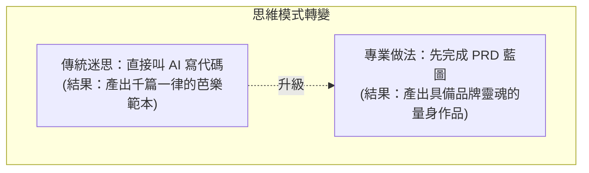
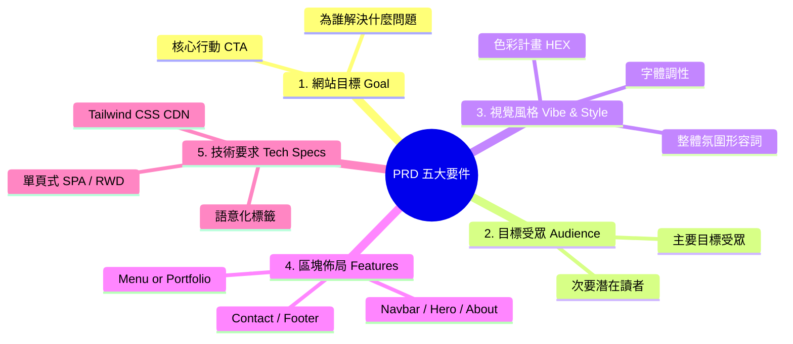
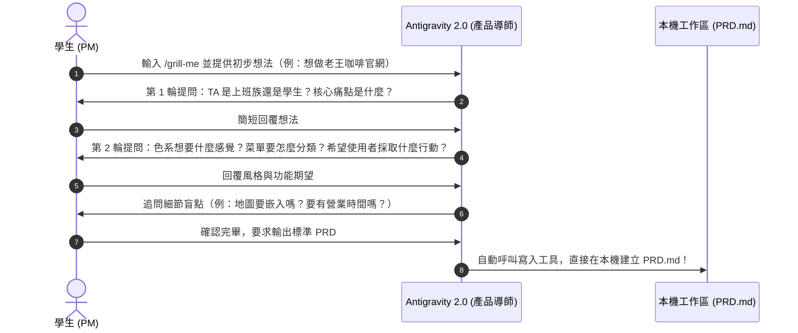

---
puppeteer:
  displayHeaderFooter: true
  scale: 1.15
  headerTemplate: '<div style="font-size: 11px; margin: 0 auto;">第十二週：實作專案四 — AI 協作：Phase 1 企劃 — 撰寫 PRD 與架構工件</div>'
  footerTemplate: '<div style="font-size: 11px; margin: 0 auto;">第 <span class="pageNumber"></span> 頁 / 共 <span class="totalPages"></span> 頁</div>'
  margin:
    top: "1.5cm"
    bottom: "1.5cm"
    left: "1.5cm"
    right: "1.5cm"
---

<style>
  /* 全域字型、字級與行距 */
  body {
    font-size: 16pt !important;
    line-height: 1.7 !important;
    font-family: "Microsoft JhengHei", "PingFang TC", "Helvetica Neue", sans-serif;
  }

  /* 階層標題微調 */
  h1 { font-size: 30pt !important; margin-bottom: 0.5em !important; }
  h2 { font-size: 24pt !important; page-break-before: always; }
  h3 { font-size: 20pt !important; }
  h4 { font-size: 18pt !important; }

  /* 表格文字放大與排版優化 */
  table, th, td {
    font-size: 15pt !important;
    line-height: 1.5 !important;
  }

  /* 程式碼區塊 (自動換行防止 PDF 截斷) */
  pre, code {
    font-size: 13pt !important;
    font-family: Consolas, "Courier New", monospace !important;
    white-space: pre-wrap !important;
    word-break: break-all !important;
  }

  /* Mermaid 流程圖節點字體放大 */
  .mermaid text {
    font-size: 14px !important;
  }
</style>

---

# 第十二週：實作專案四 — AI 協作：Phase 1 企劃 — 撰寫 PRD 與架構工件 (Phase 1: Planning & PRD)

**課程名稱**：網頁設計 (Webpage Design)  
**授課教師**：林頌堅 副教授 (Prof. Sung-Chien Lin)  
**授課單位**：世新大學 資訊傳播學系  
**聯絡方式**：scl@mail.shu.edu.tw  
**核心工具**：Google Antigravity 2.0 Desktop、GitHub Desktop、VS Code  
**課堂時間**：共 80 分鐘（雙節課：40 min + 40 min）  

---

## Ⅰ. 企劃核心理念：為什麼你需要一份 PRD？ (Single Source of Truth)

各位同學好！上週我們已經成功建立了專屬的 Git 專案倉庫，並體驗了 Antigravity 2.0 在本機「直接讀寫檔案」的威力。

本週，我們將正式進入 Vibe Coding 的核心第一階段 —— **Phase 1：企劃 (Planning)**。



### 1. 什麼是 PRD？
**PRD (Product Requirement Document，產品需求文件)** 是一份專案的施工藍圖，也是這個專案的**「唯一真相來源 (Single Source of Truth)」**。在 Agentic Vibe Coding 的世界裡，PRD 就是你與 AI 代理人溝通時最重要、最權威的依據。

### 2. 老師的真心話：Garbage In, Garbage Out！
俗話說：「垃圾進，垃圾出」。你給 AI 的 PRD 越隨便、越模糊，AI 產出的網站就越慘不忍睹。
- 如果你寫：「幫我做一個很潮的吉他社首頁。」➔ AI 只能自己通靈，產出無聊的灰色方塊。
- 如果你寫：「採用暗黑模式（Dark Mode），深灰黑底色搭配螢光霓虹黃按鈕，Hero 區塊放吉他特寫與招生倒數，菜單採三欄卡片排版...」➔ AI 就能分毫不差地精準實作！

**這個企劃階段，佔據整個專案 60% 的成功要素，請務必花時間想清楚！**

---

## Ⅱ. 撰寫優良 PRD 的五大核心要件 (5 Core Components)

一份合格的網頁 PRD 必須包含以下五個部分：



1. **網站目標 (Goal)**：「我希望這個網站能...」
   * *範例 (老王咖啡)*：「為巷口的『老王手沖咖啡』做一個日系形象官網，讓新客人能線上瀏覽單品豆單、了解主理人堅持自烘豆的職人理念，並能一鍵取得交通路線與營業時間。」
2. **目標受眾 (Target Audience)**：「這個網站主要是做給...看的。」
   * *範例*：「主要受眾是喜愛安靜氛圍、追求單品咖啡風味的大學生與遠端自由工作者；次要受眾是週末尋找手作甜點與舒適閱讀空間的鄰近社區居民。」
3. **網站風格 (Vibe & Style)**：「這是 'Vibe' Coding 的靈魂！」
   * *範例*：「日系侘寂風 (Wabi-Sabi)、溫暖、純粹。背景底色為燕麥白 (`#FDFBF7`)，主色為深烘焙咖啡色 (`#3E2723`)，搭配灰綠色 (`#556B2F`) 作為點綴。標題使用優雅襯線字體。」
4. **主要功能/區塊 (Features & Sections)**：（由上而下的單頁式佈局）
   * 導覽列 (Navbar)：固定於頂端半透明毛玻璃效果，含 Logo 與錨點連結。
   * 主視覺 (Hero)：全寬高清手沖咖啡主視覺圖與大標題。
   * 關於我們 (About Us)：左右雙欄佈局，老王烘豆照片與品牌故事。
   * 風味菜單 (Menu)：分為手沖、義式、甜點三欄卡片，標註產區風味筆記與價格。
   * 店家資訊與地圖 (Contact & Map)：地址、營業時間、低消與 Google Map 嵌入。
   * 頁尾 (Footer)：社群連結與版權宣告。
5. **技術要求 (Technical Requirements)**：
   * 單頁式網頁 (Single-Page Website)，平滑滾動 (Smooth Scroll)。
   * 採用 Tailwind CSS CDN 進行佈局，確保手機端完美適配 (Mobile-First RWD)。
   * 採用 HTML5 語意化標籤 (`<header>`, `<nav>`, `<main>`, `<section>`, `<footer>`)。

---

## Ⅲ. 規劃前神隊友：如何運用 `/grill-me` 進行需求訪談？

初學者最常遭遇的困境是：**對著空白畫面發呆，不知道怎麼寫出上述細節。**  
這時，請召喚 Antigravity 的高階指令 —— `/grill-me`！

### 1. `/grill-me` 訪談 3 步驟實戰



* **步驟一：下達訪談指令**
  在 Antigravity 對話框輸入：
  ```text
  /grill-me
  我想為我家附近的「老王咖啡」做一個形象官網，但我目前只有一些模糊的想法。
  請針對「目標受眾、視覺調性、主要功能區塊、特色賣點」向我進行一連串提問，幫我釐清需求盲點，最後整理成一份標準的 PRD！
  ```
* **步驟二：回答 AI 的產品問題**  
  AI 會連續發問，例如：
  1. 「老王咖啡主要的顧客群是誰？是來辦公用筆電的上班族，還是週末聚會的學生？」
  2. 「這家店最自豪的特色是什麼？是自家烘焙單品豆，還是手作法式甜點？」
  3. 「你希望網站給人的第一印象是什麼顏色調性？如果用三種顏色呈現，你會選什麼？」
  4. 「客人造訪網站後，最重要希望他們做出的動作是什麼？（查看今日豆單？還是看地圖來店？）」
* **步驟三：一鍵寫入本機 `PRD.md`**  
  回答完畢後，輸入：
  ```text
  太棒了！請根據我們剛才所有的訪談紀錄與確認的細節，彙整成一份具備五大核心要素的標準 PRD，並直接在專案根目錄建立 PRD.md 檔案！
  ```

---

## Ⅳ. 多模態草圖拖曳與參考網址解析 (Sketch & Web Analysis)

除了純文字對答，Antigravity 2.0 還支援多模態輸入：

### 1. 手繪 Wireframe 草圖拍照拖曳
拿一張白紙或平板，隨手畫出網站由上到下的方塊草圖（標註 Navbar, Hero, About, Menu, Map），用手機拍照後**直接拖曳到 Antigravity 對話框**：
```text
這張照片是我手繪的版面草圖（附圖），右邊這張是我喜歡的色調截圖（附圖）。
請幫我分析圖中的區塊排版結構與配色方案，轉換為 PRD 中的「主要功能區塊」與「視覺風格」，直接寫入 PRD.md！
```

### 2. 參考優秀網站網址
如果你喜歡某個現成網站的佈局，直接丟網址給它：
```text
請讀取這個參考網站的架構：https://example-cafe.com
請分析它的首頁包含了哪些關鍵區塊，並為我的「老王咖啡」提出類似但更簡約的 PRD 區塊規劃建議。
```

---

## Ⅴ. 老王咖啡標準 PRD 完整範本 (`PRD.md`)

```markdown
# 專案需求文件 (PRD)：老王手沖咖啡 (Lao-Wang Cafe) 形象官網

## 1. 專案目標 (Goal)
為座落在文教區巷弄的「老王手沖咖啡」建立一個具備日系極簡美感的形象官網。讓新客人能了解主理人堅持自烘豆的職人理念、線上瀏覽精選咖啡與手作甜點菜單，並能一鍵取得交通資訊與營業時間。

## 2. 目標受眾 (Target Audience)
- 主要受眾：喜愛安靜氛圍、追求單品咖啡風味的大學生與遠端自由工作者。
- 次要受眾：週末尋找特色甜點與舒適閱讀空間的鄰近社區居民。

## 3. 視覺風格與氛圍 (Vibe & Style)
- 整體調性：日系侘寂風 (Wabi-Sabi)、溫暖、純粹、低調優雅。
- 色彩計畫：
  - 背景底色：米杏色 / 燕麥白 (`#FDFBF7`)
  - 核心主色：深烘焙咖啡色 (`#3E2723`)
  - 點綴強調節：沉靜灰綠色 (`#556B2F`)
  - 內文字色：炭焙深灰 (`#2B2B2B`)
- 字體：標題使用襯線字體 (Noto Serif TC)，內文使用清晰無襯線字 (Noto Sans TC)。

## 4. 頁面架構與區塊 (Sections & Layout)
1. 導覽列 (Navbar)：固定於頂端半透明模糊毛玻璃效果，左側為「老王咖啡」文字 Logo，右側為錨點連結（關於我們、風味菜單、職人空間、店家位置）。
2. 主視覺 (Hero)：全寬高清手沖咖啡主視覺圖，置中主標語「一杯好咖啡，喚醒你一整天的好日子」，下方附帶「探索本季單品」幽靈按鈕 (Ghost Button)。
3. 關於我們 (About Us)：左右雙欄佈局，左側放置主理人老王烘豆照片，右側講述 15 年堅持自家烘焙、產地直送生豆的品牌故事。
4. 風味菜單 (Menu)：分為「手沖單品」、「義式特調」、「手作甜點」三大分頁或三欄卡片，每道品項清楚標註產區風味筆記（如柑橘、花香）與定價。
5. 店家資訊與地圖 (Contact & Map)：左側列出地址、平日假日營業時間、低消與 Wi-Fi 說明；右側嵌入 Google Map 互動地圖。
6. 頁尾 (Footer)：版權聲明、Instagram 與 Facebook 社群連結。

## 5. 技術規格 (Technical Requirements)
- 單頁式架構 (Single Page Website with Smooth Scroll 滾動平滑導航)。
- 使用 HTML5 語意化標籤 (`<header>`, `<nav>`, `<main>`, `<section>`, `<footer>`)。
- 引入 Tailwind CSS CDN 進行響應式佈局，並搭配外部 `mystyles.css` 補足字型與陰影微調。
- 完全適配手機 (Mobile-First RWD)、平板與桌機。
```

---

## Ⅵ. 第十二週課堂 80 分鐘實作與同儕互評節奏 (Classroom Lab)

### 課堂時間分配表 (40 min × 2)
* **第 1 節 (40 分鐘)：需求探索與 PRD 撰寫**
  1. 講解 PRD 五大核心要件與「老王咖啡」示範 (10 min)。
  2. 學生自選主題，在 Antigravity 執行 `/grill-me` 或拖曳手繪草圖展開訪談 (20 min)。
  3. 指揮 AI 將訪談成果寫入本機，建立 `PRD.md` (10 min)。
* **第 2 節 (40 分鐘)：同儕互評工作坊與生成架構工件**
  1. **同儕互評環節** (15 min)：
     左右同桌同學交換電腦，閱讀對方的 `PRD.md`，挑出 3 個「過於抽象的字眼」：
     * 「你寫『風格很潮』，到底是美式街頭還是霓虹暗色系？」
     * 「你的菜單沒標價格，AI 產出時會胡亂猜測。」
  2. **局部修訂 PRD** (10 min)：
     學生根據同儕意見，請 Antigravity 針對特定區塊修訂 `PRD.md`。
  3. **啟動 Planning Mode 生成工件** (15 min)：
     輸入以下提示詞，要求產出 `implementation_plan.md`：
     ```text
     請仔細閱讀 @PRD.md。
     請先進入 Planning Mode（規劃模式），不要直接動工寫代碼！
     請為我生成一份詳細的 implementation_plan.md 工件，包含：
     1. 視覺色彩計畫 (主色、輔助色、背景色 HEX 代碼)
     2. 頁面區塊元件拆解與 Mermaid 結構圖
     3. 所需生成的視覺圖片素材清單
     4. 若有任何不明確的需求細節，請在計畫中向我提問。
     ```

---

## Ⅶ. 本週里程碑檢核點 (Week 12 Deliverables)

在下課前，請確認你的專案資料夾中已具備：
1. **`PRD.md`**：內容完整包含五大核心要素，並已經過同儕互評修訂。
2. **`implementation_plan.md`**：在 Antigravity 右側 Artifacts 窗格中成功渲染出架構計畫書。
3. **在 GitHub Desktop 進行本週 Commit**：
   Summary 填寫「完成 PRD.md 與實作計畫書審查」，點擊 Commit to main！

> 💡 **老師的真心話**  
> 一份改過兩次的 PRD，勝過十個毫無規劃的 Prompt！當你把 PRD 磨到 90 分時，下週 AI 幫你寫出來的代碼就已經成功了 80%！我們下週進入 Phase 2 正式動工！
