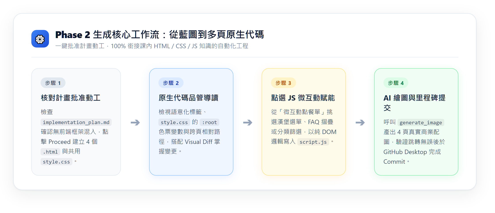
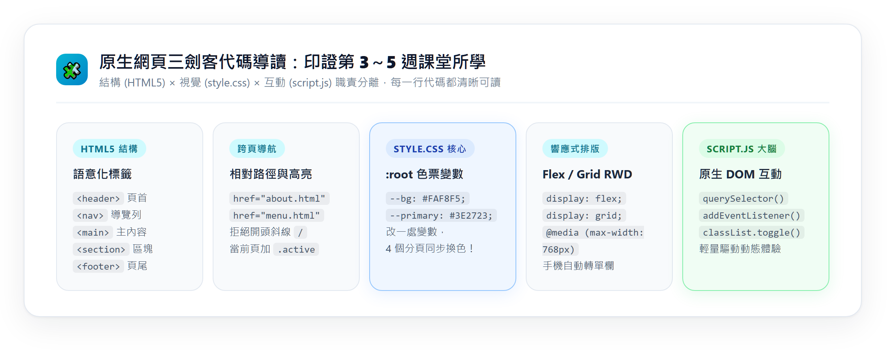
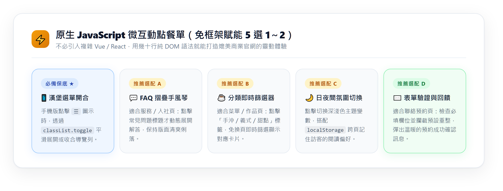
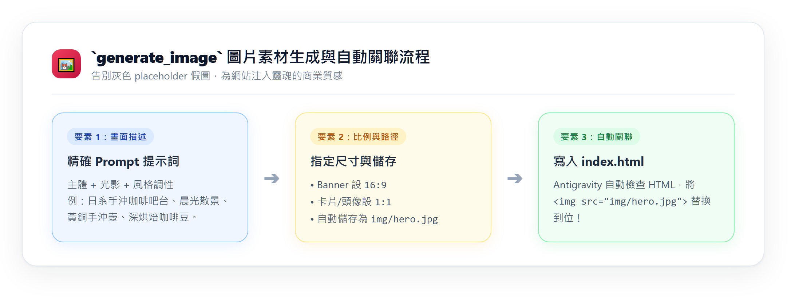

---
puppeteer:
  displayHeaderFooter: true
  scale: 1.15
  headerTemplate: '<div style="font-size: 11px; margin: 0 auto;">第十三週：實作專案四 — AI 協作：Phase 2 生成 — 代理人動工生成多頁網站與真實素材</div>'
  footerTemplate: '<div style="font-size: 11px; margin: 0 auto;">第 <span class="pageNumber"></span> 頁 / 共 <span class="totalPages"></span> 頁</div>'
  margin:
    top: "1.5cm"
    bottom: "1.5cm"
    left: "1.5cm"
    right: "1.5cm"
---

<style>
  /* 全域字型、字級與行距 */
  body {
    font-size: 16pt !important;
    line-height: 1.7 !important;
    font-family: "Microsoft JhengHei", "PingFang TC", "Helvetica Neue", sans-serif;
  }

  /* 階層標題微調 */
  h1 { font-size: 30pt !important; margin-bottom: 0.5em !important; }
  h2 { font-size: 24pt !important; page-break-before: always; }
  h3 { font-size: 20pt !important; }
  h4 { font-size: 18pt !important; }

  /* 表格文字放大與排版優化 */
  table, th, td {
    font-size: 15pt !important;
    line-height: 1.5 !important;
  }

  /* 程式碼區塊 (自動換行防止 PDF 截斷) */
  pre, code {
    font-size: 13pt !important;
    font-family: Consolas, "Courier New", monospace !important;
    white-space: pre-wrap !important;
    word-break: break-all !important;
  }
</style>

---

# 第十三週：實作專案四 — AI 協作：Phase 2 生成 — 代理人動工生成多頁網站與真實素材 (Phase 2: Multi-Page Agentic Generation & Assets)

**課程名稱**：網頁設計 (Webpage Design)  
**授課教師**：林頌堅 副教授 (Prof. Sung-Chien Lin)  
**授課單位**：世新大學 資訊傳播學系  
**聯絡方式**：scl@mail.shu.edu.tw  
**核心工具**：Google Antigravity 2.0 Desktop、GitHub Desktop、VS Code、Google Chrome / Edge  

---

## 本週學習目標 (Weekly Mission)

歡迎來到最令人興奮的實作週 —— **Phase 2：生成 (Generation) **！

上週大家已經完成並審查了包含「技術選型護欄」的 `PRD.md` 與 `implementation_plan.md`。這週，你將體驗身為「AI 產品總監」最爽快的時刻： **批准實作計畫，看著 AI 代理人在幾秒鐘內為你自動建好 4 個純淨的 HTML5 分頁、外部共用 `style.css` 樣式表與原生 `script.js` 微互動，並利用 AI 繪圖工具生成高解析度真實商業素材！**

完成本週學習後，你將能夠：
1. **一鍵批准動工**：在 Artifacts 視窗審查計畫書並點擊「Proceed」，指揮 AI 代理人批次生成零框架負擔的多頁原生網站架構。
2. **多頁面原生代碼解讀與品管**：印證第 3～5 週所學，檢查 4 個 HTML 頁面（`index.html`、`about.html`、`menu.html`、`contact.html`）的語意標籤、跨頁相對連結與外部 `style.css` 的 `:root` 色票變數。
3. **熟練閱讀 Visual Diff**：在 AI 新增或修改檔案時，快速識讀代碼變更（加號與減號），掌握版本主導權。
4. **點選「原生 JS 微互動點餐單」賦能**：不必引入複雜的前端框架，用幾十行純 DOM JavaScript 為網站注入漢堡選單、分類篩選或手風琴摺疊等靈動體驗。
5. **召喚 `generate_image` 繪製真實素材**：為 4 個分頁量身打造專屬高畫質圖片，徹底擺脫灰色假圖佔位符 (`via.placeholder.com`)，並在 GitHub Desktop 完成里程碑提交。

---

## Ⅰ. 生成核心觀念：從施工藍圖到實體多頁原生網站 (From Blueprint to Native Multi-Page Code)

過去在網頁版 ChatGPT 或 Gemini 寫多頁網站時，你必須經歷「地獄般的複製貼上手動工」：
* 請 AI 寫首頁 ➔ 手動開 VS Code 存成 `index.html`。
* 請 AI 寫菜單頁 ➔ 再開一個新檔存成 `menu.html`。
* 發現兩邊的導覽列樣式不一樣，又手動改了半天，結果不小心改壞了閉合標籤 `</div>`。



在 **Antigravity 2.0 Desktop** 中，搭配我們上週設定的「原生三劍客護欄」，這一切將變得既自動化又完全透明可控：
* **全域目錄感知與職責分離**：AI 清楚知道專案資料夾裡的所有檔案，它會同時建立 4 個 `.html` 分頁，並統一引用同一份外部 `style.css` 與 `script.js`，完美實踐第 4 週學過的「結構、視覺與互動分離」。
* **零編譯、即開即看**：因為我們嚴格禁止了 Vue、React 等需打包的前端框架，產出的每一個 `.html` 檔案都能直接在瀏覽器打開，每一行標籤與 CSS 屬性都是你熟悉的課內語法！
* **素材直接入庫**：呼叫 `generate_image` 繪製好的圖片直接存入 `img/` 資料夾，並自動寫入各頁面的 `` 屬性中！

> 💡 **老師的真心話**  
> 看到 AI 代理人一口氣為你建立好 4 個 HTML 檔案、`style.css` 與 `script.js`，是不是覺得非常神奇？但請注意：動工前一定要先確認你的 `PRD.md` 和 `implementation_plan.md` 已經存檔且沒有混入 `package.json` 等框架檔案。企劃藍圖越純粹，生成的原生網站就越乾淨好維護！

---

## Ⅱ. 實戰任務一：批准計畫動工 — 建立 4 大分頁與原生樣式架構 (Scaffolding Multi-Page Site)

### 操作步驟：

#### 步驟 1：檢閱 `implementation_plan.md` 並點擊「Proceed」
在 Antigravity 2.0 右側的 **Artifacts 窗格** 中，打開上週生成的 `implementation_plan.md`。確認目錄結構僅包含純 HTML、CSS 與 JS 後：
* **方式 A**：直接點擊計畫書下方的 **「Proceed」** 綠色按鈕。
* **方式 B**：在聊天框輸入以下動工指令：

```text
我已仔細核對 @implementation_plan.md。
計畫完全批准！請嚴格依照計畫書與 @PRD.md 的技術護欄正式動工（嚴禁使用 Vue、React、Tailwind 等任何前端框架）：
1. 一次性建立 4 個語意化 HTML5 頁面：index.html, about.html, menu.html, contact.html
2. 建立全站共用的外部樣式表 style.css：於 :root 定義品牌色票變數、引入 Google Fonts，並運用 Flexbox、CSS Grid 與 @media 媒體查詢實作手機優先響應式排版 (RWD)
3. 建立全站共用的外部腳本 script.js：先以原生 JavaScript 實作手機版頂部導覽列的漢堡選單開合功能
4. 確保 4 個頁面的頂部導覽列結構一致，相對連結 (href="about.html" 等) 正確無誤，且當前所在頁籤具備 .active 高亮樣式
5. 圖片部分先暫時使用統一的 placeholder，我們隨後會生成真實圖片替換！
```

#### 步驟 2：觀察 Antigravity 的自主建檔
此時 AI 會依序呼叫檔案工具，在你的本機專案目錄中自動長出乾淨俐落的原生網頁架構（以「老王手沖咖啡」為例）：

```text
laowang-cafe/
├── PRD.md                  (施工藍圖與技術護欄)
├── index.html              (1. 品牌首頁：全寬 Banner、特色亮點、精選推薦)
├── about.html              (2. 關於我們：烘豆職人理念、品牌故事、空間寫真)
├── menu.html               (3. 風味菜單：手沖/義式/甜點卡片、產區風味筆記與定價)
├── contact.html            (4. 門市資訊：營業時間、交通指引、Google地圖、預約表單)
├── style.css               (全站共用外部樣式表：:root 色票變數、字型與 RWD 排版)
├── script.js               (全站共用原生 JS 腳本：漢堡選單與動態微互動)
└── img/                    (專屬圖片素材庫)
```

#### 步驟 3：切換到 GitHub Desktop 驗證
打開 GitHub Desktop，左側 **"Changes"** 列表會瞬間冒出這幾個檔案，全部閃耀著綠色 `+` 號，且完全沒有多餘的框架雜訊檔案，代表乾淨的專案骨架已實體落地在你的硬碟中！

> 💡 **老師的真心話**  
> 批准動工後，千萬不要只在 Antigravity 裡看對話！一定要切換到 GitHub Desktop 觀察 Changes 列表。看到 4 個 `.html`、`style.css` 與 `script.js` 全亮起綠色加號，親眼確認這套與我們前半學期課本一模一樣的標準結構落地在硬碟中，這才是身為工程師該有的嚴謹態度。

---

## Ⅲ. 實戰任務二：多頁原生代碼導讀 — 印證前半學期所學！ (Native Code Anatomy)

因為我們在 PRD 中設定了精準的技術護欄，現在請用 VS Code 或在 Antigravity 中點開 `index.html`、`menu.html` 與 `style.css` —— 你會驚喜地發現，裡面的每一行代碼都與第 3～5 週課堂所學完全呼應！



### 1. 乾淨易讀的跨頁相對路徑導覽列 (`<nav>`)
檢查 4 個 HTML 檔案頂部的 `<nav>`，所有連結皆使用語意清晰的類別名稱與相對路徑：

```html
<!-- 共用導覽列結構範例 (menu.html) -->
<header class="site-header">
  <nav class="navbar container">
    <a href="index.html" class="brand-logo">老王手沖咖啡</a>
    <button class="menu-toggle" id="menuToggle" aria-label="開啟選單">☰</button>
    <ul class="nav-links" id="navLinks">
      <li><a href="index.html" class="nav-link">首頁</a></li>
      <li><a href="about.html" class="nav-link">關於我們</a></li>
      <li><a href="menu.html" class="nav-link active">風味菜單</a></li> <!-- 當前頁面高亮 -->
      <li><a href="contact.html" class="nav-link">門市資訊</a></li>
    </ul>
  </nav>
</header>
```

### 2. 外部樣式表 `style.css` 的 `:root` 色票變數與 RWD 斷點
打開 `style.css` 最上方，觀察 AI 如何運用 **CSS Custom Properties（CSS 自訂變數）** 集中管理你的品牌色票，並搭配 `@media` 實作手機版單欄切換：

```css
/* 全站統一色票變數：只要改這裡一個色碼，4 個分頁瞬間同步換色！ */
:root {
  --bg-cream: #FAF8F5;       /* 柔和米杏底色 */
  --brand-primary: #3E2723;  /* 深焙咖啡主色 */
  --brand-accent: #556B2F;   /* 橄欖綠強調色 */
  --text-main: #2D312E;      /* 內文深炭灰 */
}

/* 桌機版預設三欄卡片網格 */
.card-grid {
  display: grid;
  grid-template-columns: repeat(3, 1fr);
  gap: 24px;
}

/* 手機版 (< 768px) 自動轉為垂直單欄，防止畫面擠壓破版 */
@media (max-width: 768px) {
  .card-grid {
    grid-template-columns: 1fr;
  }
}
```

### 3. HTML5 語意化標籤檢核（杜絕全是 `<div>` 的不良代碼）
* **`<header>`**：是否包裹在各頁面頂部的導覽列或橫幅區塊？
* **`<main>`**：是否將各頁面的核心主體內容完整包覆？
* **`<section>`**：每個獨立的內容單元（如菜單分類、主理人故事）是否使用獨立的 `<section>`？
* **`<article>`**：菜單中的每一道咖啡單品卡片，是否使用 `<article>` 標籤？
* **`<footer>`**：全站頁尾是否使用語意標籤包覆社群與版權宣告？

> 💡 **老師的真心話**  
> 還記得我們在第 4 週學外部樣式表時，老師說過「把化妝品收進同一個 `style.css` 化妝箱，改一個檔案全站 10 頁同時生效」嗎？今天你在 `:root` 裡看到的色票變數就是業界最標準的做法！另外請特別檢查跨頁超連結：千萬不要寫成開頭帶斜線的 `/menu.html`，一定要使用乾淨的相對路徑 `menu.html`，未來發布到 GitHub Pages 才不會跳出 404 錯誤喔！

---

## Ⅳ. 實戰任務三：身為品管總監的必備素養 — 閱讀 Visual Diff

每當你指示 Antigravity 修改網頁時，聊天介面中會跳出 **Visual Diff（可視化代碼差異）**：
* 🟢 **綠色標示（加號 `+`）**：AI 新增的標籤、CSS 屬性或文字。
* 🔴 **紅色標示（減號 `-`）**：AI 刪除或替換掉的舊代碼。

> 💡 **老師的真心話**  
> 養成看 Diff 的習慣，是你在這門課能帶走的最寶貴能力！正因為我們堅持使用你學過的原生 HTML、CSS 與 JS，你在看紅色減號與綠色加號時才能一眼看穿 AI 改了什麼。每次修改後多花 5 秒鐘確認「AI 沒有偷偷刪掉我寫好的文案或結構」，你的工程敏銳度就會大幅超前！

---

## Ⅴ. 實戰任務四：免框架動態賦能 —「原生 JavaScript 微互動點餐單」

很多同學會好奇：「不使用 Vue 或 React 框架，我們的網站也能做出像商業官網一樣流暢酷炫的互動效果嗎？」  
**答案是：完全可以！** 運用我們在第 5 週學過的 **DOM 元素選取 (`querySelector`)** 與 **事件監聽 (`addEventListener`) **，只需要在 `script.js` 加入幾十行乾淨的原生 JavaScript，就能讓靜態網站瞬間「活起來」！



### 1. 原生 JavaScript 微互動點餐單（除必備漢堡選單外，請至少挑選 1～2 項）

| 互動編號與名稱 | 適用頁面 | 互動體驗說明 | 對應第 5 週 JS 核心觀念 |
| :--- | :--- | :--- | :--- |
| **★ 手機漢堡選單開合**<br>*(全站必備保底)* | 全站 4 頁 `<nav>` | 手機螢幕點擊右上角 `☰` 按鈕時，平滑展開或收合導覽選單連結。 | `getElementById` ＋ `click` 事件 ＋ `classList.toggle` |
| **選配 A：💬 FAQ 摺疊手風琴** | 服務頁 / 入社頁 | 點擊常見問題標題時才動態展開下方解答，再次點擊則收起，版面清爽不冗長。 | `querySelectorAll` 迴圈綁定 ＋ 切換展開狀態類別 |
| **選配 B：☕ 分類即時篩選器** | 菜單頁 / 作品頁 | 點擊「全部 / 手沖單品 / 義式咖啡 / 手作甜點」按鈕，免換頁即時篩選顯示對應卡片！ | 讀取 HTML `data-category` 屬性 ＋ 控制 `style.display` |
| **選配 C：🌙 日夜間氛圍切換** | 全站右上角 | 點擊太陽／月亮按鈕一鍵切換淺色與深色主題配色，並跨頁記住訪客偏好。 | 切換 `body.dark-mode` 類別 ＋ 瀏覽器 `localStorage` |
| **選配 D：✉️ 表單驗證與回饋** | 聯絡頁 / 預約頁 | 點擊送出時檢查姓名與電話是否填寫，攔截預設重整並在畫面顯示溫馨預約成功訊息。 | 表單 `submit` 事件 ＋ `event.preventDefault()` ＋ 修改 `innerHTML` |
### 2. 點餐實戰：指揮 AI 將微互動寫入 `script.js`
請依照你的網站主題，挑選 1～2 項最合適的微互動，複製並調整以下提示詞輸入 Antigravity：

```text
請幫我使用「純原生 JavaScript (Vanilla JS)」，在共用腳本 script.js 與對應 HTML 中新增以下兩項動態微互動（嚴禁引入任何外部 JS 框架）：
1. 【分類即時篩選器】：在 menu.html 菜單上方加入「全部品項」、「手沖單品」、「義式咖啡」、「手作甜點」四顆篩選按鈕（搭配 data-filter 屬性），點擊時即時篩選顯示對應類別的菜單卡片，並切換按鈕的 .active 樣式。
2. 【預約表單驗證與溫馨回饋】：在 contact.html 的預約表單送出時，請用原生 JS 檢查必填欄位，攔截表單預設跳轉，並在表單下方平滑顯示一段溫暖的「感謝您的預約，我們將於 24 小時內與您聯繫！」成功提示框。
3. 重要防護：由於 4 個頁面共用同一份 script.js，在選取特定頁面元素（如篩選按鈕或表單）時，請務必先加上 if (元素存在) 的防呆檢查，確保在其他頁面不會產生 Console 報錯！
```

### 3. 打開 `script.js` 讀懂你的動態大腦
生成完成後，點開 `script.js` 觀察 AI 寫出的代碼，你會看到非常清晰的防呆結構：

```javascript
// 範例：分類篩選按鈕邏輯（先確認頁面上有篩選按鈕才執行，避免在其他分頁報錯）
const filterButtons = document.querySelectorAll(".filter-btn");
const menuCards = document.querySelectorAll(".menu-card");

if (filterButtons.length > 0) {
  filterButtons.forEach((btn) => {
    btn.addEventListener("click", () => {
      const category = btn.dataset.filter; // 讀取按鈕上的 data-filter 值
      menuCards.forEach((card) => {
        const match = category === "all" || card.dataset.category === category;
        card.style.display = match ? "block" : "none";
      });
    });
  });
}
```

> 💡 **老師的真心話**  
> 請大家特別把上面那句 `if (filterButtons.length > 0)` 畫上三顆星！還記得我們第 5 週學 JavaScript 時提過的新手陷阱嗎？當 4 個 HTML 頁面共用同一支 `script.js` 時，`index.html` 首頁裡面並沒有菜單頁的篩選按鈕或聯絡頁的表單。如果沒有先用 `if` 確認元素存在就強行綁定事件，程式就會因為抓到 `null`（空值）而報錯停擺！學會要求 AI 加上「跨頁共用防呆檢查」，你就已經具備中階前端工程師的品管思維了！

---

## Ⅵ. 實戰任務五：告別假圖！用 `generate_image` 為 4 大分頁打造專屬真實素材

現在你的 4 個頁面結構與微互動都已經到位，但裡面的圖片還是灰色的 placeholder。  
接下來我們要直接召喚 Antigravity 內建的 **`generate_image` 工具**，為 4 個分頁量身繪製高品質商業照片！



### 1. `generate_image` 指令黃金三要素
向 Antigravity 提出繪圖需求時，請包含：
1. **畫面主體與細節**：中心物件、背景光影、材質與陳設。
2. **氛圍與調性 (Vibe) **：日系雜誌感、暖陽晨光、溫暖木質、柔和景深散景。
3. **長寬比與檔名路徑**：全寬橫幅用 `16:9`；產品卡片用 `1:1` 或 `4:3`，並指定存入 `img/` 資料夾。

### 2. 四大分頁專屬素材生成提示詞範本 (可直接複製使用)

#### 素材一：首頁全寬 Hero Banner (`img/hero_coffee.jpg`)
```text
請使用 generate_image 工具，為 index.html 的主視覺 Hero 區塊生成一張高解析度照片：
- 畫面描述：一間寧靜溫馨的日系手沖咖啡店吧台，晨光穿過百葉窗灑在深色胡桃木桌面上，吧台中央有一杯剛沖煮好、冒著淡淡白煙的單品熱咖啡，旁邊放著復古黃銅手沖壺與幾顆剛烘好的咖啡豆。
- 視覺氛圍：日系雜誌風、大地色調、溫暖治癒、微距淺景深。
- 圖片比例：16:9
- 儲存路徑：img/hero_coffee.jpg
生成完畢後，請同步將 index.html 的主視覺圖片路徑更新為 img/hero_coffee.jpg！
```

#### 素材二：關於我們頁面 職人烘豆照 (`img/about_roaster.jpg`)
```text
請使用 generate_image 工具，為 about.html 的品牌故事區塊生成一張寫真照：
- 畫面描述：一位專注的日系咖啡烘豆師站在復古大型鑄鐵烘豆機旁，手裡捧著剛烘焙出爐的深褐色咖啡生豆，專注地檢視豆子的烘焙成色，背景是排滿麻布生豆袋的烘豆工作室。
- 視覺氛圍：職人匠心、溫暖昏黃鎢絲燈光、紀實攝影風格。
- 圖片比例：4:3
- 儲存路徑：img/about_roaster.jpg
生成完畢後，請同步將 about.html 的故事左側圖片路徑更新為 img/about_roaster.jpg！
```

#### 素材三：風味菜單頁 精選手沖單品特寫 (`img/menu_pourover.jpg`)
```text
請使用 generate_image 工具，為 menu.html 的手沖單品卡片生成一張代表圖：
- 畫面描述：俯瞰視角的一只手作粗陶咖啡杯，盛裝著清亮透光的琥珀色手沖黑咖啡，杯緣旁擺放著一片新鮮橙皮與茉莉乾花，暗示柑橘與花香風味筆記。
- 視覺氛圍：日系極簡、清爽留白、自然柔光。
- 圖片比例：1:1
- 儲存路徑：img/menu_pourover.jpg
生成完畢後，請同步更新 menu.html 第一款手沖單品卡片的圖片為 img/menu_pourover.jpg！
```

#### 素材四：門市資訊頁 店面外觀氛圍圖 (`img/storefront.jpg`)
```text
請使用 generate_image 工具，為 contact.html 的門市資訊生成一張外觀照片：
- 畫面描述：座落在文教區綠蔭巷弄中的日系木質咖啡店門面，門口懸掛著米白色亞麻短暖簾，木質門窗透出溫暖黃光，門前停放著一輛復古腳踏車與綠色盆栽。
- 視覺氛圍：街道日常散步感、溫暖舒適、安靜祥和。
- 圖片比例：16:9
- 儲存路徑：img/storefront.jpg
生成完畢後，請同步將 contact.html 的交通門市區塊配圖更新為 img/storefront.jpg！
```

> 💡 **老師的真心話**  
> 生成圖片時，長寬比與儲存路徑非常關鍵！橫幅 Banner 請務必指定 `16:9`，菜單或卡片特寫請指定 `1:1` 或 `4:3`。生成後，務必叫 AI 將各 HTML 裡的 `` 替換為實際存檔路徑（如 `img/hero_coffee.jpg`），並到瀏覽器親手刷新，確認沒有任何一張圖片破圖！

---

## Ⅶ. 實戰任務六：在 GitHub Desktop 提交第二階段里程碑

完成 4 個分頁代碼建立、原生 JS 微互動與真實素材關聯後，我們要進行本週的 Git Commit！

### 操作步驟：
1. 切換到 **GitHub Desktop**。
2. 檢視左側 **"Changes"** 列表：應該會看到 4 個 `.html` 檔案、`style.css`、`script.js` 以及 `img/` 裡的所有生成圖片！
3. 在左下角 **Summary** 輸入：  
   `完成 4 大分頁原生架構、JS 微互動與專屬 AI 素材生成`
4. 在 Description 輸入：「建立 4 大 HTML 分頁、共用 style.css 與 script.js 微互動，並完成專屬商業配圖」。
5. 點擊 **`Commit to main`**！

> 💡 **老師的真心話**  
> 包含圖片與代碼的專案，檔案數量通常會突然增加。在 GitHub Desktop 點擊 Commit to main 之前，養成快速掃描檔案清單的習慣：確認所有新生成的圖片都在 `img/` 資料夾內，確認沒有多餘的框架套件資料夾（如 `node_modules`），然後寫下清晰的 Commit 摘要，這就是最標準的業界版本控管規範！

---

## Ⅷ. 本週自我檢核清單 (Self-Check Checklist)

下課前，請在瀏覽器中打開 `index.html`，親手操作驗證：

* [ ] 我的專案目錄中完整具備 4 個 `.html` 分頁、外部共用 `style.css` 與 `script.js`（無任何 `package.json` 等前端框架雜訊）。
* [ ] 在瀏覽器中點擊導覽列的按鈕，可以順暢在 4 個頁面之間互相切換跳轉， **沒有任何 404 找不到檔案的錯誤**。
* [ ] 每個頁面的導覽列上， **目前所在的分頁按鈕都有清楚的 `.active` 高亮標記**（讓訪客知道自己在哪一頁）。
* [ ] 除了手機版漢堡選單外，全站至少已實作並測試通過 **1～2 項原生 JavaScript 微互動**（如 FAQ 摺疊、分類篩選、日夜切換或表單驗證）。
* [ ] 全站至少具備 2～4 張由 `generate_image` 生成的專屬真實圖片， **沒有留下未替換的灰色 placeholder 假圖**。
* [ ] 已經在 GitHub Desktop 完成本週的進度 Commit。

> 💡 **老師的真心話**  
> 下課前務必在瀏覽器中親手把 4 個分頁互相點擊跳轉一遍，並親手按按看你點的篩選按鈕或 FAQ 手風琴！很多人是首頁做得漂漂亮亮，點到菜單頁卻跳出 404 錯誤。只要 4 個分頁能順暢互通、微互動靈敏運作且每頁都有真實圖片，這週的實作就拿下了高分！

---

## Ⅸ. 踩坑急救包 (Troubleshooting)

* **Q1：點擊導覽列的「風味菜單」，瀏覽器卻跳出找不到檔案？**  
  👉 **解答**：這是最常見的跨頁連結錯誤！請檢查該按鈕的 `href`。如果寫成 `href="/menu.html"`（開頭帶有斜線），在本地或未來的 GitHub Pages 上會找不到根目錄。請讓 AI 統一修改為相對路徑 `href="menu.html"`！
* **Q2：圖片生成了，但網頁上只顯示破圖圖示？**  
  👉 **解答**：請確認兩件事：
    1. 圖片是否確實存放在專案目錄下的 `img/` 資料夾中？
    2. HTML 裡的寫法是否為 ``（注意大小寫與副檔名 `.jpg` / `.png` 是否完全一致）。
* **Q3：我發現 4 個頁面的頁尾 Footer 長得不一樣，怎麼一次修改？**  
  👉 **解答**：這正是 Antigravity 的超能力！直接對它下達批次指令：  
  「請檢查 index.html, about.html, menu.html, contact.html 4 個檔案的 `<footer>` 區塊，統一替換為包含『老王手沖咖啡 © 2026』與 IG/FB 連結的共用頁尾！」AI 會一次精準修改 4 個檔案。
* **Q4：為什麼手機漢堡選單在首頁可以點開，換到某一頁卻沒反應？**  
  👉 **解答**：請確認兩件事：第一，4 個 `.html` 檔案底部 `</body>` 前是否都有引入 `<script src="script.js"></script>`？第二，請對 AI 說：「請檢查 `script.js` 是否有因為找不到某頁特定元素（`null`）而中途報錯，請為所有特定頁面元素加上 `if` 存在性檢查！」

---

> 💡 **老師的真心話**  
> 看到原本空無一物的專案，現在長出了一個有模有樣、包含 4 個頁面、靈動微互動與精美圖片的完整原生網站，是不是超有成就感？但請記住，現在的網站大約只有 75 分！下週我們將進入最後階段 —— **Phase 3：完善品管與正式部署**。我們將排查手機端破版、精修字體字距、徹底消除假字，並正式部署到 GitHub Pages 發布給全世界！
