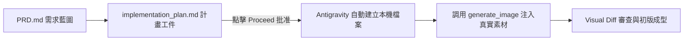
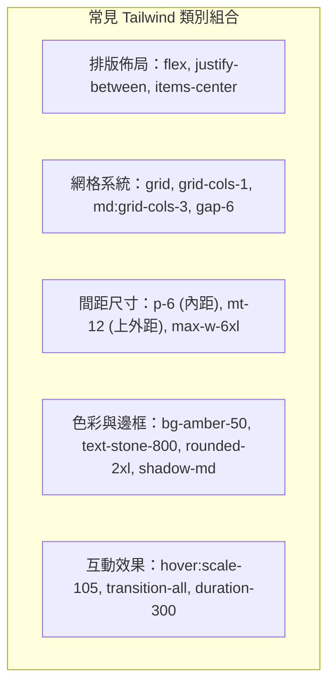
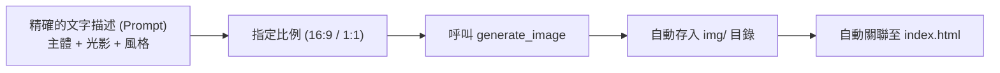

---
puppeteer:
  displayHeaderFooter: true
  scale: 1.15
  headerTemplate: '<div style="font-size: 11px; margin: 0 auto;">第十三週：實作專案四 — AI 協作：Phase 2 生成 — 代理人動工與真實素材生成</div>'
  footerTemplate: '<div style="font-size: 11px; margin: 0 auto;">第 <span class="pageNumber"></span> 頁 / 共 <span class="totalPages"></span> 頁</div>'
  margin:
    top: "1.5cm"
    bottom: "1.5cm"
    left: "1.5cm"
    right: "1.5cm"
---

<style>
  /* 全域字型、字級與行距 */
  body {
    font-size: 16pt !important;
    line-height: 1.7 !important;
    font-family: "Microsoft JhengHei", "PingFang TC", "Helvetica Neue", sans-serif;
  }

  /* 階層標題微調 */
  h1 { font-size: 30pt !important; margin-bottom: 0.5em !important; }
  h2 { font-size: 24pt !important; page-break-before: always; }
  h3 { font-size: 20pt !important; }
  h4 { font-size: 18pt !important; }

  /* 表格文字放大與排版優化 */
  table, th, td {
    font-size: 15pt !important;
    line-height: 1.5 !important;
  }

  /* 程式碼區塊 (自動換行防止 PDF 截斷) */
  pre, code {
    font-size: 13pt !important;
    font-family: Consolas, "Courier New", monospace !important;
    white-space: pre-wrap !important;
    word-break: break-all !important;
  }

  /* Mermaid 流程圖節點字體放大 */
  .mermaid text {
    font-size: 14px !important;
  }
</style>

---

# 第十三週：實作專案四 — AI 協作：Phase 2 生成 — 代理人動工與真實素材生成 (Phase 2: Agentic Generation & Assets)

**課程名稱**：網頁設計 (Webpage Design)  
**授課教師**：林頌堅 副教授 (Prof. Sung-Chien Lin)  
**授課單位**：世新大學 資訊傳播學系  
**聯絡方式**：scl@mail.shu.edu.tw  
**核心工具**：Google Antigravity 2.0 Desktop、GitHub Desktop、VS Code  
**課堂時間**：共 80 分鐘（雙節課：40 min + 40 min）  

---

## Ⅰ. 生成核心理念：從藍圖到實體代碼 (From Blueprint to Living Code)

各位同學好！經過上週扎實的企劃訪談與同儕互評，你手上現在已經有一份 90 分的 `PRD.md`，以及在 Antigravity 2.0 中審查完畢的 `implementation_plan.md` 實作計畫書。

今天，我們將正式進入 **Phase 2：生成 (Generation)**！



在過去使用 ChatGPT 或 Gemini 網頁版時，AI 印出 500 行代碼後，你必須手動全選、複製、開啟編輯器、貼上、存檔；如果遇到版面修改，又得重新覆蓋整份檔案，極容易出現漏複製或標籤未閉合的錯誤。

今天，在 Antigravity 2.0 桌面端，**你將體驗真正的「代理人自動工程」—— 一鍵批准動工，檔案自動到位！**

---

## Ⅱ. 批准實作計畫：點擊「Proceed」動工 (Approving the Plan)

當你在右側 **Artifacts 窗格** 檢閱 `implementation_plan.md`，確認色彩 HEX 代碼、區塊 Mermaid 圖與需求都符合預期後：

1. 點擊計畫書下方的 **「Proceed」** 按鈕（或在對話框輸入「計畫已確認，請開始執行動工！」）。
2. **觀察 Antigravity 的自主建檔**：
   AI 代理人會依序呼叫檔案系統工具，自動在專案中建立以下結構：
   ```text
   my-vibe-project/
   ├── PRD.md                 (需求藍圖)
   ├── index.html             (主結構與 Tailwind CSS 佈局)
   ├── mystyles.css           (自定義微調樣式表)
   └── img/                   (專屬圖片素材資料夾)
   ```
3. 切換到旁邊的 **GitHub Desktop**，你會看到所有檔案瞬間出現在 **"Changes"** 列表，全部亮起綠色的代碼新增標示！

---

## Ⅲ. Tailwind CSS CDN 實用類別與語意標籤導讀 (Code Anatomy)

Antigravity 在生成單頁式網站時，預設採用現代前端最流行的 **Tailwind CSS CDN**。我們不需要從頭手刻龐大的 CSS 規則，而是透過語意化的 utility class（功能類別）來排版：



### 檢查 HTML 語意化標籤（不要讓 AI 偷懶到處用 `<div>`）
請打開 `index.html`，運用我們在第 1~5 週學到的 HTML 知識，檢查 AI 是否使用了標準的語意標籤：
* 頂部導覽列是否使用了 `<nav>`？
* 主視覺看板是否包裹在 `<header>` 或帶有適當 class 的 `<section id="hero">` 中？
* 核心特色、菜單與聯絡資訊是否分別獨立為語意化的 `<section>`？
* 最底部社群與版權是否放在 `<footer>` 中？

---

## Ⅳ. 專業工程素養：學會閱讀 Visual Diff (Visual Diff Overlays)

每當 Antigravity 新增或修改檔案時，編輯器或對話歷程中會顯示 **Visual Diff**：
* **綠色標示（加號 `+`）**：AI 新增的標籤、類別或樣式。
* **紅色標示（減號 `-`）**：AI 移除或替換的舊代碼。

> 💡 **老師的真心話：拒絕當甩手掌櫃！**  
> 很多同學拿到 AI 的產出就直接關閉視窗，連一行都不看。這是非常危險的習慣！  
> 一個合格的「AI 產品總監」，每次 AI 修改完畢後，至少花 30 秒快速掃描 Diff：  
> 「它剛才改了哪幾個 class？」、「它有沒有不小心把我上一段手寫的文字刪掉？」  
> **養成看 Diff 的習慣，你的前端代碼閱讀能力會在無形中提升十倍！**

---

## Ⅴ. 告別假圖：使用內建多模態 `generate_image` 打造真實素材 (Real Assets)

在傳統網頁開發中，最讓人沮喪的就是版型做好了，但裡面都是 `via.placeholder.com/300x200` 的灰色假方塊，讓整個網站看起來像未完工的半成品。

在 Antigravity 2.0 中，你可以直接召喚內建的 **`generate_image` 繪圖工具**，為你的網站量身定做高品質真實素材！



### 1. `generate_image` 指令三要素
向 Antigravity 要求生成圖片時，請包含以下三個要素：
1. **主體與畫面細節**：明確描述畫面中心、背景物件與材質。
2. **氛圍與色調風格**：符合 PRD 中的 Vibe（如：日系空氣感、暖陽晨光、暗黑霓虹、高質感景深）。
3. **長寬比例與檔名路徑**：
   - 主視覺 Banner：建議 `AspectRatio: "16:9"`，存為 `img/hero.jpg`。
   - 產品卡片/頭像：建議 `AspectRatio: "1:1"` 或 `4:3`，存為 `img/menu_item1.jpg`。

### 2. 老王手沖咖啡生成實戰指令範例

```text
【指令一：生成 Hero 主視覺 Banner】
請使用 generate_image 工具，為「老王手沖咖啡」的主視覺生成一張高解析度照片：
- 畫面描述：一間溫暖靜謐的日系手沖咖啡店吧台，晨光透過百葉窗灑在深色原木桌面上，吧台上有一杯冒著裊裊熱氣的單品手沖黑咖啡，旁邊散落著幾顆剛烘焙好的咖啡豆與黃銅手沖壺。
- 風格調性：溫暖大地色系、日系極簡雜誌風、柔和景深散景。
- 圖片比例：16:9
- 儲存路徑：img/hero_coffee.jpg
生成完畢後，請同步檢查 index.html 的 Hero 區塊，將背景或主圖路徑更新為 img/hero_coffee.jpg！

【指令二：生成風味菜單代表圖】
請使用 generate_image 工具，為風味菜單區塊生成一張單品咖啡特寫：
- 畫面描述：陶瓷咖啡杯裝著清亮琥珀色的手沖咖啡，旁邊放著一片新鮮柑橘切片，象徵果香風味筆記。
- 比例：1:1
- 儲存路徑：img/coffee_pour.jpg
並同步將此圖片設定為 Menu 區塊第一張卡片的代表圖！
```

---

## Ⅵ. 第十三週課堂 80 分鐘實作節奏 (Classroom Lab)

### 課堂時間分配表 (40 min × 2)
* **第 1 節 (40 分鐘)：批准動工與代碼生成**
  1. 複習實作計畫架構，點擊「Proceed」批准動工 (10 min)。
  2. 觀察檔案生成，檢視 `index.html` 的語意化標籤與目錄結構 (15 min)。
  3. Visual Diff 導讀：挑出 Hero 與 Navbar 的代碼變更進行解讀 (15 min)。
* **第 2 節 (40 分鐘)：AI 繪圖與素材注入**
  1. 學習撰寫 `generate_image` 指令，生成專屬的主視覺 Hero Banner (15 min)。
  2. 生成至少 1 張卡片圖片存入 `img/`，並指揮 AI 關聯至 `index.html` (15 min)。
  3. 打開 GitHub Desktop，確認圖片與代碼變更，進行第一階段 Commit（Summary:「完成初版網頁架構與專屬圖片素材」）(10 min)。

---

## Ⅶ. 本週里程碑檢核點 (Week 13 Deliverables)

在下課前，請確認你的專案已達到：
1. **完整檔案結構**：專案根目錄具備 `index.html`、`mystyles.css` 與 `img/` 資料夾。
2. **真實素材注入**：網站中至少有 2 張由 AI 生成的專屬真實圖片（無任何失效的 placeholder）。
3. **初版原型成型**：雙擊 `index.html` 在瀏覽器中打開時，能看到完整的導覽列、主視覺、菜單與頁尾區塊。
4. **GitHub Desktop Commit**：在 GitHub Desktop 成功完成本週的進度提交！

> 💡 **老師的真心話**  
> 看到你心目中的咖啡廳或社團網站第一次「有模有樣」地出現在螢幕上，是不是很有成就感？  
> 但請記住，現在的它只有 70 分！下週，我們將化身最嚴格的「AI 品管師」，修復排版瑕疵、微調字體行高、適配手機螢幕，將它打磨到 100 分！
