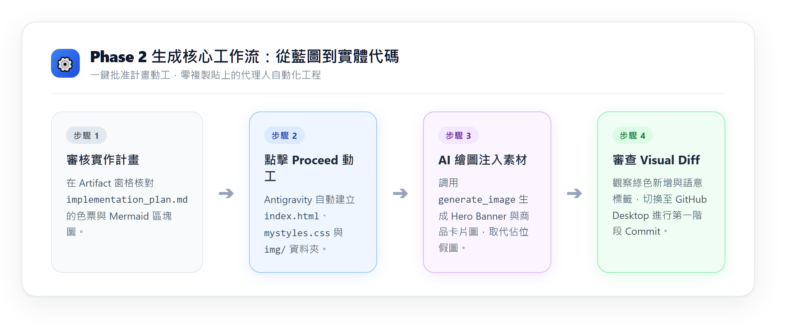
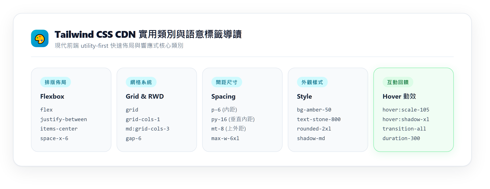
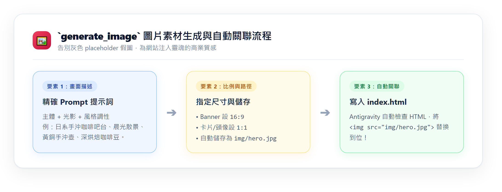

---
puppeteer:
  displayHeaderFooter: true
  scale: 1.15
  headerTemplate: '<div style="font-size: 11px; margin: 0 auto;">第十三週：實作專案四 — AI 協作：Phase 2 生成 — 代理人動工生成多頁網站與真實素材</div>'
  footerTemplate: '<div style="font-size: 11px; margin: 0 auto;">第 <span class="pageNumber"></span> 頁 / 共 <span class="totalPages"></span> 頁</div>'
  margin:
    top: "1.5cm"
    bottom: "1.5cm"
    left: "1.5cm"
    right: "1.5cm"
---

<style>
  /* 全域字型、字級與行距 */
  body {
    font-size: 16pt !important;
    line-height: 1.7 !important;
    font-family: "Microsoft JhengHei", "PingFang TC", "Helvetica Neue", sans-serif;
  }

  /* 階層標題微調 */
  h1 { font-size: 30pt !important; margin-bottom: 0.5em !important; }
  h2 { font-size: 24pt !important; page-break-before: always; }
  h3 { font-size: 20pt !important; }
  h4 { font-size: 18pt !important; }

  /* 表格文字放大與排版優化 */
  table, th, td {
    font-size: 15pt !important;
    line-height: 1.5 !important;
  }

  /* 程式碼區塊 (自動換行防止 PDF 截斷) */
  pre, code {
    font-size: 13pt !important;
    font-family: Consolas, "Courier New", monospace !important;
    white-space: pre-wrap !important;
    word-break: break-all !important;
  }
</style>

---

# 第十三週：實作專案四 — AI 協作：Phase 2 生成 — 代理人動工生成多頁網站與真實素材 (Phase 2: Multi-Page Agentic Generation & Assets)

**課程名稱**：網頁設計 (Webpage Design)  
**授課教師**：林頌堅 副教授 (Prof. Sung-Chien Lin)  
**授課單位**：世新大學 資訊傳播學系  
**聯絡方式**：scl@mail.shu.edu.tw  
**核心工具**：Google Antigravity 2.0 Desktop、GitHub Desktop、VS Code、Google Chrome / Edge  

---

## 🎯 本週學習目標 (Weekly Mission)

歡迎來到最令人興奮的實作週 —— **Phase 2：生成 (Generation)**！

上週大家已經完成並審查了多頁網站的 `PRD.md` 與 `implementation_plan.md`。這週，你將體驗身為「AI 產品總監」最爽快的時刻：**批准實作計畫，看著 AI 代理人在幾秒鐘內為你自動建好 4 個 HTML 分頁、排好 Tailwind CSS，並利用 AI 繪圖工具生成高解析度真實商業素材！**

完成本週學習後，你將能夠：
1. **一鍵批准動工**：在 Artifacts 視窗審查計畫書並點擊「Proceed」，指揮 AI 代理人自動批次生成多頁檔案架構。
2. **多頁面代碼解讀與品管**：檢查 4 個 HTML 頁面（`index.html`、`about.html`、`menu.html`、`contact.html`）的跨頁相對連結與語意化標籤。
3. **熟練閱讀 Visual Diff**：在 AI 新增或修改檔案時，快速識讀代碼變更（加號與減號），掌握版本主導權。
4. **召喚 `generate_image` 繪製真實素材**：為 4 個分頁量身打造專屬高畫質圖片，徹底擺脫灰色假圖佔位符 (`via.placeholder.com`)。
5. **在 GitHub Desktop 提交第二階段里程碑**：確認所有代碼與生成圖片皆納入版本控制。

---

## Ⅰ. 生成核心觀念：從施工藍圖到實體多頁網站 (From Blueprint to Multi-Page Code)

過去在網頁版 ChatGPT 或 Gemini 寫多頁網站時，你必須經歷「地獄般的複製貼上手動工」：
* 請 AI 寫首頁 ➔ 手動開 VS Code 存成 `index.html`。
* 請 AI 寫菜單頁 ➔ 再開一個新檔存成 `menu.html`。
* 發現兩邊的導覽列樣式不一樣，又手動改了半天，結果不小心改壞了閉合標籤 `</div>`。



在 **Antigravity 2.0 Desktop** 中，這些繁瑣的雜工將全數由 AI 代理人自動完成：
* **全域目錄感知**：AI 清楚知道專案資料夾裡的所有檔案，它會同時建立 4 個分頁，並統一引用相同的 `mystyles.css` 與導覽列架構。
* **零手動複製貼上**：AI 直接透過本機檔案系統讀寫檔案，代碼瞬間精準落地。
* **素材直接入庫**：呼叫 `generate_image` 繪製好的圖片直接存入 `img/` 資料夾，並自動寫入各頁面的 `` 屬性中！

---

## Ⅱ. 實戰任務一：批准計畫動工 — 建立 4 大分頁架構 (Scaffolding Multi-Page Site)

### 🛠️ 操作步驟：

#### 步驟 1：檢閱 `implementation_plan.md` 並點擊「Proceed」
在 Antigravity 2.0 右側的 **Artifacts 窗格** 中，打開上週生成的 `implementation_plan.md`。核對無誤後：
* **方式 A**：直接點擊計畫書下方的 **「Proceed」** 綠色按鈕。
* **方式 B**：在聊天框輸入以下動工指令：

```text
我已仔細核對 @implementation_plan.md。
計畫完全批准！請依照計畫書中的規劃與 @PRD.md 的規範，正式執行動工：
1. 一次性建立 4 個完整的 HTML 頁面：index.html, about.html, menu.html, contact.html
2. 建立共用樣式表 mystyles.css，並在所有頁面引入 Tailwind CSS CDN 與 Google Fonts
3. 確保 4 個頁面的頂部導覽列具有相同的結構，且相對連結 (href="about.html" 等) 全部正確
4. 目前所在頁面的導航連結請加上 active 高亮樣式（例如底線或強調色）
5. 圖片部分先暫時使用統一的 placeholder，我們隨後會生成真實圖片替換！
```

#### 步驟 2：觀察 Antigravity 的自主建檔
此時 AI 會依序呼叫檔案工具，在你的本機專案目錄中自動長出以下架構：

```text
laowang-cafe/
├── PRD.md                  (施工藍圖)
├── index.html              (1. 品牌首頁：全寬 Banner、特色亮點、精選推薦)
├── about.html              (2. 關於我們：烘豆職人理念、品牌故事、空間寫真)
├── menu.html               (3. 風味菜單：手沖/義式/甜點卡片、產區風味筆記與定價)
├── contact.html            (4. 門市資訊：營業時間、交通指引、Google地圖、預約表單)
├── mystyles.css            (全站共用微調樣式表與字型設定)
└── img/                    (專屬圖片素材庫)
```

#### 步驟 3：切換到 GitHub Desktop 驗證
打開 GitHub Desktop，左側 **"Changes"** 列表會瞬間冒出這幾個檔案，全部閃耀著綠色 `+` 號，代表檔案已實體建立在你的硬碟中！

---

## Ⅲ. 實戰任務二：多頁結構與 Tailwind CSS 類別導讀 (Code Anatomy)

Antigravity 預設會採用現代前端業界標準的 **Tailwind CSS CDN** 進行排版。請隨意用 VS Code 或在 Antigravity 中點開 `index.html` 與 `menu.html`，學習解讀以下核心代碼：



### 1. 跨頁相對路徑導覽列 (Navbar)
檢查 4 個 HTML 檔案頂部的 `<nav>`，所有按鈕的 `href` 是否使用了正確的相對路徑：

```html
<!-- 共用導航列結構範例 -->
<nav class="flex items-center justify-between px-8 py-4 bg-white/90 backdrop-blur sticky top-0 z-50 shadow-sm">
  <a href="index.html" class="text-2xl font-serif font-bold text-[#3E2723]">老王手沖咖啡</a>
  <div class="space-x-6">
    <a href="index.html" class="text-stone-700 hover:text-[#556B2F] transition">首頁</a>
    <a href="about.html" class="text-stone-700 hover:text-[#556B2F] transition">關於我們</a>
    <a href="menu.html" class="text-[#3E2723] font-bold border-b-2 border-[#556B2F] pb-1">風味菜單</a> <!-- 當前頁面高亮 -->
    <a href="contact.html" class="text-stone-700 hover:text-[#556B2F] transition">門市資訊</a>
  </div>
</nav>
```

### 2. 語意化標籤檢核（杜絕全是 `<div>` 的不良代碼）
* **`<header>`**：是否包裹在各頁面頂部的導航或橫幅區塊？
* **`<main>`**：是否將各頁面的核心主體內容完整包覆？
* **`<section>`**：每個獨立的內容單元（如菜單分類、主理人故事）是否使用獨立的 section？
* **`<article>`**：菜單中的每一道咖啡單品卡片，是否使用 article 標籤？
* **`<footer>`**：全站頁尾是否使用語意標籤包覆社群與版權宣告？

---

## Ⅳ. 實戰任務三：身為品管總監的必備素養 — 閱讀 Visual Diff

每當你指示 Antigravity 修改網頁時，聊天介面中會跳出 **Visual Diff（可視化代碼差異）**：
* 🟢 **綠色標示（加號 `+`）**：AI 新增的標籤、類別或文字。
* 🔴 **紅色標示（減號 `-`）**：AI 刪除或替換掉的舊代碼。

> 💡 **產品總監的必修課：花 30 秒看 Diff！**  
> 絕對不要盲目相信 AI 的每次修改！當 AI 說「我已經為你調整了菜單排版」時，務必快速滾動檢視 Diff：  
> 1. 它有沒有不小心把你原本寫好的真實文案刪掉了？  
> 2. 它新增的 class 是否符合你的預期？  
> **養成檢查 Diff 的好習慣，你對代碼的理解度與除錯敏銳度將會飛速成長！**

---

## Ⅴ. 實戰任務四：告別假圖！用 `generate_image` 為 4 大分頁打造專屬真實素材

現在你的 4 個頁面結構已經完整，但裡面的圖片還是灰色的 placeholder。  
今天我們要直接召喚 Antigravity 內建的 **`generate_image` 工具**，為 4 個分頁量身繪製高品質商業照片！



### 1. `generate_image` 指令黃金三要素
向 Antigravity 提出繪圖需求時，請包含：
1. **畫面主體與細節**：中心物件、背景光影、材質與陳設。
2. **氛圍與調性 (Vibe)**：日系雜誌感、暖陽晨光、溫暖木質、柔和景深散景。
3. **長寬比與檔名路徑**：全寬橫幅用 `16:9`；產品卡片用 `1:1` 或 `4:3`，並指定存入 `img/` 資料夾。

### 2. 四大分頁專屬素材生成提示詞範本 (可直接複製使用)

#### 素材一：首頁全寬 Hero Banner (`img/hero_coffee.jpg`)
```text
請使用 generate_image 工具，為 index.html 的主視覺 Hero 區塊生成一張高解析度照片：
- 畫面描述：一間寧靜溫馨的日系手沖咖啡店吧台，晨光穿過百葉窗灑在深色胡桃木桌面上，吧台中央有一杯剛沖煮好、冒著淡淡白煙的單品熱咖啡，旁邊放著復古黃銅手沖壺與幾顆剛烘好的咖啡豆。
- 視覺氛圍：日系雜誌風、大地色調、溫暖治癒、微距淺景深。
- 圖片比例：16:9
- 儲存路徑：img/hero_coffee.jpg
生成完畢後，請同步將 index.html 的主視覺圖片路徑更新為 img/hero_coffee.jpg！
```

#### 素材二：關於我們頁面 職人烘豆照 (`img/about_roaster.jpg`)
```text
請使用 generate_image 工具，為 about.html 的品牌故事區塊生成一張寫真照：
- 畫面描述：一位專注的日系咖啡烘豆師站在復古大型鑄鐵烘豆機旁，手裡捧著剛烘焙出爐的深褐色咖啡生豆，專注地檢視豆子的烘焙成色，背景是排滿麻布生豆袋的烘豆工作室。
- 視覺氛圍：職人匠心、溫暖昏黃鎢絲燈光、紀實攝影風格。
- 圖片比例：4:3
- 儲存路徑：img/about_roaster.jpg
生成完畢後，請同步將 about.html 的故事左側圖片路徑更新為 img/about_roaster.jpg！
```

#### 素材三：風味菜單頁 精選手沖單品特寫 (`img/menu_pourover.jpg`)
```text
請使用 generate_image 工具，為 menu.html 的手沖單品卡片生成一張代表圖：
- 畫面描述：俯瞰視角的一只手作粗陶咖啡杯，盛裝著清亮透光的琥珀色手沖黑咖啡，杯緣旁擺放著一片新鮮橙皮與茉莉乾花，暗示柑橘與花香風味筆記。
- 視覺氛圍：日系極簡、清爽留白、自然柔光。
- 圖片比例：1:1
- 儲存路徑：img/menu_pourover.jpg
生成完畢後，請同步更新 menu.html 第一款手沖單品卡片的圖片為 img/menu_pourover.jpg！
```

#### 素材四：門市資訊頁 店面外觀氛圍圖 (`img/storefront.jpg`)
```text
請使用 generate_image 工具，為 contact.html 的門市資訊生成一張外觀照片：
- 畫面描述：座落在文教區綠蔭巷弄中的日系木質咖啡店門面，門口懸掛著米白色亞麻短暖簾，木質門窗透出溫暖黃光，門前停放著一輛復古復古腳踏車與綠色盆栽。
- 視覺氛圍：街道日常散步感、溫暖舒適、安靜祥和。
- 圖片比例：16:9
- 儲存路徑：img/storefront.jpg
生成完畢後，請同步將 contact.html 的交通門市區塊配圖更新為 img/storefront.jpg！
```

---

## Ⅵ. 實戰任務五：在 GitHub Desktop 提交第二階段里程碑

完成 4 個分頁代碼建立與真實素材關聯後，我們要進行本週的 Git Commit！

### 🛠️ 操作步驟：
1. 切換到 **GitHub Desktop**。
2. 檢視左側 **"Changes"** 列表：應該會看到 4 個 `.html` 檔案、`mystyles.css` 以及 `img/` 裡的所有生成圖片！
3. 在左下角 **Summary** 輸入：  
   `完成 4 大分頁 HTML 架構與專屬 AI 圖片素材生成`
4. 在 Description 輸入：「建立 index, about, menu, contact 四大分頁，並完成導覽列跨頁跳轉與專屬商業素材圖」。
5. 點擊 **`Commit to main`**！

---

## ✅ 本週自我檢核清單 (Self-Check Checklist)

下課前，請在瀏覽器中雙擊打開 `index.html`，親手操作驗證：

* [ ] 我的專案目錄中完整具備 `index.html`、`about.html`、`menu.html`、`contact.html` 四大檔案。
* [ ] 在瀏覽器中點擊導航列的按鈕，可以順暢在 4 個頁面之間互相切換跳轉，**沒有任何 404 找不到檔案的錯誤**。
* [ ] 每個頁面的導覽列上，**目前所在的分頁按鈕都有清楚的 active 高亮標記**（讓訪客知道自己在哪一頁）。
* [ ] 全站至少具備 2~4 張由 `generate_image` 生成的專屬真實圖片，**沒有留下未替換的灰色 placeholder 假圖**。
* [ ] 已經在 GitHub Desktop 完成本週的進度 Commit。

---

## ⚠️ 踩坑急救包 (Troubleshooting)

* **Q1：點擊導覽列的「風味菜單」，瀏覽器卻跳出找不到檔案？**  
  👉 **解答**：這是最常見的跨頁連結錯誤！請檢查該按鈕的 `href`。如果寫成 `href="/menu.html"`（帶有斜線），在本地或未來的 GitHub Pages 上會找不到根目錄。請讓 AI 統一修改為相對路徑 `href="menu.html"`！
* **Q2：圖片生成了，但網頁上只顯示破圖圖示？**  
  👉 **解答**：請確認兩件事：
    1. 圖片是否確實存放在專案目錄下的 `img/` 資料夾中？
    2. HTML 裡的寫法是否為 ``（注意大小寫與副檔名是否完全一致）。
* **Q3：我發現 4 個頁面的頁尾 Footer 長得不一樣，怎麼一次修改？**  
  👉 **解答**：這正是 Antigravity 的超能力！直接對它下達批次指令：  
  「請檢查 index.html, about.html, menu.html, contact.html 4 個檔案的 `<footer>` 區塊，統一替換為包含『老王手沖咖啡 © 2026』與 IG/FB 連結的共用頁尾！」AI 會一次精準修改 4 個檔案。

---

> 💡 **產品總監筆記**  
> 看到原本空無一物的專案，現在長出了一個有模有樣、包含 4 個頁面與精美圖片的完整網站，是不是超有成就感？  
> 但是請記住，現在的網站大約只有 75 分！下週我們將進入最後階段 —— **Phase 3：完善品管與正式部署**。我們將排查手機端破版、精修字體字距、徹底消除假字，並正式部署到 GitHub Pages 發布給全世界！
