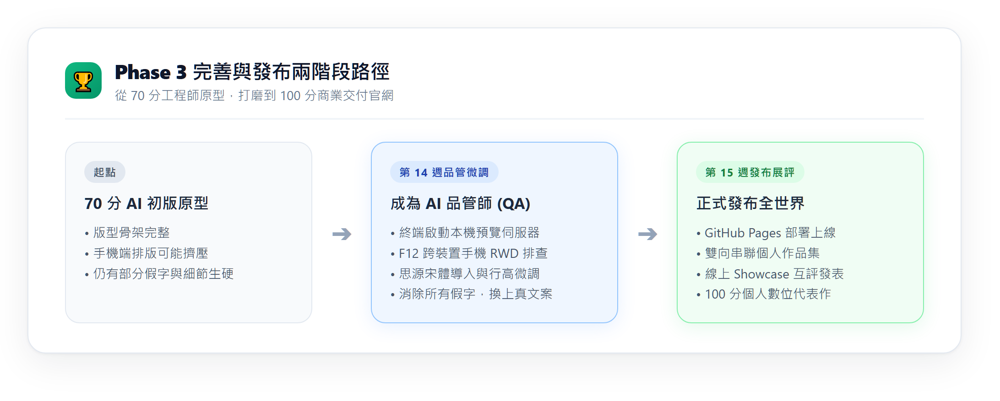
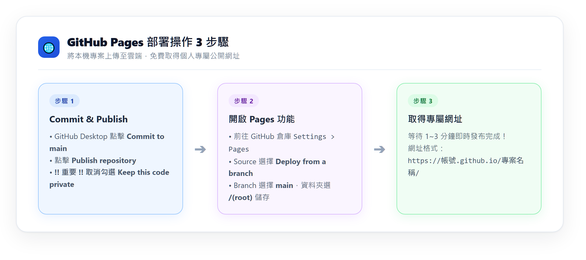
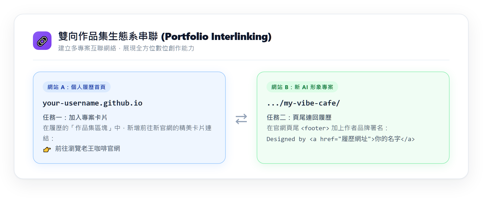

---
puppeteer:
  displayHeaderFooter: true
  scale: 1.15
  headerTemplate: '<div style="font-size: 11px; margin: 0 auto;">第十四至十五週：實作專案四 — AI 協作：Phase 3 完善品管、部署上線與作品集展評</div>'
  footerTemplate: '<div style="font-size: 11px; margin: 0 auto;">第 <span class="pageNumber"></span> 頁 / 共 <span class="totalPages"></span> 頁</div>'
  margin:
    top: "1.5cm"
    bottom: "1.5cm"
    left: "1.5cm"
    right: "1.5cm"
---

<style>
  /* 全域字型、字級與行距 */
  body {
    font-size: 16pt !important;
    line-height: 1.7 !important;
    font-family: "Microsoft JhengHei", "PingFang TC", "Helvetica Neue", sans-serif;
  }

  /* 階層標題微調 */
  h1 { font-size: 30pt !important; margin-bottom: 0.5em !important; }
  h2 { font-size: 24pt !important; page-break-before: always; }
  h3 { font-size: 20pt !important; }
  h4 { font-size: 18pt !important; }

  /* 表格文字放大與排版優化 */
  table, th, td {
    font-size: 15pt !important;
    line-height: 1.5 !important;
  }

  /* 程式碼區塊 (自動換行防止 PDF 截斷) */
  pre, code {
    font-size: 13pt !important;
    font-family: Consolas, "Courier New", monospace !important;
    white-space: pre-wrap !important;
    word-break: break-all !important;
  }
</style>

---

# 第十四至十五週：實作專案四 — AI 協作：Phase 3 完善品管、部署上線與作品集展評 (Phase 3: Multi-Page Refinement, Deployment & Showcase)

**課程名稱**：網頁設計 (Webpage Design)  
**授課教師**：林頌堅 副教授 (Prof. Sung-Chien Lin)  
**授課單位**：世新大學 資訊傳播學系  
**聯絡方式**：scl@mail.shu.edu.tw  
**核心工具**：Google Antigravity 2.0 Desktop、GitHub Desktop、VS Code、Google Chrome / Edge（進階加分工具：Vercel）  

---

## 本週學習目標 (Weekly Mission)

恭喜大家！經過前兩週的藍圖規劃與代理人生成，你的專案目錄裡現在已經具備了 4 個互相關聯的純淨 HTML5 分頁、外部共用 `style.css`、原生 `script.js` 動態微互動，以及由 AI 繪製的高質感真實素材。

然而， **AI 初次產出的多頁原型通常只有 70～75 分**。AI 在處理多頁網站時，常常會在手機端排版偷懶、各頁面的字體行高缺乏呼吸感、跨頁共用 `script.js` 偶有小瑕疵，或者殘留了敷衍的假字。這最後兩週，正是你展現「不可替代之人類審美與工程素養」的關鍵時刻 —— **你將化身全方位「AI 多頁品管師 (QA Inspector)」，運用本學期所學的 HTML / CSS / JS 專業知識排查破版瑕疵、精準微調視覺氛圍、正式部署至 GitHub Pages，並將其無縫串聯進你的個人履歷作品集中！**

完成本週學習後，你將能夠：
1. **本機伺服器真實環境預覽**：在 Antigravity 終端機啟動本地 HTTP 測試伺服器，避免檔案協定造成字型與跨頁跳轉異常。
2. **多頁面跨裝置 RWD 與微互動巡檢**：運用瀏覽器 `F12` 開發者工具與 Console 主控台，全面檢測 4 個頁面在手機與桌機上的排版及原生 JS 互動表現。
3. **手術式自然語言微調**：運用課堂所學的 CSS 變數、媒體查詢 (`@media`) 與字距行高觀念，指導 AI 批次精修全站質感並徹底消除假字。
4. **一鍵部署至 GitHub Pages（必修主線）**：將多頁原生網站公開發布，獲得全世界都能隨時造訪的 `github.io` 專屬網址。
5. **打造雙向作品集生態系（必修主線）**：將新完成的多頁專案與個人的線上履歷雙向超連結，展現實務工程水準。
6. **認識現代前端生態與 Vercel 部署（Bonus 進階視野與加分挑戰）**：理解未來大型框架網站的雲端編譯原理，並體驗將靜態倉庫一鍵連上 Vercel 取得 `.vercel.app` 獨立根網域。

---

## Ⅰ. 完善與發布核心觀念：成為全方位「AI 多頁品管師」 (Becoming the QA Inspector)

很多人以為 Vibe Coding 就是「隨便問幾句，AI 寫完就結束」。  
事實上， **真正的專業差距，就體現在這最後 25% 的品管細節中！**



### 多頁網站最常出現的五大「AI 偷懶病」：
* 📱 **手機端破版災難**：在桌機看很漂亮的三欄卡片，到了手機螢幕卻忘了寫 `@media (max-width: 768px)` 轉單欄，文字甚至衝出卡片邊框。
* 🔗 **導覽列跨頁不一致**：在 `index.html` 導覽列有 4 個按鈕，點進 `about.html` 卻少了一個，或是 `.active` 高亮標記給錯頁面。
* ⚡ **跨頁微互動漏接**：首頁的手機漢堡選單可以點開，換到聯絡頁卻因為忘記引入 `<script src="script.js"></script>` 或缺少 `if` 防呆檢查而失靈。
* 📝 **Lorem Ipsum 假字未清**：內文還殘留著拉丁文假字、商品價格標成 `\$000`、營業時間寫著「請在此輸入時間」。
* 🌫️ **視覺氛圍缺乏細膩度**：按鈕沒有滑鼠懸停 (`:hover`) 過渡動畫、字體過小擠在一起，缺乏日系設計應有的「留白呼吸感」。

這兩週，我們將透過嚴格的測試與提示詞精修，一一把這些瑕疵全部消滅！

> 💡 **老師的真心話**  
> 很多同學常常問老師：「AI 寫得那麼快，我們前半學期學 HTML、CSS 和 JavaScript 到底有什麼用？」這最後兩週就是最好的答案！AI 寫出來的初稿只是 70 分的半成品，只有看得懂 `style.css` 與 `script.js`、具備美感與品管意識的你，才能精準抓出手機端排版擠壓與腳本漏接的瑕疵。你對品質的堅持，才是讓作品脫穎而出的關鍵！

---

## Ⅱ. 實戰任務一：檢閱 Walkthrough 工件與啟動本機測試伺服器 (Walkthrough & Local Server)

### 1. 檢視 `walkthrough.md` 走查工件
在 Phase 2 完成後，Antigravity 2.0 會在右側 **Artifacts 窗格** 交付一份 `walkthrough.md` 工件。  
這份工件列出了專案中已建立的 4 個分頁、`style.css`、`script.js` 與圖片路徑清單，並提醒你值得留意的測試要點。

### 2. 終端機啟動本地 HTTP 測試伺服器
⚠️ **千萬不要只靠直接雙擊 HTML 檔案用 `file:///` 預覽！**  
使用 `file:///` 協定時，瀏覽器安全機制有時會限制外部字體載入，也無法完全模擬未來部署到 GitHub Pages 雲端伺服器的真實相對路徑環境。

請在 Antigravity 對話框中輸入：
```text
請在終端機幫我啟動一個本地 HTTP 測試伺服器，讓我可以即時在瀏覽器中預覽多頁網站的效果。
```
Antigravity 會自動在背景終端機執行 `python -m http.server 8000`。  
接著在 Chrome 或 Edge 瀏覽器網址列輸入：  
👉 **`http://localhost:8000`**（或終端機提示之本地埠號），即可享受最標準的網頁伺服器測試環境！

> 💡 **老師的真心話**  
> 再次強烈叮嚀：養成用 `localhost` 預覽的好習慣！正因為我們採用零框架負擔的純原生架構，不需要等待漫長的套件安裝，只要花 3 秒鐘讓 Antigravity 在終端機啟動內建伺服器，就能在最接近真實網際網路的環境下驗收作品，省下無數莫名其妙的除錯時間。

---

## Ⅲ. 實戰任務二：跨頁 RWD、微互動檢測與自然語言手術式精修 (Multi-Page RWD & Vibe Tuning)

### 1. 按下 `F12` 進入手機模式與 Console 主控台進行 4 頁大巡檢
在瀏覽器中按下鍵盤 **`F12`**（或右鍵點擊「檢查」），點擊左上角的 **「切換裝置工具列 (Toggle Device Toolbar)」**，將畫面寬度調整為 **iPhone 14 (390px) **，同時留意下方的 **`Console`（主控台）** 頁籤：

逐一點擊 4 個分頁進行地毯式檢查：
* [ ] **`index.html`**：Hero 主標題在手機螢幕是否會難看地折成 3～4 行？手機版右上角的 `☰` 漢堡選單按鈕點擊後能否順利展開導覽列？
* [ ] **`about.html`**：左右雙欄的「烘豆師照片」與「品牌故事」，在手機端是否自動切換為上下垂直單欄排版？
* [ ] **`menu.html`**：咖啡菜單的 3 欄卡片，在手機端是否透過 `@media` 正確轉為單欄 (`grid-template-columns: 1fr`)？分類篩選按鈕或 FAQ 手風琴點擊是否靈敏？
* [ ] **`contact.html`**：嵌入的 Google 地圖是否能自動適應手機寬度 (`width: 100%`)？測試送出預約表單時，原生 JS 的驗證與溫馨回饋訊息是否正常顯示？
* [ ] **`Console` 零紅字檢查**：在切換 4 個頁面的過程中，瀏覽器 `F12 > Console` 視窗是否保持乾淨、**沒有出現任何紅色的 `Uncaught TypeError` 錯誤**？

### 2. Vibe QA 自然語言精修對照表（運用課內 CSS / JS 專業詞彙指揮 AI）

請運用你在前半學期所學的 HTML / CSS / JS 專業概念，向 Antigravity 下達具體、專業的手術式修改指令：

| 品管面向 | ❌ 錯誤的模糊指令 (Garbage In) | ✅ 專業品管師指令 (Professional Prompt) |
| :--- | :--- | :--- |
| **字體與留白氣質** | 「字體不好看，改文青一點。」 | 「請在所有 4 個 HTML 的 `<head>` 引入 Google Fonts 的 `Noto Serif TC`（思源宋體），並在共用 `style.css` 將所有標題套用該字體、內文行高設為 `line-height: 1.8`、字距設為 `letter-spacing: 0.05em`，提升日系留白呼吸感。」 |
| **手機端菜單卡片** | 「手機版菜單擠在一起壞掉了。」 | 「在 `menu.html` 中，菜單卡片在手機端擠在一起。請修改 `style.css` 的 `.menu-grid` 樣式：桌機版維持 `grid-template-columns: repeat(3, 1fr)`，在 `@media (max-width: 768px)` 手機斷點下改為單欄 `grid-template-columns: 1fr`；並為每張卡片加上柔和陰影與 `:hover` 微幅上浮動畫 (`transform: translateY(-4px); transition: 0.3s`)。」 |
| **JS 微互動防呆除錯** | 「漢堡按鈕或篩選器怪怪的。」 | 「請全面檢查 4 個 HTML 底部是否都有正確引入 `<script src="script.js"></script>`；並檢查 `script.js` 中所有 `querySelector` 與 `getElementById`，務必加上 `if (元素存在)` 的防呆判斷，確保切換 4 個分頁時 `F12` Console 零紅字報錯！」 |
| **清除假字與統一導航** | （放任不管） | 「請全面巡檢 index, about, menu, contact 四個頁面，清除所有 `Lorem Ipsum` 與 `\$000` 預設假字，填寫真實手沖品名與世新大學周邊門市資訊；並確認 4 個檔案頂部 `<nav>` 的按鈕文字一致、`.active` 高亮類別皆精準標示在當前頁面！」 |
> 💡 **老師的真心話**  
> 看到上面表格右邊的專業提示詞了嗎？這就是為什麼老師要求大家統一使用 `style.css` 與原生 `script.js`！當你能精準講出 `line-height: 1.8`、`@media (max-width: 768px)`、`grid-template-columns: 1fr` 與 `Console 防呆檢查` 時，AI 就能像外科手術刀一樣一次到位修復問題，再也不會在那裡瞎猜你的意思！

---

## Ⅳ. 實戰任務三：部署多頁專案至 GitHub Pages 公開發布（必修主線）

經過精細打磨，你的原生多頁網站現在已經達到商業級水準！由於我們嚴格遵守了「零前端框架、純靜態三劍客」的架構護欄，整個專案可以直接無縫部署至 **GitHub Pages**，完全不需要任何複雜的編譯設定！



### 部署操作 3 步驟：

#### 步驟 1：在 GitHub Desktop 提交並推送 (Commit & Push / Publish)
1. 打開 **GitHub Desktop**。
2. 檢查 Changes 列表，確認只有乾淨的 `.html`、`style.css`、`script.js`、`PRD.md` 與 `img/` 素材。
3. 在左下角 Summary 輸入：  
   `完成多頁網站 RWD 品管、JS 微互動除錯與文案潤飾，正式部署`
4. 點擊 **`Commit to main`**。
5. 點擊主畫面上方的 **`Push origin`**（若先前尚未發布過雲端，請點擊 **`Publish repository`**，並**務必取消勾選「Keep this code private」**，確保倉庫為公開狀態）。

#### 步驟 2：在 GitHub 網頁啟動 GitHub Pages
1. 點擊 GitHub Desktop 頂部選單的 **`Repository > View on GitHub`**，在瀏覽器打開你的線上專案。
2. 點擊上方的 **`Settings`**（設定頁籤）。
3. 在左側側邊欄點擊 **`Pages`**。
4. 在 **Build and deployment** 區塊：
   * **Source**：選擇 `Deploy from a branch`
   * **Branch**：選擇 `main`，資料夾保持 `/(root)`
   * 點擊右側的 **`Save`** 按鈕！

#### 步驟 3：取得專屬線上網址並用手機實機驗證
等待 1～3 分鐘後重新整理該設定頁，上方會出現醒目的綠色提示訊息：  
**"Your site is live at https://<你的GitHub帳號>.github.io/<專案名稱>/"**

點擊該網址，並拿出你的真實手機開啟測試，逐一點擊 4 個分頁與你設計的漢堡選單、分類篩選或 FAQ 微互動，親眼見證作品在公網上流暢運行！

> 💡 **老師的真心話**  
> 發布到 GitHub Pages 後，如果點進其他頁面跳出 404，請第一時間檢查檔名的大小寫！Windows 電腦不分大小寫，但 GitHub 的 Linux 雲端伺服器分得清清楚楚。檔名 `menu.html` 若在按鈕寫成 `Menu.html` 就會直接失效。務必親手在手機上把 4 個頁面和所有互動按鈕都點過一遍，才算真正驗收過關！

---

## Ⅴ. 實戰任務四：打造雙向作品集生態系（必修主線）

一個成熟的資訊傳播人，懂得將學期中完成的所有獨立專案相互串聯，形成個人的「數位資產網絡」！



### 動作 1：在「個人線上履歷」新增本專案展示卡片
1. 在 GitHub Desktop 左上角切換儲存庫至你期中完成的個人履歷倉庫（`你的帳號.github.io`）。
2. 用 VS Code（或掛載進 Antigravity）打開履歷的 `index.html`，找到「作品集 (Projects / Portfolio)」區塊。
3. 加入一組精美的專案展示卡片 HTML（可直接搭配履歷既有的 CSS 樣式或簡潔排版）：

```html
<!-- 作品集新增項目：AI 協作多頁網站專案 -->
<article class="project-card" style="border: 1px solid #e5e0d8; border-radius: 12px; padding: 24px; background: #ffffff; margin-top: 16px;">
  <span style="font-size: 0.8rem; font-weight: bold; padding: 4px 10px; border-radius: 99px; background: #fef3c7; color: #92400e;">
    AI 代理人協同開發 (Vibe Coding)
  </span>
  <h3 style="margin: 12px 0 8px; color: #2d312e;">老王手沖咖啡 多頁形象官網</h3>
  <p style="color: #57534e; font-size: 0.95rem; line-height: 1.7;">
    運用 PRD 產品需求規劃與 Vibe Coding 工作流，與 Google Antigravity 2.0 代理人協同打造之 4 頁式品牌官網。採用標準 HTML5、外部 CSS 變數響應式排版與原生 JavaScript 動態微互動，搭配客製化 AI 商業攝影素材並部署於雲端。
  </p>
  <div style="margin-top: 16px;">
    <a href="https://你的帳號.github.io/專案名稱/" target="_blank" style="color: #2d5a4c; font-weight: bold; text-decoration: none;">
      👉 前往線上造訪網站 (GitHub Pages) →
    </a>
    <!-- 若有完成下方 Bonus Vercel 挑戰，也可並排加上 .vercel.app 連結！ -->
  </div>
</article>
```
4. 在 GitHub Desktop 中進行 Commit 並點擊 **Push origin** 推送更新履歷網站！

### 動作 2：在「新多頁網站」頁尾加入導回「個人履歷」的設計師署名
1. 在 GitHub Desktop 切換回你的多頁形象網站倉庫（如 `laowang-cafe`）。
2. 指揮 Antigravity 在全部 4 個頁面的 `<footer>` 區塊底部，統一加入設計師品牌署名與連回履歷的超連結：

```html
<p class="designer-credit">
  Designed &amp; Directed with AI Agent by 
  <a href="https://你的帳號.github.io/" target="_blank">你的姓名</a> 
  | 世新資傳 2026
</p>
```
3. Commit 並 Push！至此，你的個人履歷與多頁專案達成了完美的雙向互通！

> 💡 **老師的真心話**  
> 「雙向串聯」是專業設計師非常重視的細節。未來面試官或實習主管看你的線上履歷時，能一鍵點進你的多頁官網作品；在官網作品的頁尾，又能看到你身為產品總監的署名並一鍵點回你的履歷。這種環環相扣的完整度，會讓你的作品集瞬間從「課堂作業」升格為「專業代表作」！

---

## Ⅵ. 🌟 進階補充視野與加分挑戰（Bonus 選修）：現代前端框架生態與 Vercel 雲端部署

> 📌 **學習定位說明**：完成上方「實戰任務一～四（GitHub Pages 上線 ＋ 履歷雙向串聯）」即已達成期末專案 **100% 滿分必修要求**！本單元為**「現代前端視野科普與 Bonus 加分挑戰（+5 分）」**，歡迎行有餘力、想進一步探索業界雲端部署生態的同學自由挑戰！

### 1. 觀念升級：為什麼本學期我們禁用 Vue / React，但未來進階開發會遇見它們？

在本學期的專案中，我們在 `PRD.md` 明確規定「只准使用原生 HTML、CSS 與 JavaScript，嚴禁使用 Vue、React 等前端框架」。對於 **4～10 頁的品牌形象官網、活動頁與作品集** 而言，原生架構是最輕快且最容易維護的最佳解。

然而，當你未來升上大二、大三修習進階程式課程，或畢業後與軟體工程團隊合作開發 **「大型高互動網路應用程式 (Web Applications)」**（例如：像 Threads 一樣無限捲動即時按讚的社群平台、Uber 即時地圖叫車系統，或擁有複雜購物車與會員後台的電商網站）時，工程師就會動用 **React、Vue、Next.js 或 Vite** 等現代前端框架。

這類大型前端框架專案若直接放上我們剛才用的 **GitHub Pages**，會遇到三大「水土不服」的限制：
1. **瀏覽器看不懂未編譯的框架語法**：框架原始碼（如 `.jsx` 或 `.vue`）必須先經過伺服器執行 `npm run build` 打包翻譯成標準 HTML/JS 才能執行；純靜態的 GitHub Pages 預設不會自動編譯，直接打開只會看到 **一片空白**。
2. **子目錄路徑差異**：GitHub Pages 網址帶有 `/專案名稱/` 子路徑，常讓框架預設的根目錄資源路徑錯亂。
3. **單頁路由重整 404**：框架的虛擬路由在內頁按下重新整理時，靜態伺服器容易誤判為找不到實體檔案。

👉 **因此，現代前端業界普遍採用「GitHub ＋ Vercel」黃金組合！**  
**Vercel** 是全球最受歡迎的現代雲端部署平台——它不僅能幫複雜的 React / Vue 框架在雲端全自動編譯， **對於我們這學期做好的「純靜態 HTML / CSS / JS 原生網站」更是 100% 零門檻通吃（編譯錯誤率 0%）**，還能免費送你一個超專業的獨立根網域 **`https://專案名稱.vercel.app`**！

---

### 2. 三分鐘無痛加分挑戰：將你的純靜態倉庫連上 Vercel（Bonus +5 分）

不需要修改任何一行程式碼！只要你的專案已經推送到 GitHub，跟著以下 4 個步驟點擊滑鼠，3 分鐘內就能多拿一個業界級 `.vercel.app` 專屬網址：

1. **使用 GitHub 一鍵登入 Vercel**：  
   前往 **`https://vercel.com`** ➔ 點擊右上角 **`Sign Up`** ➔ 方案選擇免費的 **`Hobby`**（個人與教育方案），輸入姓名後點擊 **`Continue with GitHub`** 完成授權連動。
2. **匯入你的 GitHub 專案倉庫 (Import Git Repository) **：  
   進入控制台點擊右上角 **`Add New... > Project`**，在清單中找到你的多頁專案名稱並點擊 **`Import`**。（若清單沒看到該專案，點擊下方的 `Adjust GitHub App Permissions` 開啟儲存庫讀取權限即可）。
3. **保持預設直接部署 (Deploy) **：  
   因為我們的專案是超乾淨的純靜態原生架構，Vercel 的 **Framework Preset** 會自動顯示為 **`Other`**，完全不需更改任何設定，直接點擊最下方的 **`Deploy`** 按鈕！
4. **取得 `.vercel.app` 獨立根網域**：  
   不到 30 秒畫面就會灑下慶祝彩帶（**Congratulations!**）！點擊進入 Dashboard，即可獲得乾淨俐落的專屬根網址： **`https://<專案名稱>.vercel.app`**！

### 3. 兩大雲端部署平台特性總整理

| 比較項目 | GitHub Pages (`github.io`) 【本課必修】 | Vercel (`vercel.app`) 【進階加分挑戰】 |
| :--- | :--- | :--- |
| **適用專案類型** | **純靜態原生網頁**（HTML / CSS / 原生 JS） | **通吃！** 純靜態原生網頁 ＋ 未來進階前端框架 (React / Vue) |
| **網址結構** | `https://帳號.github.io/專案名稱/`（子目錄結構） | `https://專案名稱.vercel.app/`（**獨立根網域，簡潔專業**） |
| **倉庫權限要求** | 免費版強制要求 **Public（公開）** | **Public（公開）與 Private（私有）皆可免費部署** |
| **自動同步更新** | GitHub Desktop `Push` 後自動更新 | GitHub Desktop `Push` 後**兩邊平台會同時自動更新！** |
> 💡 **老師的真心話**  
> 為什麼老師把「原生 HTML/CSS/JS + GitHub Pages」訂為必修基本功，又在最後帶大家認識「前端框架與 Vercel」？因為大學教育的目標是讓大家「腳踏實地，同時眼界開闊」！先把原生三劍客與品管基本功練得紮紮實實，確保每個人都能靠自己的力量做出 100 分的網站；行有餘力的同學再花 3 分鐘連上 Vercel，體驗一次 `git push` 雙雲端同步更新的威力，未來無論走向 UI/UX 設計、數位行銷企劃或進階前端開發，你都能無縫接軌業界語言！

---

## Ⅶ. 專案終極自我檢核清單 (Final Project Checklist)

在將線上網址提交至數位教學平台前，請逐一打勾確認：

### 【必修滿分檢核項目（100%）】
* [ ] **純正原生多頁架構**：專案由 4 個獨立 `.html` 分頁、外部共用 `style.css` 與原生 `script.js` 組成，無任何未經消化的前端框架雜訊檔案。
* [ ] **跨頁導航零死連結**：4 個分頁皆能透過導覽列互相順暢切換，`.active` 高亮正確，無任何 `404` 或大小寫路徑錯誤。
* [ ] **原生 JS 微互動順暢零報錯**：手機漢堡選單與自選的 1～2 項原生 JS 微互動（如 FAQ 摺疊、分類篩選、日夜切換或表單回饋）皆正常運作，`F12 > Console` 無紅字錯誤。
* [ ] **真實內容滿載**：全站無任何 `Lorem Ipsum` 假字、無 `\$000` 假價格，皆為符合主題溫度的真實文案。
* [ ] **專屬素材到位**：全站無任何未替換的灰色 placeholder 假圖，皆為 `generate_image` 繪製或專屬實拍照。
* [ ] **跨裝置 RWD 完美適配**：在 iPhone 手機模式下，導覽列、卡片網格與嵌入地圖皆能自適應單欄流暢顯示。
* [ ] **GitHub Pages 上線與履歷雙向串聯**：已啟用 `github.io` 公開網址，且「個人履歷網站」與「本專案頁尾」已完成雙向超連結串聯！

### 【🌟 進階選修加分項目（Bonus +5%）】
* [ ] **Vercel 獨立網域部署**：已將同一個 GitHub 儲存庫串聯至 Vercel，額外取得 `https://<專案名稱>.vercel.app` 專屬網址並附於繳交連結中。

> 💡 **老師的真心話**  
> 這份終極檢核清單，就是你專業水準的試金石。確認全站沒有任何 Lorem Ipsum 假字、沒有破圖、跨頁導航與微互動完全暢通。當必修項目全部打勾時，你就可以自信滿滿地將網址繳交上去了！

---

## Ⅷ. 踩坑急救包 (Troubleshooting)

* **Q1：GitHub Pages 網址打開後顯示 404 Not Found？**  
  👉 **解答**：
    1. 檢查倉庫是否設為 **Public（公開）**。如果剛才建立時誤勾了 Private，請至 GitHub 倉庫 `Settings` 最下方的 Danger Zone 改為 Public。
    2. 檢查 GitHub Desktop 是否有未 Push 的代碼。務必點擊 **Push origin** 將本地代碼推上雲端。
    3. 首頁檔名必須嚴格為全小寫的 `index.html`（不能寫成 `Index.html` 或 `home.html`）。
* **Q2：首頁能正常打開，但點進「風味菜單」卻出現 404？**  
  👉 **解答**：這是 Linux 雲端伺服器對 **大小寫極度敏感**造成的！請檢查你的檔案名稱是否為 `menu.html`，而按鈕連結是否不小心寫成了 `href="Menu.html"`。在 Windows 本機測試時大小寫不分，但放到雲端伺服器上就會直接失效！
* **Q3：圖片或 CSS 樣式在本地預覽正常，發布到 GitHub Pages 後卻破圖或沒套用樣式？**  
  👉 **解答**：檢查 HTML 裡的引入路徑！不能寫開頭帶斜線的絕對路徑（如 `src="/img/hero.jpg"` 或 `href="/style.css"`），因為 GitHub Pages 網址包含子目錄 `/專案名稱/`。請指揮 AI 統一改為乾淨的相對路徑 `src="img/hero.jpg"` 與 `href="style.css"`！
* **Q4：按下 `F12` 看 Console 時，出現 `Cannot read properties of null (reading 'addEventListener')` 紅字？**  
  👉 **解答**：這代表 `script.js` 試圖在當前頁面尋找另一個分頁才有的按鈕（例如在首頁找聯絡表單）。請直接把這行紅字貼給 Antigravity，並說：「請在 `script.js` 為這個元素加上 `if (element)` 存在性防呆檢查！」即可一秒修復。
* **Q5：（Bonus 挑戰）在 Vercel 匯入專案時找不到我的 GitHub 儲存庫怎麼辦？**  
  👉 **解答**：點擊 Vercel 匯入清單下方的 `Adjust GitHub App Permissions`，在彈出的 GitHub 授權設定中選擇 `All repositories`（或勾選該專案倉庫）並按下 `Save`，返回頁面就能立即看到並匯入！

---

> 💡 **老師的真心話**  
> 恭喜大家完整走過這趟劃時代的 Vibe Coding 之旅！  
> 回想十幾週前，大家可能還在為如何寫出第一個 `<h1>` 標籤與第一行 `style.css` 而苦惱；而今天，你們已經能以「AI 產品總監」的高度獨立撰寫 PRD 施工藍圖、劃定精準的原生技術護欄、指揮 AI 代理人實作多頁網站與 JS 微互動、嚴格把關跨裝置 RWD 品管，並完成全球雲端發布與作品集生態系串聯。這套「懂原理、會規劃、能品管」的協作實力，將會是你們在 AI 時代最核心、最無可取代的競爭力。恭喜大家順利通關！
