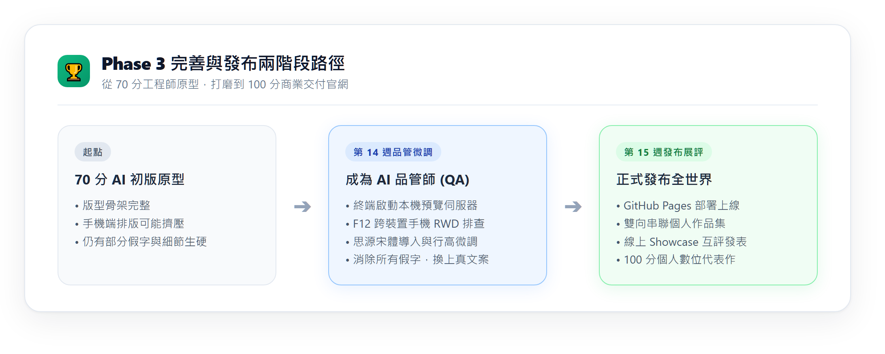
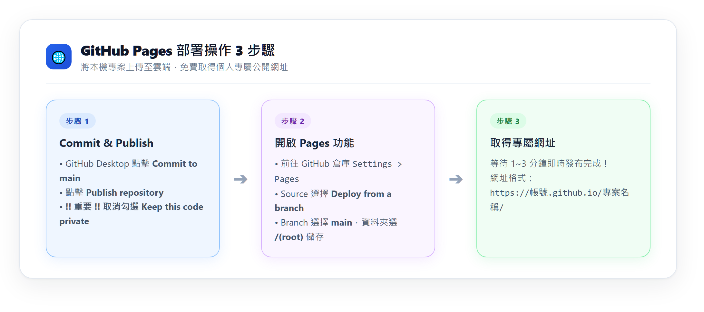
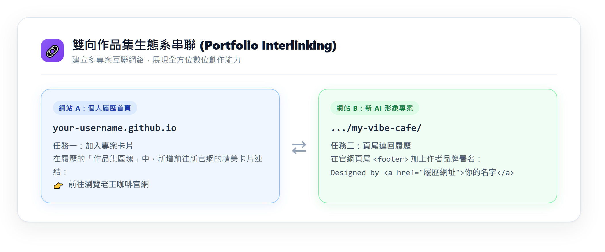

---
puppeteer:
  displayHeaderFooter: true
  scale: 1.15
  headerTemplate: '<div style="font-size: 11px; margin: 0 auto;">第十四至十五週：實作專案四 — AI 協作：Phase 3 完善品管、部署上線與作品集展評</div>'
  footerTemplate: '<div style="font-size: 11px; margin: 0 auto;">第 <span class="pageNumber"></span> 頁 / 共 <span class="totalPages"></span> 頁</div>'
  margin:
    top: "1.5cm"
    bottom: "1.5cm"
    left: "1.5cm"
    right: "1.5cm"
---

<style>
  /* 全域字型、字級與行距 */
  body {
    font-size: 16pt !important;
    line-height: 1.7 !important;
    font-family: "Microsoft JhengHei", "PingFang TC", "Helvetica Neue", sans-serif;
  }

  /* 階層標題微調 */
  h1 { font-size: 30pt !important; margin-bottom: 0.5em !important; }
  h2 { font-size: 24pt !important; page-break-before: always; }
  h3 { font-size: 20pt !important; }
  h4 { font-size: 18pt !important; }

  /* 表格文字放大與排版優化 */
  table, th, td {
    font-size: 15pt !important;
    line-height: 1.5 !important;
  }

  /* 程式碼區塊 (自動換行防止 PDF 截斷) */
  pre, code {
    font-size: 13pt !important;
    font-family: Consolas, "Courier New", monospace !important;
    white-space: pre-wrap !important;
    word-break: break-all !important;
  }
</style>

---

# 第十四至十五週：實作專案四 — AI 協作：Phase 3 完善品管、部署上線與作品集展評 (Phase 3: Multi-Page Refinement, Deployment & Showcase)

**課程名稱**：網頁設計 (Webpage Design)  
**授課教師**：林頌堅 副教授 (Prof. Sung-Chien Lin)  
**授課單位**：世新大學 資訊傳播學系  
**聯絡方式**：scl@mail.shu.edu.tw  
**核心工具**：Google Antigravity 2.0 Desktop、GitHub Desktop、VS Code、Google Chrome / Edge  

---

## 🎯 本週學習目標 (Weekly Mission)

恭喜大家！經過前兩週的藍圖規劃與代理人生成，你的專案目錄裡現在已經具備了 4 個互相關聯的 HTML 分頁，以及由 AI 繪製的高質感真實素材。

然而，**AI 產出的多頁原型通常只有 70~75 分**。AI 在處理多頁網站時，常常會在手機端排版偷懶、各頁面的字體行高沒有呼吸感、或者殘留了敷衍的假字。這最後兩週，正是你展現「不可替代之人類審美與工程素養」的關鍵時刻 —— **你將化身全方位「AI 多頁品管師 (QA Inspector)」，排查 4 個分頁的破版瑕疵、精準微調視覺氛圍、正式上線發布至 GitHub Pages，並將其無縫串聯進你的個人履歷作品集中！**

完成本週學習後，你將能夠：
1. **本機伺服器真實環境預覽**：在 Antigravity 終端機啟動本地 HTTP 測試伺服器，避免檔案協定造成字型與跨頁跳轉異常。
2. **多頁面跨裝置 RWD 巡檢**：運用瀏覽器 `F12` 開發者工具，全面檢測 4 個頁面在手機、平板與桌機上的排版表現。
3. **手術式自然語言微調**：下達精準指令，指導 AI 批次調整 4 個頁面的字體、色彩過渡、卡片陰影與消除假字。
4. **一鍵部署至 GitHub Pages**：將多頁倉庫公開發布，獲得全世界都能隨時造訪的專屬網址。
5. **打造雙向作品集生態系**：將新完成的多頁專案與個人的線上履歷雙向超連結，展現實務工程水準。

---

## Ⅰ. 完善與發布核心觀念：成為全方位「AI 多頁品管師」 (Becoming the QA Inspector)

很多人以為 Vibe Coding 就是「隨便問幾句，AI 寫完就結束」。  
事實上，**真正的專業差距，就體現在這最後 25% 的品管細節中！**



### 1. 多頁網站最常出現的四大「AI 偷懶病」：
* 📱 **手機端破版災難**：在桌機看很漂亮的三欄卡片，到了手機螢幕卻被擠成一團，文字甚至衝出卡片邊框。
* 🔗 **導覽列跨頁不一致**：在 `index.html` 導覽列有 4 個按鈕，點進 `about.html` 卻少了一個，或是 active 高亮標記給錯頁面。
* 📝 **Lorem Ipsum 假字未清**：內文還殘留著拉丁文假字、商品價格標成 $000、營業時間寫著「請在此輸入時間」。
* 🌫️ **視覺氛圍缺乏細膩度**：按鈕沒有滑鼠懸停 (hover) 動畫、字體過小擠在一起，缺乏日系設計應有的「呼吸感」。

這兩週，我們將透過嚴格的測試與提示詞精修，一一把這些瑕疵全部消滅！

---

## Ⅱ. 實戰任務一：檢閱 Walkthrough 工件與啟動本機測試伺服器 (Walkthrough & Local Server)

### 1. 檢視 `walkthrough.md` 走查工件
在 Phase 2 完成後，Antigravity 2.0 會在右側 **Artifacts 窗格** 交付一份 `walkthrough.md` 工件。  
這份工件列出了專案中已建立的 4 個分頁、樣式表與圖片路徑清單，並提醒你值得留意的測試要點。

### 2. 終端機啟動本地 HTTP 測試伺服器
⚠️ **千萬不要直接雙擊 HTML 檔案用 `file:///` 預覽！**  
使用 `file:///` 協定時，瀏覽器會限制 Google Fonts 字體加載、可能無法讀取相對路徑 JavaScript，也會造成跨頁跳轉路徑的判斷偏差。

請在 Antigravity 對話框中輸入：
```text
請在終端機幫我啟動一個本地 HTTP 測試伺服器，讓我可以即時在瀏覽器中預覽多頁網站的效果。
```
Antigravity 會自動在背景終端機執行 `python -m http.server 8000`。  
接著在 Chrome 或 Edge 瀏覽器網址列輸入：  
👉 **`http://localhost:8000`**，即可享受最標準的網頁伺服器環境！

---

## Ⅲ. 實戰任務二：跨頁 RWD 檢測與自然語言手術式精修 (Multi-Page RWD & Vibe Tuning)

### 1. 按下 `F12` 進入手機模式進行 4 頁大巡檢
在瀏覽器中按下鍵盤 **`F12`**（或右鍵點擊「檢查」），點擊左上角的 **「切換裝置工具列 (Toggle Device Toolbar)」**，將畫面寬度調整為 **iPhone 14 (390px)**：

逐一點擊 4 個分頁進行地毯式檢查：
* [ ] **`index.html`**：Hero 主標題在手機螢幕是否會難看地折成 3 行？按鈕在手機上是否容易點擊？
* [ ] **`about.html`**：左右雙欄的「烘豆師照片」與「品牌故事」，在手機端是否自動切換為上下單欄排版？
* [ ] **`menu.html`**：咖啡菜單的 3 欄卡片，在手機端是否正確轉為垂直單欄排列 (`grid-cols-1`)？價格文字是否清晰可見？
* [ ] **`contact.html`**：嵌入的 Google 地圖是否能自動適應手機寬度 (`w-full`)？聯絡表單的輸入框是否好點選？

### 2. Vibe QA 自然語言精修對照表（指引 AI 具體修改）

請運用你在課堂所學的 HTML/CSS 專業概念，向 Antigravity 下達具體、專業的手術式修改指令：

| 品管面向 | ❌ 錯誤的模糊指令 (Garbage In) | ✅ 專業品管師指令 (Professional Prompt) |
| :--- | :--- | :--- |
| **字體與氣質** | 「字體不好看，改文青一點。」 | 「請在所有 4 個 HTML 的 `<head>` 引入 Google Fonts 的 `Noto Serif TC`（思源宋體），將所有標題套用該字體；並在 `mystyles.css` 將內文行高設為 `line-height: 1.8`、字距設為 `0.05em`，提升日系空靈呼吸感。」 |
| **手機端菜單卡片** | 「手機版菜單壞掉了。」 | 「在 `menu.html` 中，菜單卡片在手機端擠在一起。請修改 Tailwind class，在小於 768px 時顯示為單欄 (`grid-cols-1`)，在 `md:` 平板尺寸以上才顯示為三欄 (`md:grid-cols-3`)，並為每張卡片加上 `shadow-sm hover:shadow-md transition-shadow`。」 |
| **清除假字與假價格** | （放任不管） | 「請全面巡檢 index, about, menu, contact 四個頁面，清除所有 `Lorem Ipsum` 與預設文字！菜單請填寫真實手沖品名（耶加雪菲水洗、藝伎蜜處理）與真實價格（NT$ 180 / NT$ 250）；門市資訊請填寫真實世新大學周邊地址與營業時間。」 |
| **跨頁導航一致性** | 「各頁面的選單長得不太一樣。」 | 「請檢查 4 個 HTML 頁面的頂部 `<nav>`：首頁的 active 標籤應在『首頁』；about.html 的 active 應在『關於我們』；menu.html 在『風味菜單』；contact.html 在『門市資訊』。請確保 4 個檔案的導覽按鈕名稱、字級與連結路徑完全一致！」 |

---

## Ⅳ. 實戰任務三：部署多頁專案至 GitHub Pages 公開發布 (Deployment)

經過精細打磨，你的網站現在已經達到 100 分水準！現在，我們要將專案發布到全球網際網路！



### 🛠️ 部署操作 3 步驟：

#### 步驟 1：在 GitHub Desktop 提交並發布 (Commit & Publish)
1. 打開 **GitHub Desktop**。
2. 檢查 Changes 列表，在左下角 Summary 輸入：  
   `完成多頁網頁 RWD 品管修復與文案潤飾，準備部署`
3. 點擊 **`Commit to main`**。
4. 點擊主畫面上方的 **`Publish repository`** 按鈕。
5. 🚨 **極度關鍵步驟**：**取消勾選「Keep this code private」！**  
   （GitHub Pages 免費版只支援公開儲存庫，若未取消勾選將無法啟用網頁發布功能）。

#### 步驟 2：在 GitHub 網頁啟動 GitHub Pages
1. 點擊 GitHub Desktop 頂部選單的 **`Repository > View on GitHub`**，在瀏覽器打開你的線上專案。
2. 點擊上方的 **`Settings`**（設定頁籤）。
3. 在左側側邊欄點擊 **`Pages`**。
4. 在 **Build and deployment** 區塊：
   * **Source**：選擇 `Deploy from a branch`
   * **Branch**：選擇 `main`，資料夾保持 `/(root)`
   * 點擊右側的 **`Save`** 按鈕！

#### 步驟 3：取得專屬線上網址並驗證
等待 1~3 分鐘重新整理該設定頁，上方會出現醒目的綠色提示訊息：  
**"Your site is live at https://<你的GitHub帳號>.github.io/<專案名稱>/"**

點擊該網址，拿出你的真實手機掃描或點擊測試，確認 4 個分頁是否都能在公網上順暢切換瀏覽！

---

## Ⅴ. 實戰任務四：打造雙向作品集生態系 (Portfolio Interlinking)

一個成熟的資訊傳播人，懂得將所有獨立專案相互串聯，形成個人的「數位資產網絡」！



### 動作 1：在「個人線上履歷」新增老王咖啡展示卡片
1. 在 GitHub Desktop 左上角切換儲存庫至你的個人履歷倉庫（`你的帳號.github.io`）。
2. 用 VS Code 打開履歷的 `index.html`，找到「作品集 (Projects/Portfolio)」區塊。
3. 加入一組精美的專案展示卡片 HTML：

```html
<!-- 作品集新增項目 -->
<div class="border rounded-xl p-6 bg-white shadow-sm hover:shadow-md transition">
  <span class="text-xs font-semibold px-2.5 py-0.5 rounded bg-amber-100 text-amber-800">AI 代理人協同開發</span>
  <h3 class="text-xl font-bold mt-2 text-stone-800">老王手沖咖啡 多頁形象官網</h3>
  <p class="text-stone-600 text-sm mt-2 leading-relaxed">
    運用 PRD 需求規範與 Vibe Coding 流程，與 Google Antigravity 2.0 代理人協同實作之 4 頁式日系形象官網。具備客製 AI 影像素材、全站跨頁無縫導航與完整手機端 RWD 適配。
  </p>
  <div class="mt-4 flex space-x-3 text-sm">
    <a href="https://你的帳號.github.io/專案名稱/index.html" target="_blank" class="text-amber-700 font-bold hover:underline">
      👉 線上造訪多頁網站
    </a>
  </div>
</div>
```
4. 在 GitHub Desktop 中進行 Commit 並點擊 **Push origin** 推送上線！

### 動作 2：在「老王咖啡」頁尾加入導回「個人履歷」的設計師簽名
1. 在 GitHub Desktop 切換回你的老王咖啡倉庫。
2. 指揮 Antigravity 或手動打開 4 個 HTML 檔案的 `<footer>` 區塊，加入設計師品牌署名：

```html
<p class="text-center text-stone-500 text-xs mt-4">
  Designed & Developed with AI Agent by 
  <a href="https://你的帳號.github.io/" class="underline hover:text-[#556B2F] font-bold" target="_blank">
    你的姓名
  </a> 
  | 世新資傳 2026
</p>
```
3. Commit 並 Push！至此，你的個人履歷與多頁專案達成了完美的雙向互通！

---

## Ⅵ. 專案成果展評量規表 (Grading Rubrics)

本次專案四成果展評將依據以下四項標準評分：

| 評量向度 | 卓越 (85 - 100 分) | 良好 (70 - 84 分) | 待改進 (0 - 69 分) |
| :--- | :--- | :--- | :--- |
| **PRD 需求定義與藍圖 (30%)** | `PRD.md` 完整定義 4 大分頁規格與具體色彩 HEX 色票，分頁職責明確，具高度可執行性。 | 定義了多個分頁，但各分頁內容劃分較模糊，色彩或字體缺乏精確描述。 | 內容簡短草率，缺漏多個分頁規格，屬於典型的 Garbage In。 |
| **AI 代理指揮與工件管理 (25%)** | 善用 Planning Mode 審查 `implementation_plan.md`，使用 `generate_image` 生成專屬素材，無手動複製貼上痕跡。 | 能透過 Antigravity 完成檔案讀寫與生成，但略過計畫審查或素材仍有缺漏。 | 仍將 AI 當作傳統聊天室手動複製貼上，未充分發揮桌面代理人特性。 |
| **前端品管與多頁 RWD (25%)** | 徹底消除 Lorem Ipsum 假字與假圖，4 個分頁在手機與桌機皆無破版，跨頁導航 active 標記精確無死連結。 | 大致消除假字，但手機端卡片偶有擠壓，或個別頁面導航列樣式未完全同步。 | 充斥假字假圖，手機端嚴重破版，跨頁連結出現 404 找不到檔案。 |
| **Git 規範與雙向串聯 (20%)** | 檔案結構井然有序，Commit 訊息清楚專業，GitHub Pages 順暢加載，與個人履歷達成無縫雙向串聯。 | 成功發布至 GitHub Pages，但 Commit 訊息過於隨意，或漏掉與個人履歷的雙向串聯。 | 無法正常於 GitHub Pages 瀏覽，圖片路徑失效或未完成公開發布。 |

---

## ✅ 專案終極自我檢核清單 (Final Project Checklist)

在將線上網址提交至數位教學平台前，請逐一打勾確認：

* [ ] **4 個分頁完整運作**：`index.html`、`about.html`、`menu.html`、`contact.html` 皆能透過導航列互相順暢切換。
* [ ] **無死連結與 404 錯誤**：所有跨頁連結均使用相對路徑（如 `href="menu.html"`），無多餘的斜線 `/` 或大小寫拼寫錯誤。
* [ ] **真實內容滿載**：全站無任何 `Lorem Ipsum` 假字、無 `$000` 假價格，皆為符合主題的真實文案。
* [ ] **專屬素材到位**：全站無任何未替換的灰色 placeholder 假圖，皆為 `generate_image` 繪製或專屬實拍照。
* [ ] **跨裝置 RWD 完美適配**：在 iPhone 手機模式下，導覽列、卡片網格與嵌入地圖皆能自適應單欄流暢顯示。
* [ ] **GitHub Pages 順暢上線**：在公網網址下能直接瀏覽，圖片與 CSS 樣式加載完全正常。
* [ ] **雙向串聯大功告成**：個人履歷網站有本專案的展示卡片，本專案頁尾有導回個人履歷的設計師超連結。

---

## ⚠️ 踩坑急救包 (Troubleshooting)

* **Q1：GitHub Pages 網址打開後顯示 404 Not Found？**  
  👉 **解答**：
    1. 檢查倉庫是否設為 **Public（公開）**。如果剛才建立時勾了 Private，請至 Settings 頁面最下方的 Danger Zone 改為 Public。
    2. 檢查 GitHub Desktop 是否有未 Push 的代碼。務必點擊 **Push origin** 將本地代碼推上雲端。
    3. 首頁檔名必須嚴格為小寫的 `index.html`（不能寫成 `Index.html` 或 `home.html`）。
* **Q2：首頁能正常打開，但點進「風味菜單」卻出現 404？**  
  👉 **解答**：這是 Linux 伺服器對**大小寫極度敏感**造成的！請檢查你的檔案名稱是否為 `menu.html`，而你的按鈕連結是否寫成了 `href="Menu.html"`。在 Windows 本機測試時大小寫不分，但放到 GitHub Pages 上就會直接失效！
* **Q3：圖片在本地預覽正常，發布到 GitHub Pages 後卻變成破圖？**  
  👉 **解答**：檢查 HTML 裡的圖片路徑！不能寫絕對路徑 `src="/img/hero.jpg"`（開頭帶斜線），因為 GitHub Pages 的網址包含了子目錄 `/專案名稱/`。請務必改為相對路徑 `src="img/hero.jpg"`！

---

> 💡 **產品總監結業筆記**  
> 恭喜你完整走過這趟劃時代的 **Vibe Coding** 之旅！  
> 你不再是只會按著課本敲代碼的初學者，而是掌握了**「規劃需求 ➔ 指揮代理人 ➔ 嚴格品管 ➔ 全球發布」**完整閉環能力的現代 AI 產品總監。這份結合了 AI 生成力與你個人美感的雙向作品集，將是你未來求職、實習最具說服力的數位武器！
