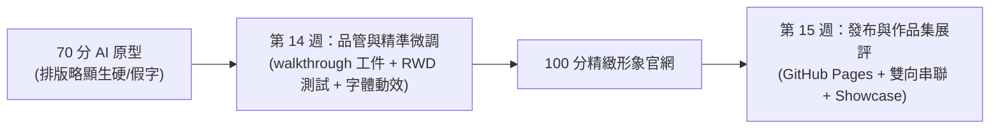
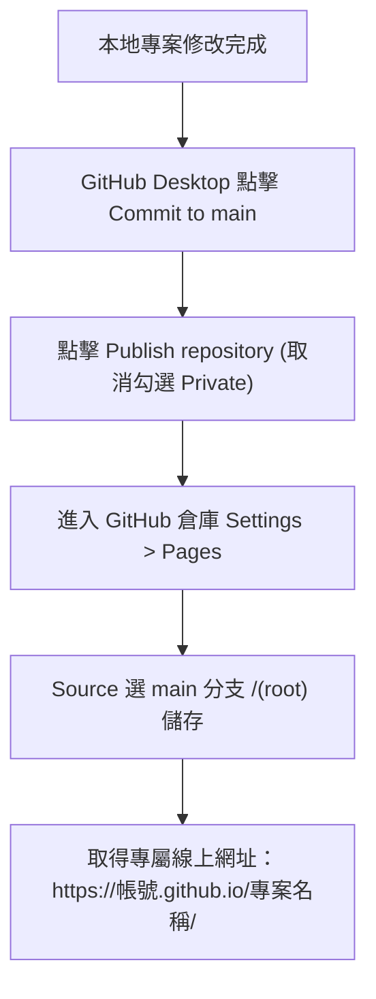
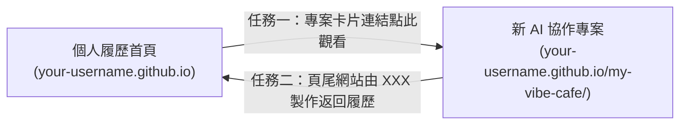

---
puppeteer:
  displayHeaderFooter: true
  scale: 1.15
  headerTemplate: '<div style="font-size: 11px; margin: 0 auto;">第十四至十五週：實作專案四 — AI 協作：Phase 3 完善品管、部署上線與作品集展評</div>'
  footerTemplate: '<div style="font-size: 11px; margin: 0 auto;">第 <span class="pageNumber"></span> 頁 / 共 <span class="totalPages"></span> 頁</div>'
  margin:
    top: "1.5cm"
    bottom: "1.5cm"
    left: "1.5cm"
    right: "1.5cm"
---

<style>
  /* 全域字型、字級與行距 */
  body {
    font-size: 16pt !important;
    line-height: 1.7 !important;
    font-family: "Microsoft JhengHei", "PingFang TC", "Helvetica Neue", sans-serif;
  }

  /* 階層標題微調 */
  h1 { font-size: 30pt !important; margin-bottom: 0.5em !important; }
  h2 { font-size: 24pt !important; page-break-before: always; }
  h3 { font-size: 20pt !important; }
  h4 { font-size: 18pt !important; }

  /* 表格文字放大與排版優化 */
  table, th, td {
    font-size: 15pt !important;
    line-height: 1.5 !important;
  }

  /* 程式碼區塊 (自動換行防止 PDF 截斷) */
  pre, code {
    font-size: 13pt !important;
    font-family: Consolas, "Courier New", monospace !important;
    white-space: pre-wrap !important;
    word-break: break-all !important;
  }

  /* Mermaid 流程圖節點字體放大 */
  .mermaid text {
    font-size: 14px !important;
  }
</style>

---

# 第十四至十五週：實作專案四 — AI 協作：Phase 3 完善品管、部署上線與作品集展評 (Phase 3: Refinement, Deployment & Showcase)

**課程名稱**：網頁設計 (Webpage Design)  
**授課教師**：林頌堅 副教授 (Prof. Sung-Chien Lin)  
**授課單位**：世新大學 資訊傳播學系  
**聯絡方式**：scl@mail.shu.edu.tw  
**核心工具**：Google Antigravity 2.0 Desktop、GitHub Desktop、VS Code  
**課堂時間**：共 160 分鐘（雙週四節課：第 14 週 80 min + 第 15 週 80 min）  

---

## Ⅰ. 完善與發布核心理念：成為 AI 的品管師 (Becoming the QA Inspector)

各位同學好！

恭喜大家！在經歷了 Phase 1 企劃與 Phase 2 生成後，你的專案資料夾裡現在已經有了一個由 AI 代理人寫好的網站骨架，並且擁有了由 `generate_image` 繪製的專屬真實圖片素材。

但是，**AI 產出的原型通常只有 70 分**。AI 的美感有時候很「工程師」，而且常常在手機端排版偷懶，或者留下一堆假文字。

這最後兩週，才是真正展現人類不可取代價值的關鍵時刻 —— **你將從「產品經理」轉身為「品質品管師 (QA Inspector)」與「視覺總監」，將 70 分的原型打磨到 100 分，並正式發布到全世界！**



---

## Ⅱ. 檢閱 Walkthrough 工件與啟動本機測試伺服器 (Walkthrough & Local Server)

### 1. 檢視 `walkthrough.md` 驗證走查工件
在 Phase 2 完成後，Antigravity 會在右側 Artifacts 窗格主動交付一份 **`walkthrough.md` 工件**。這份報告會列出：
- 已建立的組件與檔案路徑清單
- 建議的測試路徑（例如：檢查導航列錨點點擊是否平滑滾動）
- 未來可以優化的細節清單

### 2. 終端機一鍵啟動本地測試伺服器
不要直接雙擊 HTML 檔案用 `file:///` 開啟！為了確保 Google Fonts、圖片加載與 JavaScript 動態效果正常運作，請在 Antigravity 對話框中要求：
```text
請在終端機幫我啟動一個本地 HTTP 測試伺服器，讓我可以即時在瀏覽器預覽網站效果。
```
Antigravity 會自動在背景執行 `python -m http.server 8000`。點擊終端機連結 `http://localhost:8000`，即可在 Chrome / Edge 中流暢預覽！

---

## Ⅲ. 跨裝置 RWD 檢測與手術式自然語言微調 (RWD Audit & Vibe Tuning)

### 1. 按下 `F12` 開啟開發者工具（手機版檢查）
在瀏覽器中按下鍵盤 `F12`，點擊左上角的「裝置切換圖示 (Toggle Device Toolbar)」，將畫面切換為 **iPhone 14** 或 **iPad**：
* 菜單的三欄卡片在窄螢幕下是否被擠扁了？
* 大標題文字是否過大而折行得非常難看？
* 導航列按鈕在手機上是否容易誤觸？

### 2. Vibe QA 手術式自然語言微調
請運用前幾週學過的 CSS 與 HTML 觀念，向 Antigravity 下達專業、具體的品管指令：

| 品管面向 | ❌ 錯誤的模糊指令 (Garbage In) | ✅ 專業的品管指令 (Professional Prompt) |
| :--- | :--- | :--- |
| **字體與氣質** | 「字體不好看，弄好看一點。」 | 「請在 `<head>` 引入 Google Fonts 的 `Noto Serif TC`（思源宋體），將所有主副標題套用該字體；並在 `mystyles.css` 將內文行高調大為 `line-height: 1.8`，字距 `letter-spacing: 0.05em`，增加日系呼吸感。」 |
| **色彩與按鈕** | 「按鈕太醜了。」 | 「目前的深藍色太生硬。請將 Hero 主按鈕改為深烘焙咖啡色 (`#3E2723`)，文字為米白，並加上圓角 `rounded-full` 與 `hover:bg-amber-900 transition-all duration-300` 的滑順過渡動畫。」 |
| **手機端排版 (RWD)** | 「手機版壞掉了。」 | 「在寬度小於 768px 的手機螢幕下，Menu 菜單區塊的 3 欄卡片會擠在一起。請修改 Tailwind class，讓它在手機尺寸下自動轉為單欄 (`grid-cols-1`)，在平板以上再顯示為三欄 (`md:grid-cols-3`)。」 |
| **假字清除** | （放任不管） | 「請檢查全站所有區塊，將所有 `Lorem Ipsum` 假字替換為真實的老王咖啡文案、手沖單品名稱（如：耶加雪菲、藝伎）與真實新台幣價格（NT$ 180）！」 |

---

## Ⅳ. 部署你的 AI 協作專案至 GitHub Pages (Deployment)

當你在本地將網站修改至 100 分時，我們要進行最關鍵的一步：**將專案公開發布到全世界！**



### 部署操作 3 步驟：
1. **提交與發布 (Commit & Publish)**：
   * 打開 GitHub Desktop，確認所有修改都已在 Changes 列表。
   * 左下角 Summary 輸入「完成老王咖啡最終版並準備部署」，點擊 **「Commit to main」**。
   * 點擊主畫面上方的 **「Publish repository」** 按鈕。
   * **!! 極度重要 !!**：**取消勾選「Keep this code private」**（GitHub Pages 必須是公開倉庫才能免費託管）。
2. **啟動 GitHub Pages**：
   * 在 GitHub 網站進入該倉庫，點擊 **Settings > Pages**。
   * 在 Build and deployment 區塊，Source 選擇 **Deploy from a branch**，分支選擇 **main**，資料夾保持 **/(root)**，點擊 **Save**。
3. **取得專屬線上網址**：
   * 等待 1~3 分鐘重新整理，上方會出現綠色勾勾，提示你的網站已在以下網址發布：  
     `https://<你的GitHub帳號>.github.io/<你的倉庫名稱>/`

---

## Ⅴ. 打造雙向作品集生態系 (Portfolio Interlinking)

一個優秀的數位創作者，會讓所有作品互相串聯，形成個人的「數位資產網絡」。



### 任務一：在「個人履歷」中加入新專案展示卡片
1. 在 GitHub Desktop 切換到你的履歷倉庫（`your-username.github.io`）。
2. 用 VS Code 打開履歷的 `index.html`，找到「作品集 (Projects/Portfolio)」區塊。
3. 新增一段精美的作品卡片 HTML：
   ```html
   <div class="project-card">
       <h3>老王手沖咖啡形象官網 (AI 協作專案)</h3>
       <p>運用 PRD 需求定義與 Vibe Coding 流程，與 Google Antigravity 2.0 代理人協同實作的現代單頁式響應式網站。</p>
       <a href="https://你的GitHub帳號.github.io/my-vibe-cafe/" target="_blank">👉 點此前往瀏覽線上專案</a>
   </div>
   ```
4. 在 GitHub Desktop 中 Commit 並 Push。

### 任務二：在「新專案」頁尾加入連回「個人履歷」的連結
1. 在 Antigravity 中打開 `index.html`，找到 `<footer>` 區塊。
2. 加上導回個人履歷的品牌署名：
   ```html
   <p class="text-center text-stone-500 text-sm mt-4">
       Designed & Developed by <a href="https://你的GitHub帳號.github.io/" class="underline hover:text-amber-700" target="_blank">你的名字</a> | 2026
   </p>
   ```
3. Commit 並 Push。至此，兩大網站完美串聯！

---

## Ⅵ. 第 14 ~ 15 週課堂 160 分鐘實作節奏 (Classroom Schedule)

### 第 14 週 (80 分鐘)：Phase 3 完善 — 成為 AI 品管師
* **第 1 節 (40 分鐘)：檢視工件、啟動本地伺服器與 RWD 破版排查**
  1. 檢閱 `walkthrough.md` 檢查清單 (5 min)。
  2. 終端機執行 `python -m http.server 8000` 開啟本地預覽 (15 min)。
  3. 按 `F12` 切換手機/平板模式，逐一記錄需要微調的破版元件 (20 min)。
* **第 2 節 (40 分鐘)：Vibe QA 自然語言精準微調實戰**
  1. 引入 Google Fonts 思源宋體，調整標題與內文字距、行高 (15 min)。
  2. 微調按鈕圓角、卡片陰影與 hover 懸浮動畫 (15 min)。
  3. 替換真實文案，徹底消除所有假字，進行本週 Commit (10 min)。

### 第 15 週 (80 分鐘)：發布上線、作品集串聯與成果展評
* **第 1 節 (40 分鐘)：GitHub Pages 部署與雙向串聯**
  1. GitHub Desktop 發布公開倉庫並開啟 Pages (15 min)。
  2. 執行任務一與任務二：個人履歷 ⇄ 新專案雙向串聯 (25 min)。
* **第 2 節 (40 分鐘)：課堂成果展評 (Showcase) 與同儕互評**
  1. 所有人將線上網址貼在課堂看板，進行「線上看展互評」(25 min)。
  2. 抽樣優秀作品上台投放大螢幕，教師針對設計與技術進行總評 (10 min)。
  3. 總結五週學習成果，提煉 AI 時代的「AI 產品總監」思維 (5 min)。

---

## Ⅶ. 專案評分量規表 (Grading Rubrics)

| 評量向度 | 卓越 (85 - 100 分) | 良好 (70 - 84 分) | 待改進 (0 - 69 分) |
| :--- | :--- | :--- | :--- |
| **PRD 需求定義能力 (30%)** | 五大要素完整詳盡，風格氛圍描述具體且具高度可執行性，能有效指引 AI。 | 五大要素齊全，但部分區塊描述較抽象，缺乏精準的色彩或排版指示。 | 內容草率簡短，缺漏多個關鍵區塊，屬於典型 Garbage In。 |
| **AI 代理指揮與工件管理 (25%)** | 善用 Antigravity 2.0 的 Planning Mode 審查計畫、充分利用工件系統與圖像生成，無複製貼上痕跡。 | 能透過 Antigravity 完成檔案讀寫與生成，但略過計畫審查或未充分使用工具。 | 未使用桌面代理特性，仍將 AI 當作傳統聊天室手動複製貼上。 |
| **前端品管與細節客製 (25%)** | 完全消除 Lorem Ipsum 假字與假圖，具有個人真實內容，字體、間距、色彩搭配精緻協調，RWD 完美運作。 | 替換了大部分真實內容，但在手機尺寸下偶有排版擠壓，或細節美感微調不足。 | 充斥大量假字假圖，排版破裂，未針對 AI 產出進行任何品管或微調。 |
| **Git 規範與線上發布 (20%)** | 檔案結構整齊（有 `img/`、`css/` 分類），Commit 訊息清楚專業，GitHub Pages 順暢加載，雙向串聯無死連結。 | 成功發布至 GitHub Pages，但檔案散亂未分類，Commit 訊息過於隨意，或漏掉雙向串聯。 | 無法正常於 GitHub Pages 瀏覽，圖片路徑錯誤或未完成部署。 |

---

## Ⅷ. 老師的真心話：AI 時代的品味與工程素養 (Teacher's Final Advice)

親愛的同學們，歷經這五週的洗禮，你們完成了一件了不起的成就！

你們不再只是用傳統思維逐行編碼，而是親身走過了一套**2026 最前沿的現代軟體開發工作流**：
從擔任 **「產品經理 (PM)」** 撰寫 PRD、透過 `/grill-me` 深度訪談；到化身 **「技術領導 (Tech Lead)」** 審核實作計畫、指揮 AI 生成專案；再到扮演最嚴謹的 **「品質品管師 (QA)」**，用你的審美與前端知識把關每一個字距、每一個斷點。

這套能力，是純粹的編碼者做不到的，也是只會隨手按 Enter 提問的外行做不到的。

**這份作品集，將會是你們大學生涯中最耀眼的數位名片！恭喜大家順利通關！**
